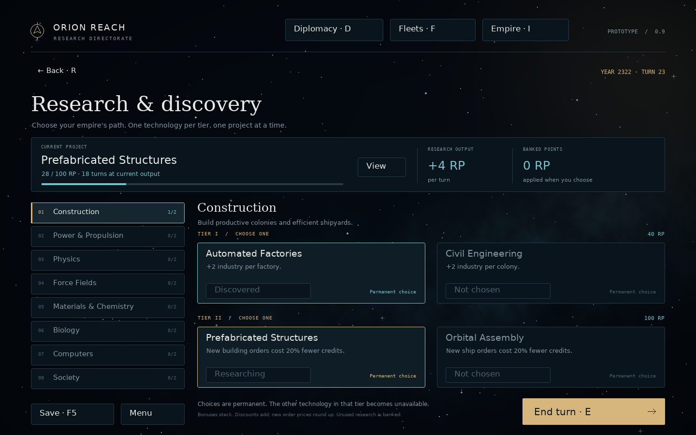
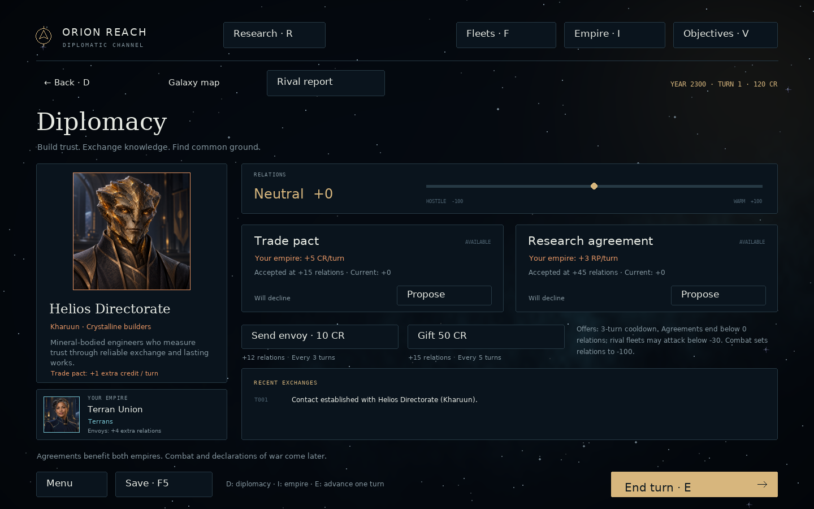

# Orion Reach — Python prototype 0.13.0

A playable colony-building and interstellar expansion prototype with conquest and scientific victories, fleet combat, research, races, diplomacy and an AI rival for a
MOO2-inspired space strategy game.
**Orion Reach is a temporary working title.** The artwork, interface and code
in this project are original; no Master of Orion artwork or game data is included.


## Run

Use a desktop computer with **Python 3.10 or newer**. This is a desktop Python
application; it does not run inside the ChatGPT Android app. Tested here on
Linux with Python 3.12.14 and pygame-ce 2.5.8. Windows/macOS launch scripts are
provided, but those platforms have not been tested in this environment.

**Recommended during development: Anaconda / Miniconda.** Extract the entire
ZIP and open Anaconda Prompt (or a terminal with Conda initialized). Change
directory into the extracted `orion_reach` folder, then run:

```sh
conda create -n moo2 python=3.12
conda activate moo2
python -m pip install -r requirements.txt
python main.py
```

The environment creation and dependency installation are one-time steps.
For later sessions, return to the project folder and run:

```sh
conda activate moo2
python main.py
```

Edit the Python files in your preferred editor, then close and restart the
game to see your changes. Tracebacks appear directly in the terminal.

Startup shows the supplied **Atlas Forge Games** logo for approximately 2.5 seconds,
then opens the main menu. Click or press any key to skip. The intro appears only
when launching the application; returning to the menu does not replay it. A small
studio credit also remains on the main menu. The Animated Background setting
also controls the intro's short fade.

For quick development launches, bypass the intro:

```sh
python main.py --skip-intro
```


**Optional Windows launcher:** open the extracted `orion_reach` folder and
double-click **launch.bat**. This creates its own `.venv` and installs the
dependency on its first launch. Python must already be installed. Use the
command-line route above when working in your Conda environment.

**macOS/Linux:** extract the ZIP, open a terminal in `orion_reach`, then run:

```sh
sh launch.sh
```

**Or use an existing Python environment**, from the project folder:

```sh
python -m pip install -r requirements.txt
python main.py
```

Only pygame-ce is required at runtime. The first dependency installation needs
internet access; the game itself works offline. pygame-ce is imported as
`pygame`; use a clean environment if you already have the separate `pygame`
package installed. Official documentation: <https://pyga.me/docs/>.

## Included

- Skippable Atlas Forge Games studio splash and main-menu logo credit.
- Animated title screen: **New Game, Load Game, Settings, Quit**, plus About.
- **Continue** appears when a campaign is already open in the current session.
- New Game setup: editable empire name, three galaxy sizes (24/48/72 systems),
  an optional reproducible seed, **Fog of war ON/OFF**, and player/rival race choices with illustrated portraits.
- Click a star on the galaxy map to open a dedicated **solar-system screen**.
- Click a **fleet badge** on the galaxy map to inspect its ships. Select a group,
  click **Choose destination**, then click a star to send that group together.
- Build cheap **scouts** to reveal worlds and recover one-time discoveries.
  **Exploration · X** records recovered caches, archives and derelict probes.
- Click a planet's globe or caption to open its **planet overview**: environment,
  size, gravity, minerals, habitability, orbital distance and colony status.
- The planet overview includes a **colony surface scene** with illustrated buildings
  and landscapes for all six environments. Click a building to inspect it,
  the shipyard to build ships, or the headquarters palace to open the empire report.
- Sol contains Mercury, Venus, Earth and Mars. Other systems have reproducible
  planet data and distinct illustrations for six environment types.
- The planet screen has **Overview**, **Colony** and **Shipyard** tabs. Earth is your starting
  colony: construct factories, mines, trade centres and research labs, with a
  building-slot limit based on planet size.
- Construction queues show progress and completion estimates. Completed
  buildings contribute industry, credits and research; cancel projects for a
  refund of unspent work or demolish completed buildings to free a slot.
- **Empire Overview** combines economy totals and a sortable colony directory.
  Open it with **Empire · I** or the **I** key from any gameplay screen. Click
  a colony row to open its construction screen.
- Build colony ships in the **Shipyard**, send them from the galaxy map or **Fleets**, advance
  travel with End Turn, and settle new worlds from their planet overviews.
- Build **frigates**, then **Engage** opposing fleets in the same system. A separate
  tactical screen offers alternating ship actions, fixed damage, retreat, a combat
  log and persistent losses. Damaged ships can repair at friendly colonies.
- Build **troop transports**, clear opposing ships, then **Invade colony** from a
  rival planet's Overview tab. Capturing its last colony wins by conquest.
- **Objectives · V** tracks both victory paths. Finish all eight research branches,
  research **Ascension Theory**, then construct and charge an **Ascension Gate**
  to win through science. The AI can win by either path too.
- The galaxy map shows flight paths, ship positions and newly claimed systems.
- The **Helios Directorate** develops its economy, builds colony ships, travels
  between systems and settles unclaimed worlds on each End Turn. Open
  **Empire → Rival report** to inspect its economy, colonies and recent activity.
- Cyan marks your colonies and ships; orange marks the rival's. Rival worlds
  can be surveyed, with construction controls disabled.
- **Diplomacy · D** opens race portraits and profiles, relations, envoys, gifts, trade pacts,
  research agreements and the rival's recent responses. Treaty income is
  included in Empire Overview and Rival report.
- **Research · R** opens eight branches, each with two tiers and two mutually
  exclusive choices per tier. Discover technologies that improve production,
  science, commerce, construction prices, travel and colonization. The rival researches too.
- Back buttons and Escape follow **Colony → Planet → System → Galaxy**. Pause, settings
  and Continue preserve the active overview. Previous/Next controls browse
  systems and planets, including systems with no planets.
- These are separate full-window screens inside the game, not additional
  operating-system windows.
- Real JSON saves: one autosave and any number of separate manual snapshots.
  Load Game shows dates, empire names and turns, with pagination.
- Autosave on campaign creation, construction orders/cancellations/demolition,
  ship orders, settlement, adding a rival, diplomatic actions, research choices,
  every combat action, invasions, gate orders, End Turn, return to menu and normal exit.
- Fullscreen, animated background and interface-sound settings persist.
- Mouse and keyboard navigation, resizing with correct letterboxed hit regions.
- Damaged/incompatible saves appear as unavailable instead of crashing the app.

**Scope:** construct buildings, colony ships, frigates and troop transports, travel between systems, and
found additional colonies alongside an expanding AI empire, and negotiate
trade and research agreements, make permanent technology choices, fight fleet battles,
invade colonies and win through conquest or science.
Population growth, food, shields, advanced weapons and additional AI empires are future work.
Planet attributes, population and
habitability are illustrative game data. Sol intentionally includes only four
inner worlds; its artwork is stylized. Settings contains interface sounds,
not music.

## Build your first colony

Start or load a game, then click **Sol → Earth → Colony**. Click **Build** beside
a building in the catalogue, then advance turns with **End Turn** or **E**.
Earth starts with 120 empire credits, 6 industry per turn, and 8 credits per
turn from its population. A first factory costs 45 credits and completes after
four End Turns; it raises industry from 6 to 10 for subsequent turns.

| Planet size | Building slots |
| --- | ---: |
| Tiny | 4 |
| Small | 6 |
| Medium (Earth) | 8 |
| Large | 10 |
| Huge | 12 |

Each completed or queued building uses one slot. Repeated copies of a building
are allowed, and their outputs add together. Planet size determines capacity;
habitability does not change it in this version.

| Building | Upfront credits | Construction work | Output per turn |
| --- | ---: | ---: | --- |
| Factory | 45 | 24 | +4 industry |
| Mining complex | 30 | 18 | +1 / +2 / +3 industry on Poor / Average / Rich worlds, plus +1 credit |
| Trade centre | 40 | 24 | +4 credits |
| Research lab | 50 | 30 | +4 research points |

These are base values. Discovered technologies change the prices and outputs
shown in the catalogue. Capacity and work costs remain unchanged.

- Industry advances one sequential queue on each colony. Overflow work can
  start the next queued project in the same turn; unused industry is not stored.
- The catalogue estimates completion after any projects already in the queue,
  including speed increases from factories/mines that will finish ahead of it.
- A turn collects output from buildings operational at its start. A newly
  completed building starts producing on the following turn.
- Click a queued slot to inspect it and **Cancel**. An unstarted project returns
  its full credit cost; a partially built project refunds
  `floor(credits actually paid × remaining work / total work)`. The displayed refund
  is exact, even if a discount is discovered after the order was placed.
- Click an operational building to **Demolish** it. Confirmation is required;
  its output stops immediately and its construction cost is not refunded.
- Uncolonized planets show their capacity, with construction disabled until
  settled. Bring a colony ship to the system and use the planet's Overview tab.

Every colony has a base of 6 industry per turn and one credit per billion
inhabitants. There is no upkeep or population growth yet. All colony income and
research contribute to the empire totals. Costs, work and capacities can be
tuned in `orion/buildings.py`.

## Research and discovery

Open **Research · R** from any gameplay screen, or press **R**. Build a research
lab in a colony to start producing points. Research agreements and discovered
technologies can also provide research income.

- Choose a branch, then one of the two technologies in its first tier.
  **Tier I costs 40 RP; Tier II costs 100 RP.** All eight branches are available
  from the start. Completing a tier unlocks the next tier in that branch.
- Confirming commits to that technology permanently. Its alternative is
  excluded, and the active project cannot be cancelled or switched. One
  empire-wide project runs at a time. Browse other branches while it progresses.
- Banked points are applied immediately when you choose; a large bank can
  complete the project immediately. Otherwise, End Turn applies new research
  income. A project can wait at zero progress until you build a lab.
- Excess points are retained. With no active project, all research is banked.
  Choose your next project after a discovery; there is no automatic player queue.
- Research completion happens after the turn's production, travel and income.
  A newly discovered bonus applies to future actions and the following turn's output.
  The screen shows progress, estimated turns, income, banked points and excluded choices.
- Each empire has independent discoveries and points. The AI uses the same
  costs and restrictions, chooses according to its race, and reports discoveries
  and its current project in Rival report. Technology trading is not implemented.

| Branch | Tier I: choose one | Tier II: choose one |
| --- | --- | --- |
| Construction | Automated Factories / Civil Engineering | Prefabricated Structures / Orbital Assembly |
| Power & Propulsion | Ion Drives / Compact Reactors | Fusion Drives / Fusion Grids |
| Physics | Research Instruments / Field Laboratories | Planetary Observatories / Quantum Optics |
| Force Fields | Radiation Shields / Habitat Shields | Thermal Barriers / Industrial Force Fields |
| Materials & Chemistry | Deep Core Drills / Lightweight Alloys | Superconductors / Composite Structures |
| Biology | Colony Biospheres / Symbiotic Farming | Colony Biogenesis / Ecology Networks |
| Computers | Research Networks / Trade Algorithms | Distributed Computing / Planetary Automation |
| Society | Colonial Administration / Scientific Institutes | Commerce Guilds / Cultural Exchange |

All 32 branch options have effects on existing game systems, described on their cards.
You can discover 16 branch technologies plus the ultimate **Ascension Theory**
project, available in Objectives after completing tier II in every branch.
Either choice in each tier qualifies. Building bonuses affect existing and
future copies; flat colony bonuses affect every owned colony. Bonuses add
together. Percentage discounts add and the final credit price rounds up.
Research never changes the price already paid for a project.

Speed bonuses also add; both drive technologies give +75% speed. A voyage
keeps its departure speed until arrival, including across save/load. New orders
use your latest speed. Population bonuses apply when settling a new colony,
including with an older ship; existing colonies do not gain population. Biology
does not add food or automatic population growth in this first version.
Radiation Shields allows barren colonies; Thermal Barriers allows volcanic
colonies. These habitats do not change the world's natural habitability.



## Basic AI opponent

New games include the **Helios Directorate**, starting on a habitable world
far from your colonies. Both empires start with one colony, 8 billion inhabitants,
120 credits and no buildings or ships. The rival's starting world retains its
generated size, biome and minerals, so its building capacity can differ from Earth's.

**Continuing a v0.5 or earlier campaign:** load your save, open **Empire → Rival
report**, then click **Add rival**. This uses an unclaimed habitable world in a
system without your colonies. It preserves your existing assets and progress.
Older saves do not gain an opponent automatically. If no suitable starting world
remains, Add rival is disabled. Adding a rival autosaves the campaign.

- With fog enabled, the AI first builds a scout and explores with its own survey
  information. It chooses colony sites from known worlds, or explores with a colony
  ship if none are known. Its race determines the order of factories, trade centres,
  research labs and mines. Its strongest colony produces colony ships and frigates;
  other colonies develop their economies. The shipyard's development target rises
  as the empire grows.
- Colony ships settle suitable unclaimed planets in their current system, otherwise
  travel to nearby systems with available worlds. The rival avoids sending more
  ships to a system than it has available planets. If a target is claimed while
  a ship is travelling, it chooses another world or route after arrival.
- Credits and research are separate for each empire. All construction, refunds,
  building slots, ship costs, travel and settlement use the same rules.
  The AI receives no extra income or production. It can have up to three colony
  ships active or queued, depending on its colony count and remaining worlds.
- **End Turn** issues the AI's orders, records starting yields, advances both
  empires' travel and construction, then deposits income in their respective
  treasuries. Newly completed ships receive their first AI order on the next
  End Turn; arrived ships can settle or reroute on the next End Turn.
- With fog enabled, **Rival report** shows surveyed colonies and currently visible
  ships. Old surveys are dated; treasury, research totals, hidden routes and private
  activity are not shown. With fog off it shows finances, output, all ships, colonies
  and the latest six activity entries. Click **Survey** to inspect a colony.
- Your Empire Overview and Fleets list only your assets. A system can contain
  colonies from both empires, shown with cyan and orange rings. Hostile rivals
  build escorted invasion groups to capture colonies. In peacetime, the AI
  develops its economy and research toward an Ascension Gate.

AI decisions are deterministic for a given game state. Saving and loading
preserves its finances, orders, ships, ownership and recent activity.

## Planet surface and building graphics

Open a planet's **Overview** tab to see its surface. Terran, Ocean, Desert,
Tundra, Barren and Volcanic worlds have distinct seeded landscapes. The small
globe beside the tabs retains the planetary view.

- Completed factories, mines, research labs and trade centres appear on the
  surface. Repeated types share a graphic with a count, such as **Factory ×3**.
- Queued types that have no completed building yet appear as faded previews.
  Counts and previews update after construction, cancellation, demolition and loading.
- Clicking a building opens the Colony tab and selects its first completed copy;
  if none is finished, it selects the first queued project of that type.
  Use the individual Colony slots to inspect other copies or queued projects.
- The **headquarters palace** marks Earth for the player and the rival's original
  homeworld for the AI. If that world is captured, the marker moves to a remaining
  colony. Click it for Empire Overview or Rival report.
- A **shipyard** appears at every colony, reflecting its existing ability to build
  all three ship types. Click it to open the Shipyard tab.
- The palace and shipyard are landmarks for existing capabilities. They use no
  building slots, charge no construction cost and provide no additional yields.
- Rival graphics open survey controls; construction, cancellation and demolition
  remain restricted to their owner. Unsettled worlds show an empty landscape.

The Colony catalogue, occupied slots and Shipyard also use the new building art.
Sprites preserve transparency and aspect ratio, and are cached for rendering.
Missing or unreadable PNGs fall back to a simple building symbol. Assets live in
`assets/buildings/`; restart after replacing an image. All races currently share
this first architectural style. Colony graphics work with existing saves.


## Races and diplomacy

Choose your own race and the rival's race in **New Game**. There is still one
rival empire, the Helios Directorate. These are original prototype identities:

| Race | Identity | Diplomatic trait | AI preferences |
| --- | --- | --- | --- |
| Terrans | Adaptable human diplomats | Envoys improve relations by 12 instead of 8 | Balanced development; trade at +20, research at +30 relations |
| Kharuun | Crystalline builders and engineers | An active trade pact yields 6 CR/turn instead of 5 | Mining before labs; trade at +15, research at +45 relations |
| Aelari | Amphibious scholars and archivists | An active research agreement yields 4 RP/turn instead of 3 | Labs before trade centres; trade at +30, research at +15 relations |

Traits apply to whichever empire belongs to that race. Race selection does not
change building costs, base colony production, habitability or travel speed.
For this version, every player race starts on Earth; the rival starts on a
distant generated world. A race and an empire are separate: two empires may
belong to the same race. Changing races does not overwrite a custom empire name.

Each race has an illustrated portrait on its New Game card. Diplomacy shows
the rival's portrait and a smaller portrait of your own race. The PNG files live
in `assets/portraits/`; replace one using the same filename and restart the game
to change its appearance. Portraits preserve their aspect ratio and are cached
for rendering. If an image is missing or unreadable, its race emblem appears
instead. Portraits work with existing saves; no save-format change is needed.


Open **Diplomacy** from the top bar or press **D**. The screen shows the rival's
identity, a relations score from -100 to +100, agreement benefits and acceptance
thresholds. An offer is accepted immediately when relations meet that rival
race's threshold; otherwise it is declined with a reason. This is deterministic,
with no hidden dice roll. The rival responds to your offers; unsolicited AI
diplomatic proposals are not implemented yet.



| Action | Effect | Cooldown |
| --- | --- | --- |
| Send envoy | Spend 10 CR; +8 relations, or +12 for Terrans | 3 turns |
| Gift 50 CR | Transfer 50 CR from your treasury to the rival; +15 relations | 5 turns |
| Propose trade pact | If accepted, +5 CR/turn to each empire; Kharuun receive +6 | All treaty offers share 3 turns |
| Propose research agreement | If accepted, +3 RP/turn to each empire; Aelari receive +4 | All treaty offers share 3 turns |
| End an agreement | Stop that agreement's benefits for both empires; -15 relations | Treaty offers wait at least 3 turns |

A cooldown of three turns means an action used on turn 1 becomes available
again on turn 4. Declined proposals also trigger the treaty-offer cooldown.
Envoys and gifts are disabled when relations reach +100. Their displayed gains
are capped at that maximum.

Treaties have no signing fee, ongoing cost or fixed expiry. Each active treaty
adds +1 relations per End Turn. Income starts on the next End Turn, belongs to
each empire separately, and never increases a planet's local industry.
Empire Overview and Rival report include it in their totals and identify the
agreement contribution. Research points fund the active technology or enter the bank.
The Cultural Exchange technology adds +3 to each active agreement's output for
the empire that discovered it; the other empire's benefits are unchanged.

Ending an agreement requires confirmation. If relations fall below zero, the
rival ends any remaining agreements at the beginning of the next End Turn,
before income is collected. Envoys and gifts can restore relations. Diplomacy
does not restrict travel or settlement. Starting combat ends both agreements
and sets relations to -100. Rival frigates can initiate encounters while relations
are below -30. Alliances, separate war declarations and border treaties are not implemented.

Existing campaigns gain neutral diplomatic contact when loaded if a rival
already exists. Older player empires are assigned Terrans and existing Helios
empires Kharuun, with no changes to their assets or treasury. Campaigns without
a rival stay peaceful: **Diplomacy → Rival report → Add rival** opens contact.
Race choices are fixed for the campaign; start a new game to choose others.

## Exploration and fog of war

New campaigns default to **Fog of war: ON**. Click that setting in **New Game**
to turn it off before beginning. The setting is saved with the campaign and is
fixed during play. Old campaigns keep their fully revealed maps.

1. Open **Sol → Earth → Shipyard** and build a **Scout**: **25 credits, 12 work,
   8 hull**, no weapons and no building slot. At Earth's initial industry this
   takes **two turns**. New games still begin without ships.
2. On the galaxy map, click your fleet badge, select the scout, click **Choose
   destination**, then click an unexplored star. Travel speed and group movement
   follow the same rules as other ships.
3. Arrival automatically surveys the system. Any ship can chart planets;
   **scouts additionally search for discoveries**. A discovery is recovered by
   the first empire to find it, with rewards credited immediately on that turn.
4. Open **Exploration · X** to read the discovery log, inspect recovered systems,
   see survey progress, or open your home colony's scout shipyard.

| Information | Fog ON | Fog OFF |
| --- | --- | --- |
| Star positions, names and star types | Charted from the start | Visible |
| Planets, resources and colonies | Unknown until visited | Visible |
| Previously visited systems | Retain their last-observed survey | Always current |
| Live system activity | Requires your colony or a ship in orbit | Visible everywhere |
| Enemy ships in orbit | Visible only in an observed system | Visible everywhere |
| Enemy journeys | Hidden | Visible |
| Scout discoveries | Must be recovered by a scout | Still require a scout |

Stored planet surveys show the buildings, ownership and population seen at the
time of the visit, with a date. They do not reveal subsequent enemy changes.
Send another ship to update them. Unobserved colony controls are disabled.
There is no sensor radius or visibility along interstellar routes in this version.
Retreat orders avoid **known** enemy fleets; an unobserved retreat destination
may contain opposing ships.

Discovery sites use a separate seeded generator, so the same galaxy seed keeps
the same stars and possible finds. About 35% of systems can contain a discovery;
starting home systems contain no recoverable discovery. Each site pays out at most once,
including after revisiting, sending several scouts, changing ownership, or reloading.
Simultaneous arrivals resolve in ship-ID order.

| Discovery | Reward |
| --- | --- |
| Abandoned supply cache | 40 credits |
| Ancient archive | 30 research points |
| Derelict probe | 20 credits and 15 research points |

Recovered research contributes to the active project; any surplus stays banked.
Scouts are unarmed and cannot colonize or invade. They can accompany escorts,
hold or retreat in combat, and repair at friendly colonies like other ships.
With fog enabled, the rival builds up to two scouts and uses its own knowledge
to explore and claim discoveries. With fog off, its existing expansion policy
can already see all colony sites.

Diplomacy remains available through the existing communications channel. It
does not reveal enemy worlds. Science-victory warnings still announce dangerous
gate milestones, but omit locations you cannot currently observe.


## Build, travel and colonize

1. Open **Sol → Earth → Shipyard** and click **Build colony ship**. It costs
   **80 credits and 42 work**, completing after seven End Turns at Earth's
   initial 6 industry per turn, if there are no projects ahead of it.
2. Return to the **galaxy map** and click the cyan fleet badge beside Sol.
   Its number is the number of ships in that fleet. The fleet screen lists their
   types, hull health and roles; select the ships you want to send.
3. Click **Choose destination**, then hover a star to preview its travel time.
   **Click the destination star to issue the order immediately.** All selected
   ships depart together; unselected ships stay in orbit. **Cancel / Escape**
   returns to the ship list without sending anything.
4. Use **End Turn / E** to advance the journey. Fleets shows remaining turns.
   You can save and reload during flight. Arrival is automatic; the ship waits
   in the destination system until you choose its next action.
5. Click the destination star, open a suitable planet, click **Colonize**,
   and confirm. The ship is consumed and the planet becomes a colony with
   **1 billion inhabitants**, 6 base industry and 1 credit income per turn.
   It appears immediately in Empire Overview and can build buildings and ships.

To settle **Mars** first, build a ship at Earth and open Mars directly; no travel
order is needed between planets in the same system.

| Rule | Prototype behavior |
| --- | --- |
| Suitable planets | Uncolonized Terran, Ocean, Desert and Tundra worlds |
| Hostile worlds | Barren requires Radiation Shields; Volcanic requires Thermal Barriers |
| Ship construction | Shares the sequential queue and industry with buildings; no building slot |
| Queue capacity | Up to 20 total projects per planet |
| Cancellation | Shipyard lists every queued project; refunds follow the same unspent-work rule as buildings |
| Travel time | `ceil(hypot(1.4 * dx, dy) / (0.18 * (1 + speed bonus / 100)))`, minimum one turn between distinct systems |
| Travel restrictions | Orders require a ship in orbit; no mid-flight rerouting, fuel cost or range limit yet |
| Settlement | Requires an arrived colony ship in the target system; consumes exactly one ship |
| Population | 1 B starting colonists plus Biology bonuses; included in ship cost, with no homeworld deduction |

Unused construction overflow follows the existing building rules. A ship
finishes in orbit and receives no automatic travel order. The colony economy
starts on the next End Turn after settlement. Ship costs, initial colonists,
queue capacity and travel speed are defined in `orion/production.py`.

## Fleets on the galaxy map


- **Cyan badges** are your fleets; **orange badges** belong to the rival. Click
  either to inspect the ships. Badges are placed clear of star click targets;
  a short line connects each badge to its orbit or position along a flight path.
- Ships of one empire sharing an orbit form a fleet automatically. **Select all**,
  **Clear**, and individual checkboxes let you send all or part of it. Selections
  are retained across pages; use Previous / Next, Page Up / Down, or the wheel.
- **Choose destination** returns to the map. Hovering a star previews the route,
  travel time and visible rival ships there. Unknown systems reveal no planetary
  details before arrival. A single click sends the selection.
  Clicking the origin or empty space does not send ships. Escape, Cancel, or
  **Change selection** returns to the manifest with your selection intact.
- Flights with the same origin, destination and travel progress share a badge.
  Ships that leave on different turns stay separate until they arrive. Arrived
  ships join other ships of their empire already in orbit.
- Rival fleets and ships in transit are **inspection only**. Existing travel,
  combat and ownership rules apply; no mid-flight rerouting is added.
- Opening another overview or ending the turn clears an unissued map order.
  Saving records only issued journeys; loading never sends a pending selection.
- The existing **Fleets · F → Course → star → Send ship** controls remain
  available for individual ships.


## Fleet combat

1. Build a **frigate** at a colony's Shipyard. Base cost is **60 credits and 36 work**:
   six End Turns at Earth's initial industry, with no earlier projects in the queue.
   Existing ship-price discounts and propulsion technologies also apply to frigates.
2. Select ships from a galaxy fleet badge and send them to a system containing
   rival ships, or use the individual **Fleets → Course** controls.
   A fleet is all ships of one empire in that system; ships in transit do not participate.
3. Click **Engage** in Fleets or **Engage opposing fleet** on the system overview.
   You need at least one frigate and opposing ships in orbit. The confirmation
   explains the whole-fleet commitment and diplomatic consequences.
4. On the combat screen, select one of your available ships and an enemy target,
   then click **Fire**. The AI takes its next action automatically. Each surviving
   ship acts once per round; **Hold** spends an activation without attacking.
   Scouts, colony ships and troop transports cannot fire, but can hold or retreat with the fleet.
5. Resolve the battle or retreat, then choose **Return to system**. Strategic time,
   income, research, construction and other travel do not advance during combat.
   Escape pauses the battle, and Save / Load resumes the exact round and activation.

| Ship | Base credits | Work | Hull | Damage per shot |
| --- | ---: | ---: | ---: | ---: |
| Colony ship | 80 | 42 | 12 | 0 (unarmed) |
| Frigate | 60 | 36 | 20 | 5 |
| Troop transport | 80 | 42 | 16 | 0 (8 invasion attack) |
| Scout | 25 | 12 | 8 | 0 (unarmed) |

Shots always hit their selected enemy. There are no range, movement, armour or
shield rules yet. Sides alternate one ship activation at a time. If one side has
used all of its ships, the other finishes its remaining activations. A new round
then makes every surviving ship available again. The initiating empire acts first.
The AI prefers finishing damaged targets and attacking armed ships; an unarmed
AI fleet retreats when a safe destination exists.

**Losses and retreat:** ships at zero hull are destroyed. Results are committed
once when combat ends; survivors retain damage, and destroyed ship IDs are never
reused. Retreat withdraws all surviving ships to the nearest other friendly
system without a known opposing fleet. If there is no such friendly destination, the
nearest other system without known opposing ships is used. With fog on, unobserved
enemy fleets do not influence the choice. The confirmation names the
destination and travel time. Retreat uses normal strategic travel, and damage is
retained. Winning a space battle clears orbit; use troop transports to capture
colonies and their buildings afterward.

**Repairs:** ships recover **4 hull per End Turn**, up to full health, after a
complete turn in orbit at a system containing one of their colonies and no
opposing ships. Travelling ships and ships that only just arrived do not repair
that turn. Repair has no credit cost in this prototype.

**AI and diplomacy:** the rival begins building a small defensive fleet after
developing its shipyard. It maintains up to three frigates as its empire grows,
in addition to its colony ships. Frigates guard colonies in peacetime and pursue
opposing fleets when relations are **below -30**. Neutral fleets can share orbit
without fighting. An engagement immediately ends both agreements, sets relations
to **-100**, and starts a three-turn treaty-offer cooldown. Diplomacy remains
available after battle, so improving relations can stop further AI attacks.

A hostile encounter already in orbit interrupts End Turn before income or
production is applied. A hostile fleet arriving during End Turn starts combat
after that strategic turn completes. Only one battle runs at a time, and no
strategic orders can be issued until its result is acknowledged. Every combat
action is autosaved; tactical health, activations, logs, results and retreats
survive saving and loading.


## Conquest and scientific victory

Open **Objectives · V** from any strategic screen. Both victory paths are always
enabled for the player and the rival, including when continuing older saves.
Single-empire campaigns can win through science; they do not automatically win
conquest simply because no rival was added.

### Conquest

1. Build **troop transports** in the Shipyard: **80 credits, 42 work, 16 hull**
   and **8 invasion attack** each. They are unarmed in fleet combat, so escort
   them with frigates. Ordinary ship discounts and propulsion bonuses apply.
2. Send them to a system containing a rival colony. Destroy or drive away **all
   opposing ships in that system** before attempting an invasion.
3. Open the rival planet's **Overview → Invade colony**. The forecast shows
   total attack against **4 + the planet's population** defence. Attack must
   be strictly greater; ties favour the defender. There is no random roll.
4. Confirm to deploy **all your troop transports currently in that system**.
   Every deployed transport is consumed, whether the invasion succeeds or fails.
   One transport can take a 1 B colony (8 > 5); an 8 B homeworld needs two (16 > 12).

A successful invasion transfers the population, buildings and ordinary paid
construction queue intact. Research, treasury and fleets do not transfer. Any
built or queued Ascension Gate is destroyed without a refund, and its charge is
lost. If your headquarters is captured, its landmark moves to a remaining colony.
An invasion immediately ends both treaties, sets relations to **-100**, and
starts the usual three-turn offer cooldown, including after a failed landing.

Capturing **every rival colony** wins immediately. Losing your last colony causes
defeat even if you still have colony ships or military ships. Fleets alone cannot
keep an empire alive. A hostile AI assembles frigates and enough transports,
travels using the normal rules, and invades exposed colonies on End Turn. It
favours enemy gate colonies. A decisive AI invasion stops the turn before income
or production; its result and consumed transports are saved immediately by the UI.

### Science

1. Complete **tier II in all eight branches**: 16 discoveries in total. Every
   combination of exclusive technology choices can reach this victory path.
2. In **Objectives**, choose **Ascension Theory** for **500 RP**. It uses the
   existing one-project research system: stored points apply immediately, then
   normal research income contributes until completion.
3. Choose one of your colonies in Objectives and build the **Ascension Gate**:
   **500 credits and 300 work**, paid through the normal shared construction
   queue. It needs no building slot, has no discount, and is limited to one built
   or queued gate per empire. Cancel an unfinished gate from its Shipyard queue
   for the normal unspent-work refund.
4. After construction, keep the gate for **five charging turns**. Charging starts
   on the turn after completion. Any opposing ship in that system pauses charging,
   even in peacetime; existing charge is preserved and resumes when orbit clears.
   A ship arriving that turn blocks charging immediately.
5. The fifth clear-orbit charge wins. Protect the colony: capture destroys the
   gate, while a fleet battle by itself does not destroy the structure.

The AI follows the same research, costs and charging rules. With fog off, Objectives
shows its research progress and gate location. With fog on, it only shows known
colony and gate information. End Turn announces rival gate construction, completion
and the final charging turn; unobserved locations are hidden. If both gates activate in the same turn,
the campaign is a **draw**. No score, turn-limit, diplomatic or exploration victory
is enabled in this version.

A final **Victory / Defeat / Draw** screen records the condition, winner and turn.
The finished campaign stops accepting strategic orders. Save a final snapshot,
return to the menu, or start a new campaign. Loading a finished save reopens its
result screen; active battles and unfinished gates also resume correctly.


## Empire Overview

Click **Empire · I** at the top of the galaxy, system, planet or colony screen,
or press **I**. The overview shows:

- Total colonies and population, treasury and credit income, industry,
  stored research and research income, and occupied/available building slots.
- One row per colony, with population, per-turn output, slots, the current
  construction project, work progress, completion estimate and waiting projects.
- **All**, **Building**, **Idle** and **Full** filters. Full includes slots
  reserved by queued projects. The summary totals always cover the entire empire.
- Sortable colony name, population, industry, income, research and occupied
  slot columns. Numerical columns initially sort highest first; clicking the
  same heading again reverses the order.
- Five colonies per page; use Previous/Next, Page Up/Down, Left/Right or the
  mouse wheel to browse larger empires.

Click a row to open that colony, then use **Empire · I** to return. **Escape**,
**I**, or the overview's Back button returns to the screen you opened it from.
Save, End Turn, pause, settings and Continue work from the overview. The list
and totals refresh after construction and turn changes. Industry remains local
to each planet; the empire total is a report, not a shared construction pool.

Earth is the starting colony; each newly settled world appears in the directory.
The current project may be a building or a ship. Ship construction counts as
activity but does not reserve a building slot. View filters,
sort order and page are kept during play and reset when starting/loading a game.

## Controls

| Action | Control |
| --- | --- |
| Select a control | Mouse, Tab / Shift+Tab, Up / Down |
| Activate focused control | Left click, Enter or Space |
| Edit name/seed | Click field or focus it and press Enter; type; Enter finishes |
| Replace field contents | Ctrl+A (Cmd+A on macOS), then type |
| Back through Colony → Planet → System → Galaxy | Escape or the Back button |
| Pause / resume on the galaxy screen | Escape |
| Pause from any overview | Menu button |
| Fullscreen | F11 |
| Save a manual snapshot | F5, or Save Game on any overview |
| Advance one turn | E, or End Turn |
| Open a solar system | Click a star; or Left / Right then Enter on the galaxy screen |
| Open a planet | Click its globe/caption; or Left / Right then Enter in the system screen |
| Browse planets while viewing details | Left / Right, or Previous / Next buttons |
| Manage buildings | Colony tab on a planet overview |
| Inspect, cancel or demolish | Click a building slot in the Colony tab |
| Open / close Empire Overview | I, or the Empire button while playing |
| Open a colony from Empire Overview | Click its row, or focus it and press Enter |
| Browse colony pages | Page Up / Down, Left / Right, mouse wheel, or Previous / Next |
| Open / close Fleets | F, or the Fleets button while playing |
| Open / close the exploration log | X, or Exploration on the galaxy map |
| Choose fog of war | Fog of war ON/OFF in New Game setup |
| Inspect a fleet | Click its cyan or orange badge on the galaxy map |
| Send selected ships together | Fleet badge → select ships → Choose destination → click a star |
| Preview a group journey | Hover a star while choosing the destination |
| Change or cancel a group selection | Escape, Cancel, or Change selection on the destination map |
| Build ships / inspect the shared queue | Shipyard tab on a planet |
| Set a ship destination | Course in Fleets → click a star → Send ship |
| Cancel an unissued course | Cancel button or Escape on the route-selection map |
| Settle a world | Colonize on its Overview tab, with a colony ship in the system |
| Browse fleet or shipyard queue pages | Page Up / Down, mouse wheel, or Previous / Next |
| Inspect or add the AI opponent | Empire → Rival report |
| Open / close Diplomacy | D, or the Diplomacy button while playing |
| Open / close Research | R, or the Research button while playing |
| Open / close victory objectives | V, or Objectives while playing |
| Invade a rival colony | Troop transports in orbit → planet Overview → Invade colony |
| Research Ascension Theory / build a gate | Objectives → research project / colony selector |
| Browse research branches | Click a branch or use Left / Right on the Research screen |
| Start a fleet battle | Engage in Fleets or on the system overview |
| Attack in combat | Select your ship → select an enemy → Fire |
| Skip a ship's action | Select your ship → Hold |
| Withdraw from combat | Retreat, then confirm the destination |
| Pause / resume combat | Escape or Menu; Resume returns to the same battle |
| Choose player and rival races | New Game |

## Save locations

User data is stored separately from the extracted source folder:

| System | Folder |
| --- | --- |
| Windows | `%LOCALAPPDATA%\OrionReach` |
| macOS | `~/Library/Application Support/OrionReach` |
| Linux | `$XDG_DATA_HOME/orion-reach`, default `~/.local/share/orion-reach` |

Saves are in `saves/`; preferences are in `settings.json`. To choose a different
location, use `python main.py --data-dir ./my_data` or set
`ORION_REACH_DATA_DIR`. Starting another campaign replaces the single autosave;
use **Save Game** to retain a manual snapshot first. Manual snapshots are never
overwritten. Saves use validated, versioned JSON, not executable serialization.
Writes use a temporary file followed by an atomic replacement.

**Compatibility:** v0.13 loads all earlier prototype saves without rewriting the
source file during loading. Existing research banks, construction payments,
ships and travel times are preserved. Pre-v0.13 saves retain **fog OFF** and start
with an empty discovery log; build scouts to recover discoveries in those games.
Start a new campaign to play with fog enabled. Fleet grouping is derived from
existing ship data.
Pre-combat saves gain full ship hulls and no
active battle. v0.10 ship health, active battles and tactical turns are preserved.
Older campaigns gain both victory paths with no existing gate or result.
Research from v0.9 is preserved. Each empire starts with an empty research
tree when upgrading from v0.8 or earlier; saved points can be spent immediately.
v0.6 ownership and the rival economy are retained,
and neutral diplomacy is added. Earlier colonies and ships become player-owned;
no rival is added until you choose Add rival. v0.5 ships, flights and production
are preserved. v0.3/v0.4 building queues, progress, planets and research are
preserved, and those campaigns start with no ships. v0.1's missing planets are
generated deterministically; v0.1/v0.2 start with empty production and zero research.
New saves use **format version 10**, including the fog setting, per-empire surveys,
scout scans, discovery claims, gates, charging progress, campaign results,
troop transports, ship hulls, active or resolved battles,
discoveries, research projects, construction payments, departure speeds, races
and diplomacy. They cannot be opened by v0.12 or earlier. Loading resumes the
result screen if the campaign is finished, or the combat screen if a battle is
unfinished or awaiting acknowledgement; otherwise
it starts at the galaxy map with system/planet selection retained.
Keep an older manual snapshot if you plan to switch back; normal gameplay
updates the autosave. Unissued route previews are not saved as orders.

## Extend the prototype

| File | Responsibility |
| --- | --- |
| `main.py` | Entry point, CLI and screenshot capture |
| `orion/app.py` | Event loop, screens and transitions |
| `orion/ui.py` | Buttons, focus styling, text and layout helpers |
| `orion/art.py` | Starfield animation, orbit guides and spacecraft |
| `orion/system_views.py` | Solar-system and planet overview layouts |
| `orion/colony_view.py` | Colony slots, construction catalogue and project inspection |
| `orion/buildings.py` | Building definitions, costs, outputs and size-based capacity |
| `orion/empire.py` | Read-only empire totals, colony filtering and sorting |
| `orion/empire_view.py` | Empire Overview layout and colony directory |
| `orion/ai.py` | Deterministic rival construction, travel and settlement policy |
| `orion/rival_view.py` | Rival economy, activity and colony survey report |
| `orion/races.py` | Race identities, diplomatic traits and AI development preferences |
| `orion/race_art.py` | Cached race portraits and procedural fallback seals |
| `orion/building_art.py` | Cached transparent building sprites and fallback art |
| `orion/colony_scene.py` | Seeded landscapes, headquarters markers and clickable colony graphics |
| `orion/setup_view.py` | Campaign and race selection screen |
| `orion/diplomacy.py` | Relations, offers, treaty income, cooldowns and diplomatic history |
| `orion/diplomacy_view.py` | Diplomatic contact and negotiation screen |
| `orion/research.py` | Technology definitions, exclusive choices, validation and yield bonuses |
| `orion/research_view.py` | Branches, tiers, project progress and research controls |
| `orion/combat.py` | Battle snapshots, alternating actions, AI targeting, retreat and validation |
| `orion/combat_view.py` | Tactical formations, health bars, targeting, logs and results |
| `orion/branding.py` | Supplied studio logo, proportional scaling, splash and menu credit |
| `orion/victory.py` | Invasions, Ascension Gates, victory checks and outcome validation |
| `orion/victory_view.py` | Objectives, gate controls and final campaign results |
| `orion/production.py` | Shared project catalogue, ship costs and travel balance |
| `orion/fleet_views.py` | Shipyard and empire-wide ship operations |
| `orion/fleets.py` | Fleet grouping from orbit and shared travel progress |
| `orion/galaxy_fleet_view.py` | Clickable map badges, fleet manifests and group route previews |
| `orion/exploration.py` | Survey snapshots, visibility, scout discoveries and validation |
| `orion/exploration_view.py` | Exploration log, unknown systems and map intelligence |
| `orion/fleet_art.py` | Procedural transport, frigate and scout drawings |
| `orion/planet_art.py` | Cached, deterministic globe drawings for six environments |
| `orion/model.py` | Game state and seeded generation; no pygame dependency |
| `orion/storage.py` | Save validation, atomic writes, settings and data paths |
| `assets/` | Bundled artwork and fonts |
| `assets/branding/` | Original Atlas Forge logo supplied by the project owner |
| `assets/portraits/` | Terran, Kharuun and Aelari portraits, with generation prompts |
| `assets/buildings/` | Six colony building sprites, manifest and generation prompts |
| `tools/build_art.py` | Rebuild the original planet/background (optional) |
| `tests/test_prototype.py` | Save integrity and UI event-flow checks |
| `tests/test_colony.py` | Construction rules, economy timing and save migrations |
| `tests/test_empire.py` | Empire reports, filtering, pagination and colony navigation |
| `tests/test_colonization.py` | Ship construction, travel, settlement, migration and the full UI loop |
| `tests/test_galaxy_fleets.py` | Group orders, splitting, arrival, saves, map hit regions and ship selection |
| `tests/test_exploration.py` | Fog boundaries, discoveries, scouts, private AI knowledge, saves and UI flows |
| `tests/test_ai.py` | Ownership, independent economies, AI expansion, save continuity and rival controls |
| `tests/test_diplomacy.py` | Race selection, diplomatic rules, treaty accounting, save compatibility and UI actions |
| `tests/test_colony_scene.py` | Surface selection, mixed queues, headquarters, ownership, missing art and save continuity |
| `tests/test_research.py` | Research choices, effects, accounting, forecasts, save migrations and screen interaction |
| `tests/test_combat.py` | Battles, losses, retreat, repair, strategic locks, migrations and combat UI |
| `tests/test_victory.py` | Invasion rules, both endings, AI conquest, gate blockades, saves and UI controls |

Keep new simulation rules in `model.py` or additional model modules. Add screens
to the UI controller as needed. The next practical increments are population
growth, food and more advanced technology tiers.
Shields, advanced weapons and ship customization can follow. Bump the save version and add
migrations when the data schema changes.

## Development checks

The automated checks use Python's built-in unittest and SDL's dummy drivers:

```sh
python -m unittest discover -s tests -v
python main.py --headless --screenshot menu.png
python main.py --headless --screen splash --screenshot splash.png
python main.py --headless --screen setup --screenshot setup.png
python main.py --headless --screen galaxy --screenshot galaxy.png
python main.py --headless --screen system --screenshot system.png
python main.py --headless --screen planet --screenshot planet.png
python main.py --headless --screen colony --screenshot colony.png
python main.py --headless --screen empire --screenshot empire.png
python main.py --headless --screen shipyard --screenshot shipyard.png
python main.py --headless --screen fleets --screenshot fleets.png
python main.py --headless --screen fleet --screenshot fleet.png
python main.py --headless --screen fleet_course --screenshot fleet_course.png
python main.py --headless --screen exploration --screenshot exploration.png
python main.py --headless --screen unexplored --screenshot unexplored.png
python main.py --headless --screen rival --screenshot rival.png
python main.py --headless --screen diplomacy --screenshot diplomacy.png
python main.py --headless --screen research --screenshot research.png
python main.py --headless --screen combat --screenshot combat.png
python main.py --headless --screen objectives --screenshot objectives.png
python main.py --headless --screen result --screenshot victory.png
```

`--screen` supports `splash`, `menu`, `setup`, `load`, `settings`, `galaxy`, `system`,
`unexplored`, `exploration`, `planet`, `colony`, `empire`, `shipyard`, `fleets`, `fleet`, `fleet_course`, `rival`, `diplomacy`, `research`,
`combat`, `objectives`, `result`, and `about`.
Galaxy, fleet, exploration, combat and result captures use local example states. Ordinary campaigns
still start without ships. Screenshot mode does not create
a campaign save or change your settings.
To regenerate art only, install `numpy` and `Pillow` and run
`python tools/build_art.py`; these are not needed to play.

## Start a GitHub repository

Suggested repository name: **orion-reach**. Start private while developing the
prototype. The repository root should contain `main.py`, `README.md`, `orion/`,
and `assets/` directly.

1. On <https://github.com/new>, create an empty repository. Leave the options
   to add a README, `.gitignore`, and license unselected: this project already
   includes the first two, and you can choose a license separately later.
2. Open Anaconda Prompt in the extracted `orion_reach` folder and run:

   ```sh
   git init -b main
   git add .
   git status
   git commit -m "Initial prototype: menu, galaxy preview and save/load"
   ```

3. Copy the HTTPS URL from the new repository's page. Replace `YOUR_USERNAME`
   below with your GitHub username (and adjust the repository name if needed):

   ```sh
   git remote add origin https://github.com/YOUR_USERNAME/orion-reach.git
   git push -u origin main
   ```

Complete GitHub authentication if prompted. If Git reports an unknown author
identity, set your name and preferred GitHub commit email with `git config
user.name` and `git config user.email`, then repeat the commit. If `git` is not
available in your Anaconda Prompt, install Git for Windows and reopen the prompt.

The supplied `.gitignore` excludes environments, caches, common local settings
and save directories. Keep any custom `--data-dir` outside the repository, or
add that directory to `.gitignore`. Source code, assets, tests and the bundled
screenshots are included. `.gitattributes` keeps line endings consistent.

For the next feature, start a branch from the working baseline:

```sh
git switch -c feature/diplomacy-races
```

After editing and checking the game, commit the change and push that branch.
Official import instructions:
<https://docs.github.com/en/migrations/importing-source-code/using-the-command-line-to-import-source-code/adding-locally-hosted-code-to-github>.

## Troubleshooting

- **Window does not open:** run from a terminal to see the error, and confirm a
  working desktop display is available. Headless machines can use screenshots.
- **No audio device:** gameplay works; interface sounds are skipped.
- **Fullscreen trouble:** press F11. If needed, delete `settings.json` to restore
  defaults; this does not delete saves.
- **Cannot save:** select a writable directory using `--data-dir`.
- **Linux venv error:** your Python distribution may package `venv` separately;
  install its venv support or use an existing environment.

Font notices are included in `assets/fonts/LICENSE-DejaVu.txt`. pygame-ce is
installed separately and retains its own license. No third-party game assets
are redistributed.
