# Orion Reach — Python prototype 0.60.2

A playable colony-building and interstellar expansion prototype with a modular ship designer, guarded treasure worlds, population growth, local food, conquest, scientific and council victories, fleet combat, research, races, diplomacy and up to five AI rivals for a
MOO2-inspired space strategy game.
**Orion Reach is a temporary working title.** The artwork, interface and code
in this project are original; no Master of Orion artwork or game data is included.


## Fixes in v0.60.2

Right-click any **Farming, Industry, Research or Mining** worker row in your
planet overview to see its complete calculation. The six output cards also
open explanations for credits, food, industry, research, resources and energy.
Breakdowns show operational buildings, bonuses, rounding, administration and
applicable deductions. Right-click again, press Esc or choose Close to dismiss.
Worker assignments are unchanged by inspection. Long explanations have pages.

Outpost ships now have dedicated transparent artwork in all fleet and ship views.

## Fixes in v0.60.1

- Invasions and raids lose transports only for troop casualties, rounded up to
  whole loads (8 troops by default). Full surviving squads re-embark; leftover
  troops become the occupation garrison, or return home after a raid.
- Added dedicated Space Hub artwork throughout colony screens.
- Removed the coordinate grid from the galaxy map.

## New in v0.60: system megastructures

Open **Megastructures** in a solar system to commission a four-stage project.
Each civilization can commission each type **once per campaign**, with **one
structure per solar system**. Starting, repairing and advancing construction
require being the only civilization with a settlement in that system. A rival
settlement pauses work; outposts do not count as settlements.

| Structure | Research prerequisite (either choice) | Completed effect | Total materials / industry |
| --- | --- | --- | --- |
| Dyson Sphere | Power & Propulsion tier 4 | **Unlimited energy empire-wide**, including gates; backup fuel use stops | 20,000 RES / 4,000 IND |
| Stellar Forge | Construction tier 3 | **13× ship production** in its system; normal ship material prices | 18,000 RES / 3,500 IND |
| Research Array | Physics tier 7 | **4% chance per turn** to discover an unknown technology, including an omitted alternative | 15,000 RES / 3,000 IND |
| Asteroid Mining Network | Materials & Chemistry tier 6 | **600 resources per turn**, directly to the empire reserve | 16,000 RES / 3,200 IND |

The forge accelerates ships only. It does not improve building construction,
Trade Goods, population assembly or megastructure work. The array produces **no
ordinary research points**; its discoveries persist even across exclusive choices.
Orbital mining is separate from planetary mining and administrative penalties.

Choose how much local industry to contribute: 0, 25, 50, 75 or 100%. Materials
are paid as work proceeds. Fuel is funded first, followed by megastructures and
colony queues. Only affordable work is diverted, so shortages return unused
industry to normal production. Construction can be paused at any time. The four
stages cost 1×, 2×, 3× and 4× their initial budget; completed sections provide
partial benefits from the following turn. There is no recurring upkeep yet.

Structures appear in the system overview with illustrated stages, progress and
controls. They can be attacked after orbital defenses are cleared, using ships'
normal bombardment action. Repairs consume industry and resources before further
construction. A sole new settler can inherit a structure after its owner loses
every colony in the system; work starts paused. Captured duplicates do not stack.
Hostile armed blockades stop work and effects. Shared settlements stop work while
completed sections continue functioning for the existing owner.

AI civilizations follow the same rules and invest from large resource reserves.
`python editor.py` exposes the costs, prerequisites, yields, discovery chance,
ship acceleration, hull and repair costs. Save format **42** and balance format
**7** load earlier campaigns/profiles without replacing their custom settings.

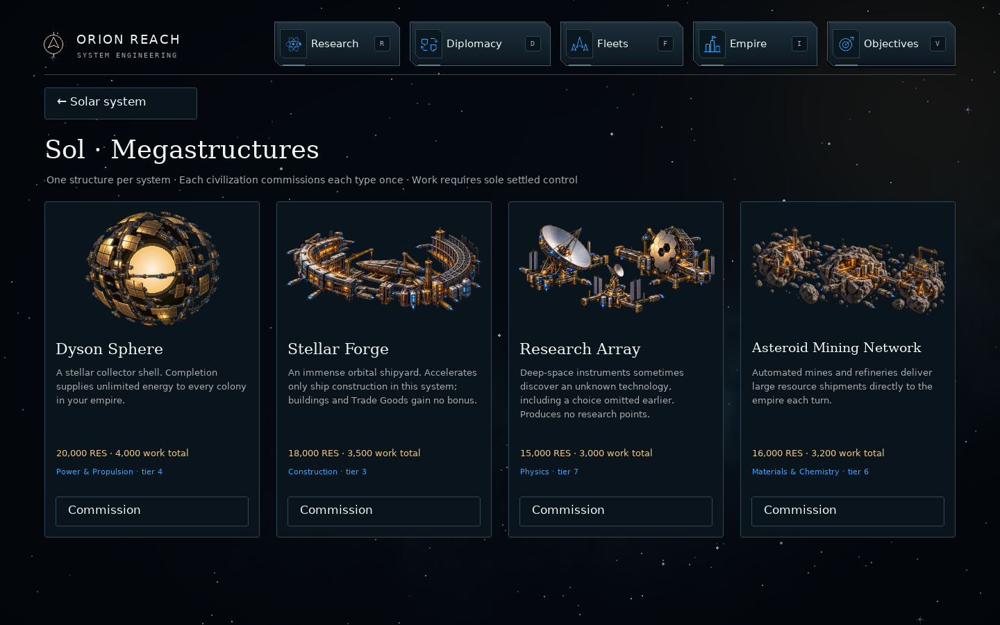
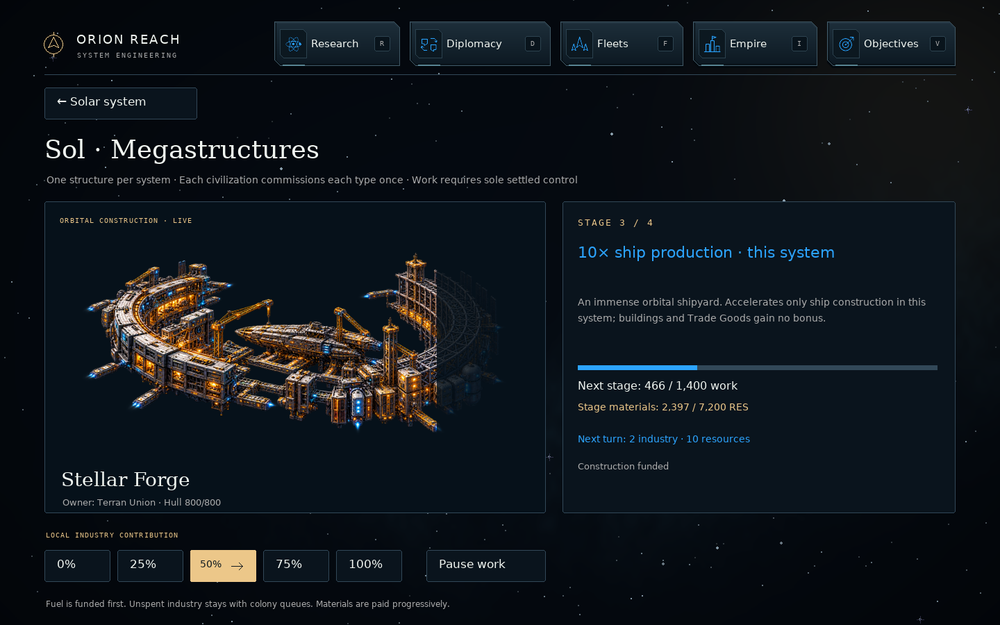

## Previous update, v0.59: administrative strain

Expansion now reduces colony efficiency through shared administration and local
distance from the capital. The same rules apply to players and AI civilizations.

- Each settled **system beyond the first adds 4 percentage points** of strain to
  every colony. Multiple planets in one system count once; outposts do not count.
- Each newly settled or conquered system adds another **4 points for eight
  production turns**. Additional planets in an owned system do not restart its
  timer. An empire's founding capital starts fully integrated.
- Only planets in a distant system receive its distance strain:
  **18 × max(0, distance in light-years / 7 − 1) percentage points**.
  The first 7 ly are free; 10.5 ly adds 9 points, 14 ly adds 18, and 28 ly adds 54.
  Outposts extend fuel range but do not change administrative distance.
- Add the three components and cap total strain at **90%**. Research and colony
  credit production receive the full penalty, industry and mining half, food a
  quarter. Energy, upkeep, fuel demand, food consumption and salaries are unchanged.
  Apply after output bonuses and before expenses. Whole-unit yields round down;
  the existing minimum of one construction industry remains.
- Trade Goods convert reduced industry and then pay credit strain. The UI shows
  the actual payout. Diplomatic income, raid loot and one-time expedition rewards
  are unaffected. Construction forecasts account for integration finishing.

The **planet overview** shows empire, integration and local distance components,
capital, light-year distance, output reductions and remaining integration turns.
The settlement confirmation previews the shared cost and the target's total
strain. The capital follows the existing headquarters palace: if the original
homeworld is lost, the first remaining colony becomes headquarters; recovering
the homeworld restores it. Losing the last colony in a system removes its strain
and integration timer. Taking that system again begins a new integration period.

AI empires use effective yields when allocating workers and budgeting. They
secure an initial foothold, favor efficient locations, and consolidate while
another system integrates or their income is negative. Race-specific strain
modifiers and administrative reduction technologies are left for later balancing.

Edit **Global rules → Administration** in `python editor.py` to change the rates,
integration duration, light-year distance unit, cap or each output's sensitivity.
Save format **41** and balance format **6** preserve the settings and timers.
Older saves gain size/distance strain immediately, with their existing systems
treated as fully integrated; old statistics are retained. Existing custom balance
values are preserved while the new controls are added.

Validation: **956 tests pass**, including 27 new administration and interface
checks. Colony controls remain separate on both ordinary and fully developed
planets. Run `python -m unittest discover -s tests -v` to reproduce the suite.

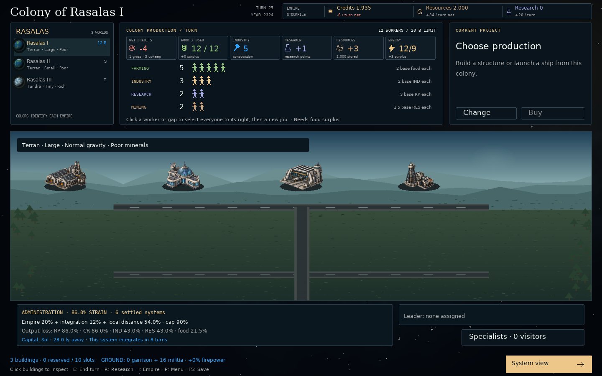
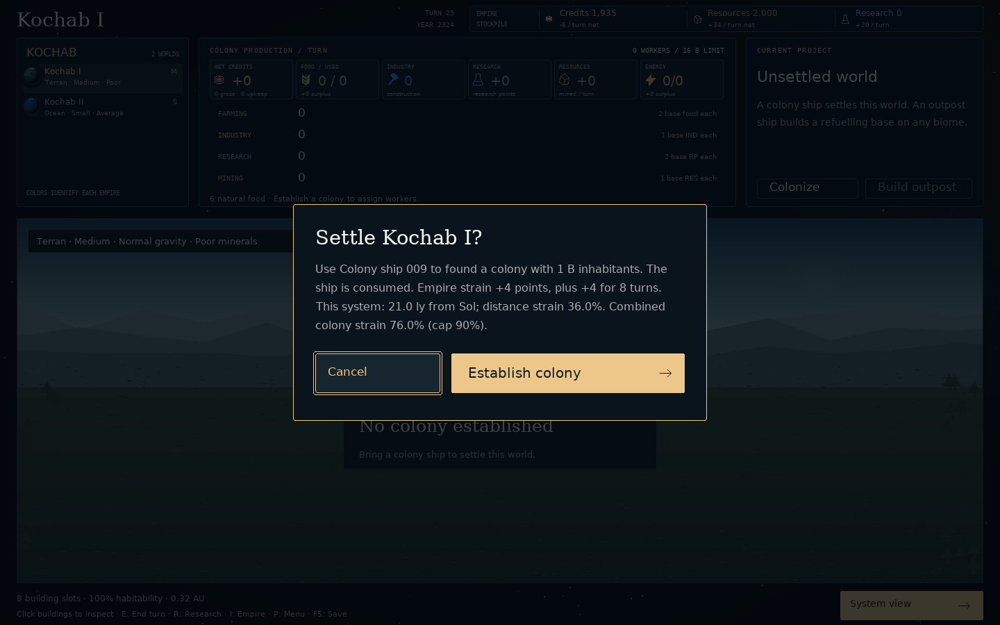

## Previous update, v0.58: portraits and planetary outposts

Mara Voss and Orun Basalt now have individual portraits in the specialist roster,
character details and their assigned colony's overview.

Standard colony ships cost **800 Resources and 420 work** (ten times the former
price). New **outpost ships cost 80 Resources and 42 work**. Racial and research
discounts still apply; starting fleets keep their free colony ship.

Send an outpost ship to a system, select an uncolonized planet, and click
**Build outpost**. The ship is consumed. Every biome is suitable, including
Barren and Volcanic worlds, and even Varkesh can establish outposts. There can be
**one outpost per system across all empires**. Guardians, opposing ships and
missile bases must be cleared first.

- A base extends fuel range exactly like an owned colony and keeps its own
  system visible. Outposts have no population, construction, output or upkeep;
  they do not count as colonies for victory or specialist assignments.
- The installation is visible on the planet, with **30 hull** and no weapons.
  Clear its orbital defenders, then use **Attack outpost** on the planet screen.
  Armed ships share the normal once-per-turn bombardment allowance. Attacks
  end treaties and set relations to -100. Destruction immediately removes the
  base's supply coverage. Damage persists; peaceful bases repair 4 hull/turn.
- An owned outpost can become a normal colony by bringing a colony ship and
  using **Upgrade to colony**. Habitability research is still needed to settle
  hostile biomes. A defeated empire loses its outposts. A Remnant awakening
  on an outpost world replaces the unarmed base with its colony.
- The AI can build and deploy outpost ships, attack hostile bases, save materials
  for expensive colonies, and favor known new systems for colonization.
- The galaxy range overlay retains its transparent blue fill and outlines the
  **union of all colony and outpost ranges**. No interior overlapping-circle
  lines are drawn, and gaps outside fuel range remain unfilled.

Existing campaigns load with no new outposts added. Their former standard
colony-ship costs migrate to the new values, while deliberately customized
costs remain unchanged. Previously queued orders keep their reserved material
cost; construction work uses the active ship definition. Save format is **40**,
balance profile format **5**. Ship costs and **Global rules → Outposts** can be
adjusted with `python editor.py`.

Validated with **929 passing automated tests**, including 24 outpost and portrait
checks, plus visual inspection of eight updated screens.

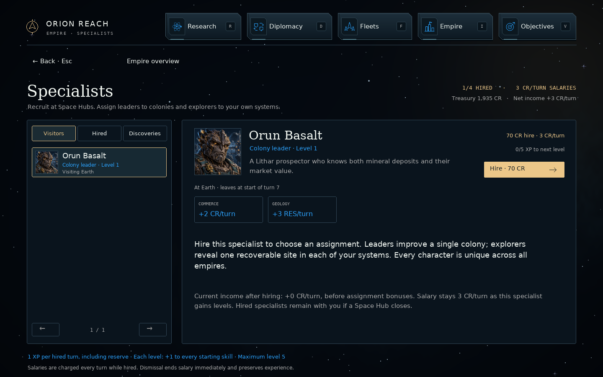
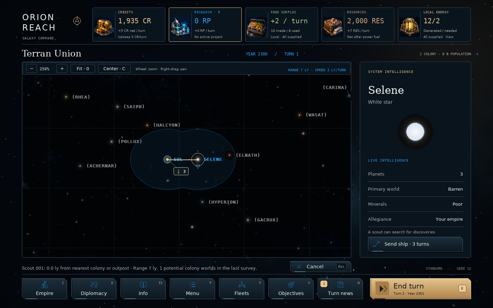

## Previous update, v0.57: Space Hubs and unique specialists

Build a **Space Hub** in a colony, then open **Empire → Specialists**, the
planet's **Specialists** button, or click the completed Hub on the surface.
The first operational Hub welcomes two visitors on the next turn, when
available: a colony leader and an explorer. Later visitors arrive periodically;
Terran and Concord receive them more often. Extra Hubs do not multiply the
empire's visitor rate.

The galaxy shares **18 unique characters**, each with a name, biography and
distinct starting skills. A character can visit or work for only one empire at
a time. Hire up to **four** specialists; each demands an immediate hiring fee
and a fixed salary every turn, including time in reserve. Salaries are included
in the treasury, empire budget and credits-per-turn statistics. Dismissal stops
the salary immediately, with no fee refund. Hired characters remain employed
if their Hub closes; experience survives dismissal and later recruitment.

- **Colony leaders:** one per colony; fixed industry, science, credits, food or
  mining bonuses. Multiple leaders can serve different colonies. Assignments
  do not require a Hub at the destination.
- **Explorers:** one per friendly system with no foreign colonies. Survey first,
  then use Hacking, Salvaging or Archaeology to recover a sealed station,
  mineral asteroid or ancient observatory. Each system has one finite site;
  rewards cannot be repeated. Progress survives reassignment and conquest.
- **Experience:** one XP per hired turn. Levels 2–5 require 5, 15, 30 and 50 total
  XP. Each level adds one to each starting skill; missing skills remain zero.
  Salaries do not increase with level. Assignments are immediate in this first
  version, with no separate character travel system.

The AI uses the same hiring, salary, assignment and exploration rules. Old
campaigns gain an empty specialist roster and can build Hubs; their existing
balance and research trees remain intact. Save format is now 39 and balance
profile format is 4. **`python editor.py`** includes Specialists, Expedition
sites and Global rules → Specialists. Prices, starting skills, rewards,
experience, capacities and arrival rates can be changed for future campaigns.
The in-game Info guide also explains the new rules. Admirals, agents and
offensive missions remain future additions.

Validated with **905 passing automated tests**, including 31 specialist tests,
plus visual checks of recruitment, assignments, discoveries and editor screens.

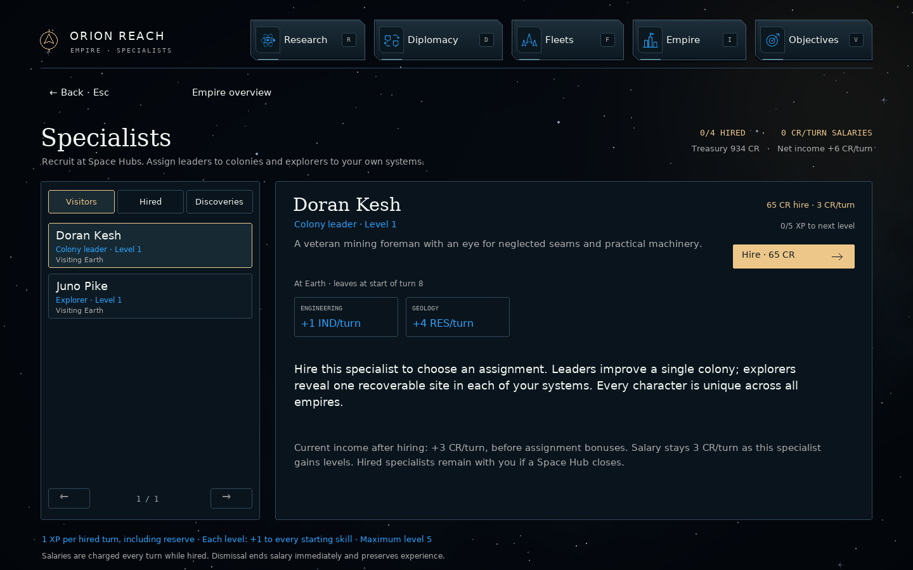

## Previous update, v0.56: research progression and advanced facilities

The standard research tree now introduces a beam weapon at every physics tier
from **II to VIII**: pulse, ion, quantum, plasma, graviton, particle/phased,
then heavy beam/disruptor weapons. Utility research remains a meaningful
alternative. Early sensors and fusion torpedoes move to tier II, antimatter
torpedoes to VI, battleships to IV and titans to VI. The existing research
prices and two exclusive choices per tier remain in place.

Six researchable facilities extend the basic economic buildings:

| Role | Middle progression | Later progression |
| --- | --- | --- |
| Manufacturing | Robotic factory — Computers III | Nanofactory — Materials VII |
| Mining | Deep-core mine — Materials III | Automated refinery — Materials V |
| Research | Advanced research lab — Physics IV | Quantum research lab — Computers VII |

Each has higher fixed output and a stronger workforce bonus, balanced by more
Resources, construction work, energy and credit upkeep. These are additional
facilities: each occupies its own building slot, can be built once per planet,
and stacks with other facility types. They inherit the corresponding factory,
mine or laboratory research bonuses. Mines retain priority during power shortages.

Unlocked facilities appear in the construction queue's building column and in
the colony **Advanced** category. The AI uses researched facilities
with the same upkeep and power checks. All six are editable in `python editor.py`.
See [RESEARCH_TREE.md](RESEARCH_TREE.md) for the complete layout and facility costs.

The new layout applies to **new campaigns using the standard balance**. Existing
campaigns and custom profiles retain their research choices, positions, prices
and progress; older profiles gain the six facility definitions automatically.
If you have a custom `balance.json`, keep editing its tree or use the editor's
**Reset all** and **Save** to adopt all new defaults for future campaigns.
Reset all also resets your other custom balance values. Save format remains
**38**; balance profiles advance to **3**. No new dependencies are needed.

## New in v0.55: galaxy map zoom and panning

Zoom into the galaxy with the **mouse wheel over the map**, or use the map's
**− / +** buttons. Zoom ranges from the full map at **100%** to **400%**. Wheel
zoom keeps the position under the cursor in place, subject to the map edges.

**Hold the right or middle mouse button and drag** to move the map in any
direction. **Shift + arrow keys** also pan; hold them for continuous movement.
Horizontal mouse-wheel/trackpad scrolling pans horizontally, and **Shift +
mouse wheel** pans vertically. Ordinary arrow-key navigation remains available.

The **Fit** button, **0**, or **Home** returns to the full galaxy. **Center** or
**C** brings the selected system back into view at the current zoom. Keyboard
**+ / −** also changes zoom. System names and fleet badges stay readable while
stars, ships, routes, sensor coverage and fuel ranges move together. Objects
outside the view do not leave stray labels or clickable markers at its edges.

Zooming and panning also work while choosing a fleet destination. Dragging
never sends ships; left-click a destination as usual. The wheel over the side
panel still pages through planets or the fleet manifest. The view is retained
when visiting another screen and resets when starting or loading a campaign.
Observers can use the same controls. Save format remains **38**; no additional
dependencies or gameplay balance changes are included.

## New in v0.54: diplomacy statistics from turn one

Open **Diplomacy → Statistics**, beside Rival report, to compare civilizations
over time. Six graph tabs show population, industry, food production, mining
production, energy generation and net credits per turn. The horizontal axis is
the campaign turn, starting at **turn 1** by default; each civilization has its
own colored line. Hover over a turn to inspect exact values, click civilization
names to hide or show lines, or focus on the last 25 or 100 turns.

Your empire is always included. Foreign empires appear when contact is
established, revealing their full recorded history back to turn 1. Their names,
lines and totals stay hidden before contact. Newly created empires have records
only from their founding turn. Observer campaigns can compare every empire.

Population includes enslaved residents. Food and mining show gross production;
energy shows actual generation across local grids. Credits show net income after
maintenance, including agreements and Trade Goods. This is an economic history,
not a treasury or resource-stockpile chart. Values reflect the active campaign's
balance rules; the current point updates with orders and is fixed when advancing
the turn. Historical points are preserved in saves.

Save format **38** loads older campaigns. Since earlier versions did not store
statistics, their history begins at the turn on which they are loaded. Missing
earlier turns stay blank. No additional dependencies are required.

## New in v0.53.1: portraits, equipment details and future blueprints

Aelari, Lithar and Remnant now use the three supplied portraits on race selection,
diplomacy and first contact. Restart the game after installing the update.

Right-click **any equipment row** in the ship designer, including the basic laser
cannon, to see its effects, hull-scaled damage and cost, range, accuracy, tracking,
special rules and research requirements. Detail pages use the campaign's active
balance values; arrows show additional pages, and Escape or right-click closes.

You can add and remove equipment, auto-fit, save and revise blueprints before
researching their hull or modules. Slot limits and fitting rules still apply.
Auto-fit previews the selected hull using known equipment and that hull's native
equipment; other future modules can be added manually. **Planned** designs show
the missing research and a button to view all requirements, including technologies
excluded by an earlier choice. Construction unlocks automatically when every
requirement is met. Existing ships and queued orders keep their equipment.

Save format remains **37**. Earlier campaigns load normally, and planned designs
survive saving and loading. AI construction still requires its own research.
No new dependencies are needed.

## New in v0.53: construction columns and hull-sized modules

The production screen keeps **buildings on the left, the construction queue in
the middle and ships on the right**. Building and ship pages move independently;
queueing, cancelling and reordering keep the screen open. The routine end-turn
income/autosave banner is removed. Autosaves, error messages and the existing
research, idle-colony, news and battle screens still work.

New ship designs use **one module per category slot**. Every standard combat
hull has **four offensive slots**; there is no shared space budget. All weapon
technologies, including graviton beams, can fill these slots. The hull determines
the module's size, output and cost:

| Hull | Module size | Damage / module cost | Offensive / defensive / support slots |
| --- | --- | --- | --- |
| Frigate | Small | 100% | 4 / 2 / 1 |
| Destroyer | Small | 100% | 4 / 2 / 2 |
| Cruiser | Medium | 200% | 4 / 3 / 2 |
| Carrier | Medium | 200% | 4 / 2 / 3 |
| Battleship | Heavy | 300% | 4 / 3 / 2 |
| Titan | Heavy | 400% | 4 / 3 / 2 |

For example, four graviton beams deliver a raw volley of **64** on a frigate,
**128** on a cruiser, **192** on a battleship and **256** on a Titan. Each weapon
still makes its own hit roll. Larger weapons are less accurate against smaller
targets: medium and battleship mounts lose 30 percentage points per smaller size
class; Titan mounts lose 35. Heavy weapons have no size penalty against other
heavy hulls, planetary bases or guardians. Small weapons retain fast tracking.
Scouts and drones are even smaller targets. Range, evasion and research bonuses
also affect the final chance, shown in combat; tracking can reduce it to 5%.

Armor, shields and repair output scale with module size too. Weapon range,
movement bonuses, percentage effects and drone counts do not scale. Carriers
can fit at most two drone bays. The designer shows effective module statistics,
slot counts and costs. Auto-fit and new AI warships use the same rules and pay
the full cost; tactical AI forecasts include tracking. Standard ship presets
remain available at their listed prices and fixed equipment ratings.

The balance editor exposes **Offensive slots, Defensive slots, Support slots,
Module size, Module scale and Tracking penalty** in Designer hulls. Module
values are the small-size base values. Existing custom profiles gain these new
controls while retaining all their earlier settings.

Save format **37** loads older campaigns. Existing custom blueprints, built
ships and queued orders retain their old capacity rules and statistics. Opening
an old blueprint in the designer previews a refit; saving it applies the new
slots and scale to future orders, without changing built ships or queued work.
No additional dependencies or artwork are required.

## New in v0.52.1: research pacing and available construction

Standard research costs are four times higher at every tier, including
Ascension Theory: **160, 400, 480, 880, 1,440, 2,160, 3,040 and 4,160 RP**
for tiers I–VIII, and **20,000 RP** for Ascension. These are the defaults for
new campaigns and the balance editor. Saved v0.52 campaigns and existing
custom profiles retain their chosen research prices.

The planet production picker shows only projects that can be queued now.
Unresearched buildings, completed buildings, already queued buildings and
buildings without a free slot are hidden. Every building is limited to
**one per planet**, including queued orders, for both players and AI. Cancelling
its order or demolishing it makes it available again. Ships remain repeatable.
Basic buildings without a research prerequisite remain available from the start.

The list updates immediately without closing the screen. Trade Goods remains
available, and Resources are still reserved when work starts, so you can plan
ahead before the required Resources arrive. AI colonies choose other eligible
buildings or Trade Goods instead of repeatedly ordering the same building.

Existing saves retain their buildings and queued work, including duplicates
ordered under earlier rules; new orders always enforce the one-per-planet limit.
Save format 36 remains compatible. No new dependencies or artwork are required.

## New in v0.52: standalone balance and research editor

Launch the editor in the same environment as the game:

```bash
python editor.py
```

Browse searchable catalogues for buildings, standard ships, designer hulls,
modules, weapons, races, guardians, AI personalities and global rules. Click
a value to edit it; **Enter** applies the change. Costs, production, upkeep,
population, starting resources, movement, diplomacy and other balance values
are editable. **Undo**, **Redo**, **Reset item** and **Reset all** support experiments.

In **Research tree**, drag a technology between branches and tiers. Dropping
onto another technology swaps their positions. Double-click to edit its cost,
effects, name or description. Research branches can also be reordered. The
current game supports nine branches, eight possible tiers, and up to two
alternatives per tier; validation catches gaps and overfilled tiers.

**Save** writes `balance.json` beside `main.py`, with the previous file retained
as `balance.json.bak`. **Save as** and **Open** manage alternate profiles. Start
a **new campaign** to use the saved profile. Existing campaigns keep their own
balance snapshot, including research order, in save format **36**. Older saves
load with the standard rules. No additional dependencies are required.

See [the editor guide](docs/balance-editor.md) for units, profiles, limits and
command-line validation. This editor changes the existing game data; new game
mechanics and new entity types still require Python changes.

## New in v0.51.1: compact empire stockpile

The planet overview and production picker now show a small **Empire stockpile**
strip at the top: total Credits, Resources and stored Research, each with its
empire-wide change per turn. Credit income includes maintenance and Trade Goods;
Resources show net mining after power-plant fuel. Debt and negative rates are
highlighted. The values update immediately as you change production or workers,
buy projects or cancel construction.

The production cards below remain local to the selected colony, including food,
industry and energy. The Observer keeps its read-only header. This is a display
update; game rules and save format are unchanged.

## New in v0.51: construction queues and Trade Goods

The production picker stays open while you add buildings, ships or the
Ascension Gate. **Queue** appends each project in the order selected. Click a
queued project to make it current without closing the picker; cancellation and
queue paging also keep the screen open. **Return to colony** or Escape finishes
editing. Building limits, unique buildings and resource reservations still apply.

**End Turn opens the overview of each owned colony without production orders**
before advancing. Newly finished queues also open their colony overview; battles,
council decisions, first contact, news and research reminders are handled first.
Choose production or leave the colony to continue reviewing the remaining worlds.
Colonies waiting for Resources already have an order and are not considered idle.

**Trade Goods** is an ongoing production option, always available at the bottom
of the picker. Each turn it converts **30% of available industry, rounded down
per colony**, into credits: 9 industry earns 2 CR; 10 earns 3 CR. It needs no
building slot, Resources, maintenance or research. The preview, colony income,
empire budget and actual turn income include these credits. Industry already
reserved for population assembly remains reserved.

Leaving an empty building/production screen or an idle planet overview selects
Trade Goods automatically and autosaves. Trade Goods continues until another
order is chosen and does not trigger idle reminders. Selecting it manually
pauses existing construction while preserving work and reserved Resources.
Adding a project or clicking a queued project resumes construction. Trade Goods
cannot be bought. A turn spent completing normal construction does not also
earn a full turn of Trade Goods income.

Existing saves load normally; new saves use format **35** to retain the mode.
No dependencies or new artwork are required. Extract this update over the
current installation and restart the game.

## New in v0.50.1: missile bases on their planets

Tactical missile bases now sit on the surface of their own planets, using the
same biome and globe artwork as the system view. Each defended world shows its
name, an attached battery and the base's hull bar. Click the planet to select
or target its battery; the side panel identifies the world and surface defense.

Missiles launch from the surface installation, and incoming fire strikes it.
A destroyed base leaves a damaged installation on the surviving planet. The
colony, its population and its ownership remain unchanged. Battle results count
missile bases separately from ships. Multiple defended worlds and both sides'
defenses are supported, including automatic combat.

This changes presentation only: movement, targeting cells, weapon ranges, hull,
damage and save format remain unchanged. Existing battles can be loaded.

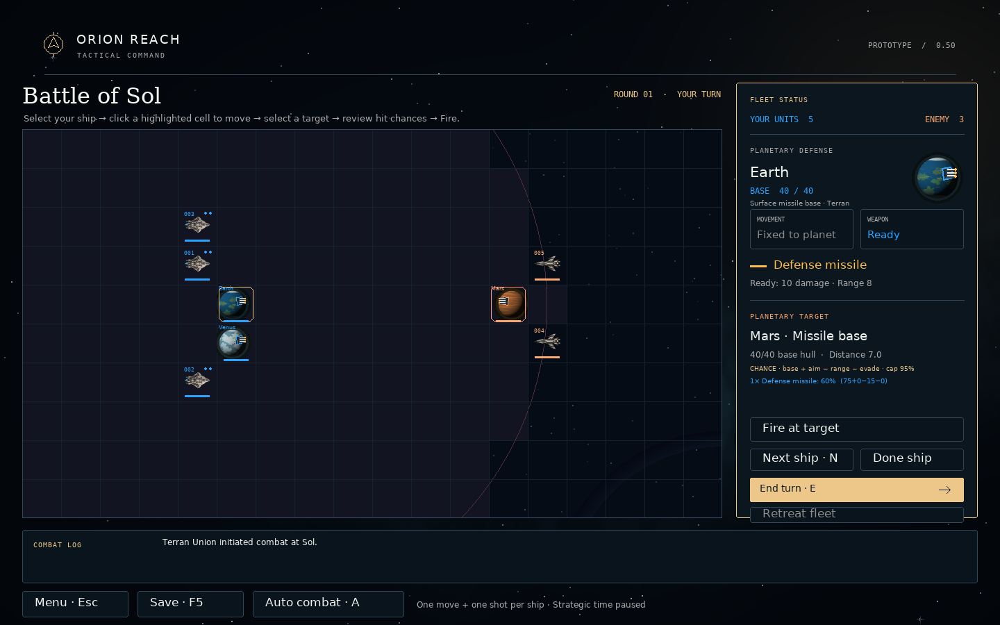

## New in v0.50: automatic fleet combat

Choose **Auto combat · A** on the tactical screen to let the computer command
your ships. It moves ships, chooses targets, fires weapons, launches carrier
drones and ends tactical turns using the existing combat rules. You can watch
the normal movement, weapon and explosion animations, including guardian and
black-hole battles. An unarmed surviving fleet retreats if a safe route exists.

Choose **Take control · A** at any time to resume manual orders. An action
already underway finishes its animation; used movement, weapon shots and drone
launches stay spent. If the enemy is acting, your orders resume on your next
turn. Menu, Settings, dialogs and Info pause combat. Saving retains every
applied action; loading a battle restores manual control.

Automatic control is selected separately for each battle. It stops at victory,
defeat or retreat, leaving the result for you to review. Strategic time does not
advance. Existing saves work unchanged; no new research or dependencies are
required.

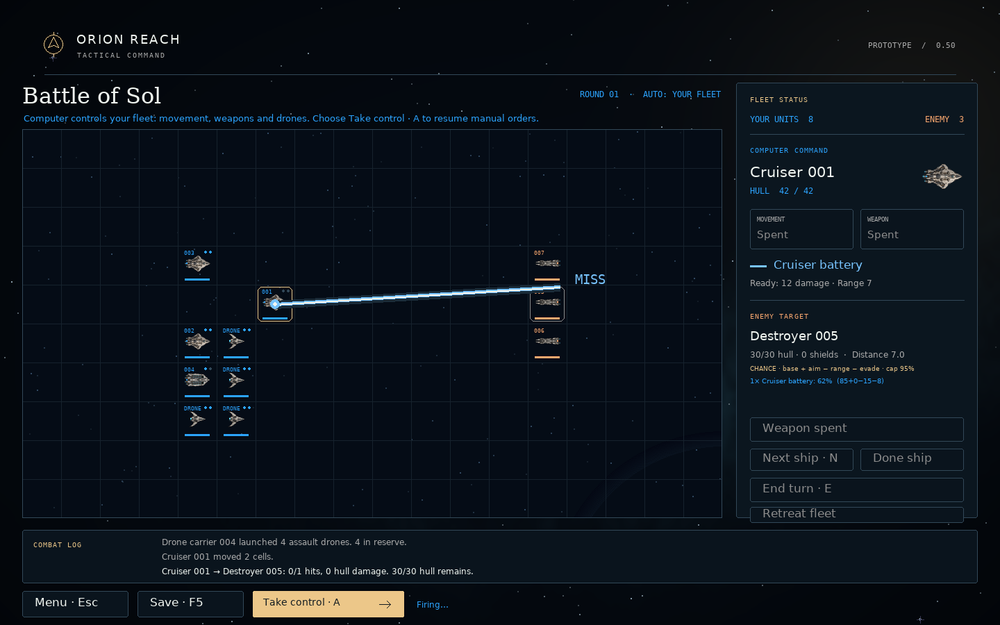

## New in v0.49: black-hole expeditions

New galaxies contain **two black holes in Compact**, or **three in Standard and
Expansive**. The Maw, The Silent Eye and The Broken Crown have distinct map
sprites and detailed artwork in the right-hand overview. They replace remote,
unsettled map locations; homeworlds and ordinary guardian worlds are preserved.

- **Gravitic Mapping**, Computers VI, costs **540 RP** and reveals their names
  and positions. Its alternative is Planetary Data Vaults (+2 RP per colony).
- **Event Horizon Navigation**, Computers VII, costs **760 RP** and permits safe
  approaches. It includes detection even if Mapping was skipped. Its alternative
  is Quantum Research Archives (+4 RP per colony). Earlier choices are unchanged.
- Without safe navigation, **every ship arriving at a black hole is lost**. The
  game asks for confirmation before queuing an unsafe expedition. Departure can
  be cancelled before End Turn. Navigation must be completed before the arrival
  turn; research finishing during that turn comes too late. Ordinary routes
  crossing the area remain safe, and normal colony-based fuel range still applies.
- A safe expedition encounters a **legendary guardian** at an ancient site
  outside the event horizon. Fight or retreat using normal tactical combat;
  damage persists. The first empire to defeat it recovers **one unique relic**.
  Defeat, retreat and later visits grant no additional reward.
- **Turn news** reports mapped sites, lost expeditions and recovered relics.
  **Info → Legendary artifacts** marks relics in your collection. Ownership is
  saved; flagship/capital placement and all proposed bonuses remain planned.

Computer empires research navigation and assemble military expeditions under
the same rules. The Observer sees all sites from the beginning. Otherwise,
black holes remain hidden until researched, even with fog of war disabled.
Mapping alone does not reveal the guardian's condition or the site's relic.
Black holes do not count toward the council's settled solar-system threshold.

**Start a new campaign to get black holes.** Older saves retain their original
worlds and Ascension requirements. Saves now use format **34**, including
expeditions in flight, ongoing guardian battles, claims and news read markers.
There are no new dependencies.

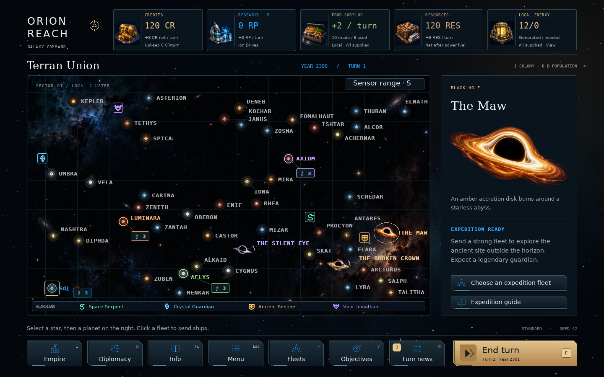

## New in v0.48: galaxy map artwork

The galaxy map now displays a nebula and starfield background behind its systems,
fleets and routes. The image keeps its proportions, fills the map without black
bars, and is slightly dimmed for readability. The right-hand system overview and
command bars retain their existing panels.

**Menu → Settings → Galaxy background** turns the artwork on or off. It is on by
default, and the preference is saved between sessions. Turning it off restores
the plain map. Campaigns, fog of war and fleet orders are unaffected.

The supplied artwork lives at `assets/backgrounds/galaxy-v1.png`. Replace that PNG
and restart to use your own image; missing or unreadable artwork falls back to
the plain map. The original image is preserved, with scaling and dimming cached
in memory. No new dependencies or save migration are required.

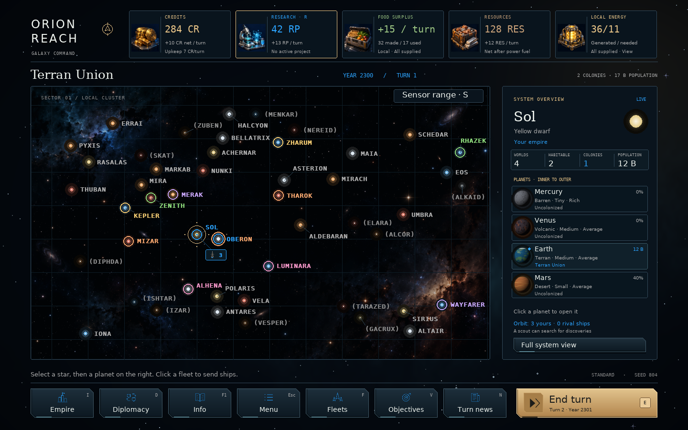

## New in v0.47: legendary artifacts in the encyclopedia

Open **Info → Legendary artifacts** to browse ten illustrated relic concepts.
Each entry includes the original artwork, its legend, a proposed flagship or
capital placement, and proposed bonuses and special powers. The artwork and
**Planned content** notice stay visible while long descriptions scroll.

Originally these entries were previews only. As of v0.49, black-hole expeditions
can recover relics into an empire's collection. Transport, equipment and
activation remain planned, and relics grant no current gameplay bonuses.
Combat, economy, research, council votes, AI and campaign saves are unchanged.
The encyclopedia now contains 176 entries across 11 categories.

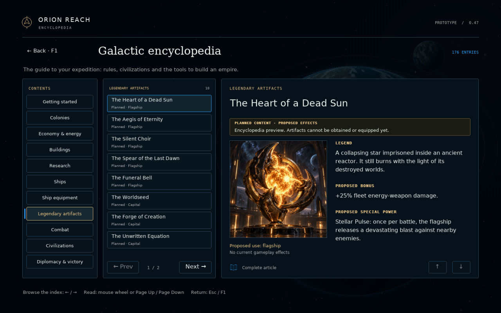
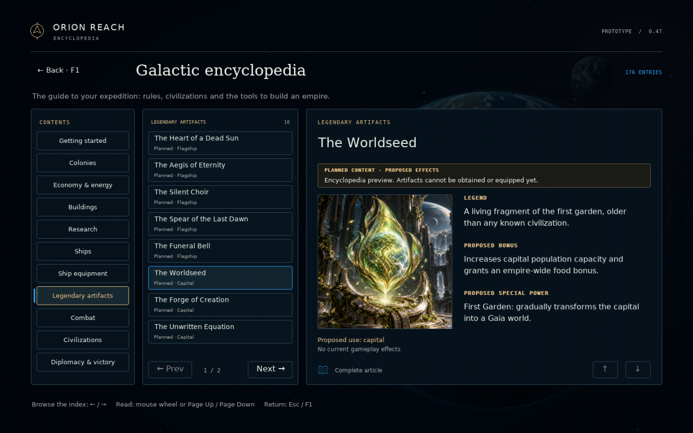

## New in v0.46: Info and the galactic encyclopedia

The galaxy's bottom bar now includes **Info**, with an open-book icon:
**Empire · Diplomacy · Info | Menu | Fleets · Objectives · Turn news · End turn**.
Menu and End turn keep their previous positions.

Click **Info**, or press **F1** from a campaign view, to open the encyclopedia.
It starts with guides to exploration, colonization, population, resources,
energy, fleet travel, combat, diplomacy and victory. The catalog also lists
all current buildings, research technologies, ship classes, ship equipment and
civilizations, including the Observer. Costs, effects and traits come from the
game's public rule catalogs. Values are base values, before empire bonuses.

Choose a category on the left and an article in the middle. **Previous/Next**,
Left/Right, or the mouse wheel over the article list changes its page. Read long
articles with the mouse wheel, Page Up/Page Down or the article's arrow buttons.
**Back, Escape or F1** returns to the previous view with fleet selections and
orders intact. Reading does not advance turns, change research, or reveal
hidden campaign intelligence; battles pause while the encyclopedia is open.

The reference is organized for additional topics in later updates. Existing
campaigns and settings continue to work without migration.

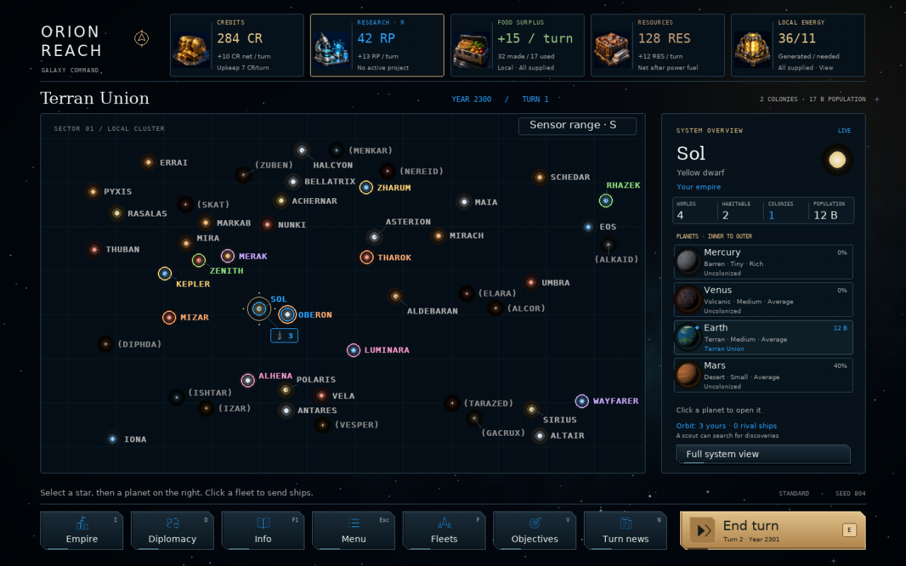
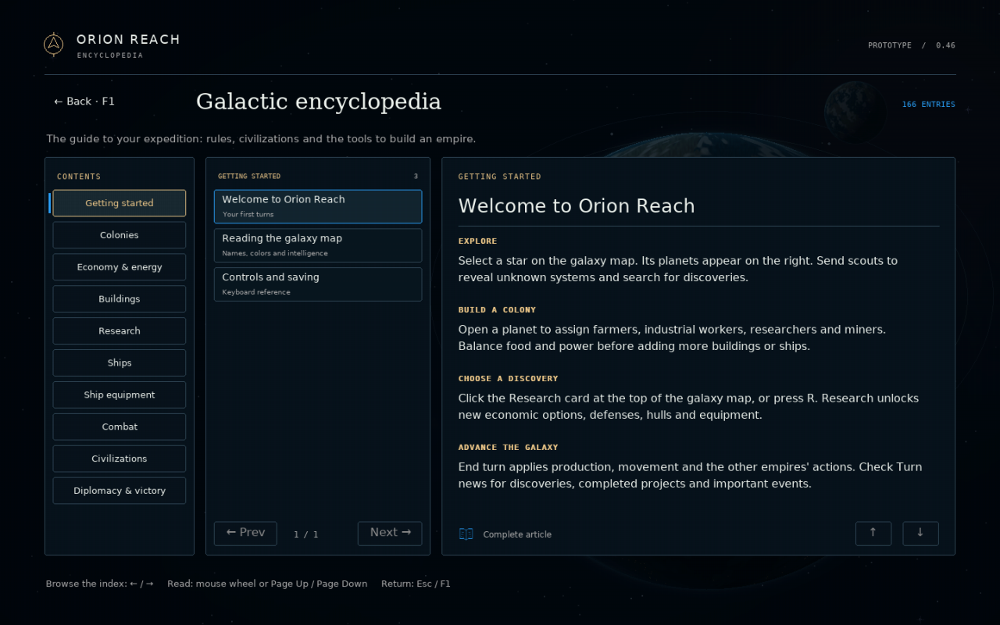

## New in v0.45: clearer galaxy colors

The galaxy uses **saturated blue** for your empire by default, gray for neutral
system names, brighter rival colors, stronger ownership rings and **13 px bold
system names**. Unexplored systems retain parentheses; shared systems retain
their names split into each known owner's color.

Open **Settings → Galaxy colors** from the main menu or the in-game Menu to
choose **Saturated blue** or **Saturated turquoise**. The choice applies
immediately and is saved automatically for future sessions and campaigns.
Ownership labels, rings, fleet markers and empire colors in other views use
the same choice. Generic interface accents retain the blue UI color.

Existing settings without a color preference use saturated blue. This is a
display preference; existing campaigns load normally with no save migration.


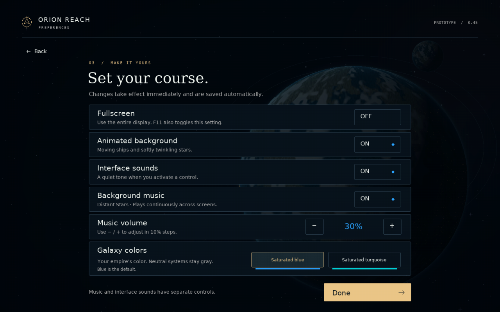

## New in v0.44: victory options and advanced fuel tanks

The **second new-game screen**, immediately after choosing a race, now lets you
toggle **Conquest**, **Science**, and **Galactic Council** independently. All
three are on by default. The choices apply to every empire and are saved with
the campaign, including Observer games. Objectives shows which conditions are
enabled. Turn them all off for open-ended play; losing every colony still ends
a human campaign.

- With Conquest off, defeating the final rival does not end the campaign.
- With Science off, Ascension Theory, gate construction and gate charging are
  disabled. All other research remains available to humans and AI.
- With Galactic Council off, no council forms and no elections occur.

**Three new paired tiers** extend Materials & Chemistry without removing any
previous technologies. Complete each tier to unlock the next; choose one of its
two alternatives. Skipping a tank does not prevent researching a later tank.

| Tier | Fuel tank | Range added | Alternative | RP |
| --- | --- | ---: | --- | ---: |
| V | Cryogenic Fuel Tanks | +10 ly | Automated Refineries: +3 Resources per operational mine | 360 |
| VI | Antimatter Fuel Tanks | +15 ly | Molecular Shipbuilding: new ships cost 15% fewer Resources | 540 |
| VII | Spatial-Compression Tanks | +20 ly | Nanostructured Materials: +4 industry per colony | 760 |

Tank bonuses add to the existing Lightweight Alloys (+10 ly), Composite
Structures (+15 ly) and Deep-Space Logistics (+5 ly) upgrades. They automatically
extend the range of **all existing and future ships** from your owned colonies;
no refit or ship-design slot is needed. They change range, not travel speed or
voyages already underway. The Varkesh's 50% range bonus applies afterward. AI
empires can prioritize the new tanks when their explored frontier is exhausted.

**Save compatibility:** older campaigns keep all three victories enabled and
retain their previous Ascension requirements, invested RP, discoveries, gates
and council ballots. The new tiers are optional for their science goal. New
campaigns must complete the three additional tiers before Ascension Theory.
Save format is now 33; loading never rewrites an older save file.

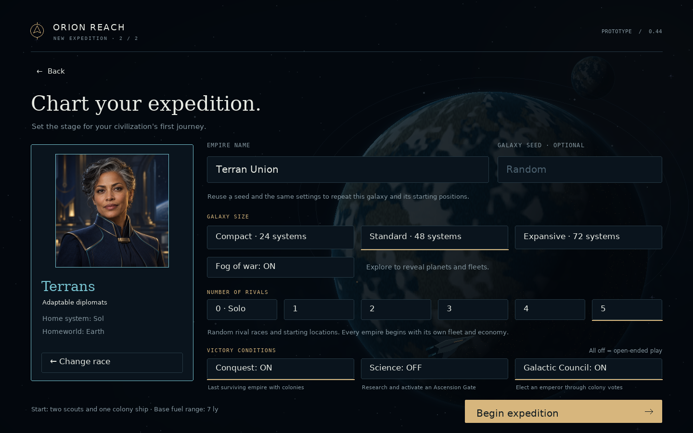


## New in v0.43: the Galactic Council

**Ascension Theory now costs 5,000 RP**, ten times its previous 500-RP cost.
Research already invested is retained as the same number of points, including
in older saves. Completed discoveries and existing gates remain valid. Gate
construction still costs 500 Resources and 300 work, followed by five powered,
clear-orbit charging turns.

The **Galactic Council** adds a third victory path:

- At the end of a turn, once **at least half of all solar systems are settled**,
  the first election is called. A system counts once if any world in it has a
  colony, including systems shared by several empires. Solo campaigns have no council.
- Each surviving empire receives **one vote per colonized world**. Population,
  slaves and uncolonized worlds do not add votes. A fresh census is taken at
  every election, and every surviving empire is a candidate.
- You cast your delegation's votes for one empire, including your own, or
  abstain. AI ballots are visible. Computer empires back themselves unless a
  larger empire has friendly relations (+25 or higher); then they support the
  friend with the best relations, breaking equal preferences by colony count.
- **At least half of all eligible votes**, rounded up, elects the
  **Emperor of the Universe**, provided the candidate has a unique lead.
  Abstentions remain in the denominator. An exact 50–50 tie elects nobody.
- After an unsuccessful vote, another election occurs **50 turns later**, even
  if settlement subsequently falls below half. The schedule ends once an emperor
  is elected.
- If you win, the game ends in a **council victory**. If another empire wins,
  you may **accept** the ruling and end the campaign, or **defy** it. Defiance
  ends all treaties with surviving AI empires and sets their relations with you
  to **−100**: every one declares war. Elections cease, and the campaign
  continues toward conquest or Ascension.

The voting screen opens automatically and pauses strategic orders until you
vote or decide the ruling. Battles already in progress finish before voting.
Council membership establishes diplomatic contact and reveals public vote
counts without revealing unsurveyed planets or fleet locations. Election news,
ballots, outcomes and pending choices are saved. Observer campaigns resolve
elections automatically and can inspect the council from their Objectives tab.

**Existing campaigns:** the council begins checking the settlement threshold on
the next completed turn. Already finished campaigns keep their result. Current
saves from v0.43 use format 32; older saves load without modifying the original file.

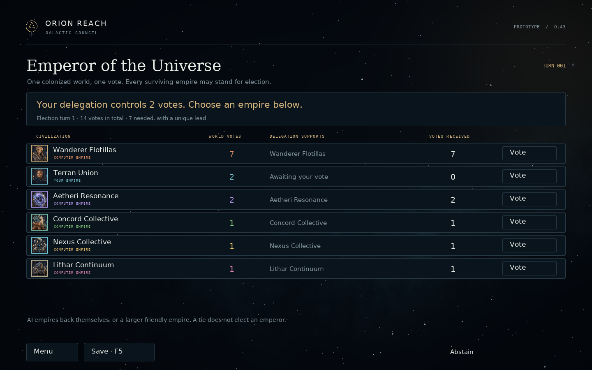
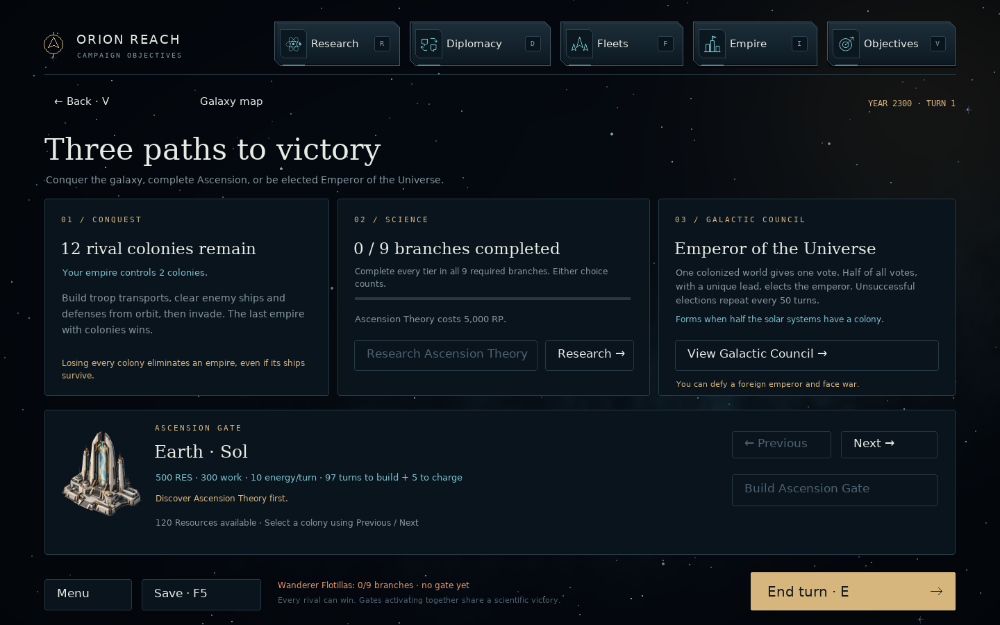

## New in v0.42.1: Varkesh warlords

The Varkesh now use the supplied portrait of a tusked, armored warlord beneath
red clan banners. It appears in race selection, setup, first contact and
diplomacy, including existing campaigns after restarting the game.

Their disposition is **Brutal · Predatory · Intimidating**. A threatening
first-contact transmission and new replies to envoys, gifts, accepted/rejected
treaties and broken agreements give them a consistent raider voice. Replies
appear in **Recent exchanges**, alongside the exact costs and diplomatic
outcomes. Gifts are described as tribute; they retain their ordinary effect on
relations. Existing racial abilities, AI behavior and treaty rules are unchanged.
The update requires no save migration. Replay their first-contact greeting from
Diplomacy to hear the new introduction in an existing campaign.

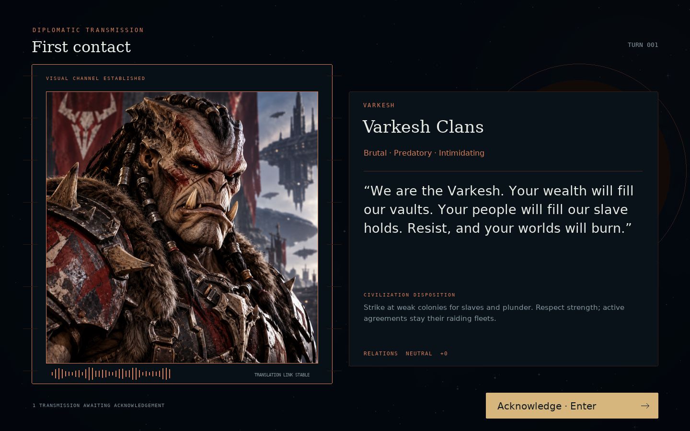

## New in v0.42: the expanded combat arsenal

**18 research technologies** add eleven weapons, specialized shields, armor,
flak, damage control, and interceptor/bomber bays. All previous technologies and
their research costs remain. Research still offers **two exclusive choices at
each sequential tier**, with immediate selection, transferable unfinished RP,
and right-click technology information.

| Field and tier | First choice | Alternative | RP |
| --- | --- | --- | ---: |
| Physics V | Pulse Beams | Plasma Beams | 360 |
| Physics VI | Ion Beams | Graviton Beams | 540 |
| Physics VII | Particle Beams | Heavy Beam Mounts | 760 |
| Physics VIII | Phased Beams | Disruptor Beams | 1,040 |
| Materials III | Fusion Torpedoes | Reinforced Armor | 120 |
| Materials IV | MIRV Torpedoes | Antimatter Torpedoes | 220 |
| Force Fields V | Regenerative Shields | Hardened Shields | 360 |
| Starship Engineering V | Interceptor Drones | Advanced Flak Systems | 360 |
| Starship Engineering VI | Bomber Drones | Automated Damage Control | 540 |

Both drone tiers offer an alternative useful without a carrier. Researching a
drone technology does not unlock a carrier hull that was skipped earlier.
Advanced modules are independent unlocks: for example, hardened shields do not
require the earlier radiation-shield choice.

### Weapon choices

Damage below is the total damage of **one module** before accuracy, interception,
and shields. Each pulse or MIRV projectile rolls its own hit chance.

| Weapon | Damage | Range | Weapon spaces | Special effect |
| --- | ---: | ---: | ---: | --- |
| Pulse cannon | 2 × 4 | 6 | 1 | +15 percentage points of base accuracy; usual 95% final cap |
| Plasma cannon | 24 | 4 | 2 | Strong close-range fire |
| Ion cannon | 8 | 6 | 2 | Up to 32 shield damage; amplification never spills into hull damage |
| Graviton beam | 16 | 6 | 2 | Hit slows the target by one cell through its next combat turn |
| Particle lance | 20 | 10 | 3 | Long-range artillery |
| Heavy beam battery | 30 | 9 | 4 | Large, powerful beam mount |
| Phased beam | 16 | 7 | 2 | 50% of damage bypasses ship shields |
| Disruptor | 40 | 5 | 3 | One full combat turn of recharge after firing |
| Fusion launcher | 18 | 9 | 2 | Stronger torpedo warhead |
| MIRV launcher | 3 × 7 | 8 | 3 | Ignores half of interception |
| Antimatter launcher | 36 | 9 | 3 | One full combat turn of reload after firing |

Graviton slowing applies on a hit even if shields absorb the damage, never
stacks, and never reduces a moving ship below one cell. Stations remain immobile.
Recharge also applies after a miss; other ready weapons can still fire. New
torpedoes benefit from Advanced Torpedo Guidance and remain subject to point
defense. Beam precision applies to the new beams. Ion amplification also affects
planetary shields during bombardment; phased penetration applies only to ship
shields. Strategic bombardment retains its once-per-ship, per-turn limit.

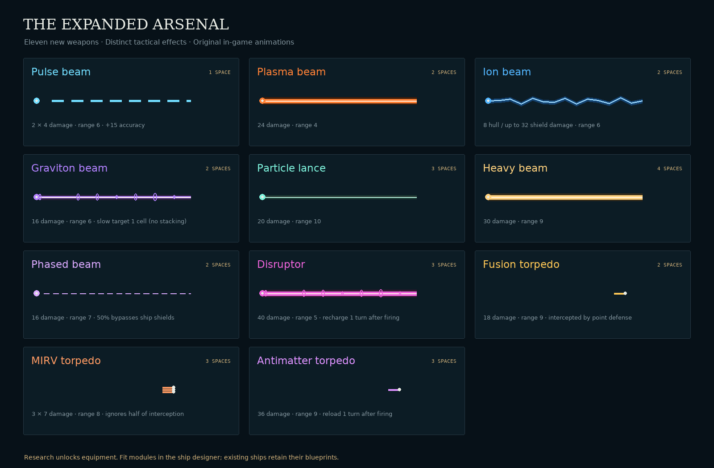

### Defense and carrier equipment

- **Reinforced armor:** +14 hull per defense space, with the same one-cell
  movement penalty as ordinary armor (minimum one).
- **Regenerative shield:** 8 capacity per module; restores 2 shield points at
  the start of each owning fleet's combat turn, up to the ship's total capacity.
- **Hardened shield:** 12 capacity per module; while shields remain, reduces
  phased penetration by 75%. Hardening does not stack.
- **Advanced flak:** 45% interception per defense space, with a 75% shipboard
  cap when flak is fitted. Ordinary point defense retains its 60% cap.
- **Automated damage control:** one support space; repairs up to 3 hull per
  owning turn, with a finite reserve of 12 hull per module per battle. It cannot
  repair beyond the hull with which the ship entered battle or revive a wreck.
- **Interceptor bays:** carriers launch fast, six-cell drones with 2 damage
  against ships and 8 against other drones. Each interceptor protects other
  friendly ships within two cells with +20% interception, capped at +40% from
  escorts. Combined shipboard and escort interception is capped at 90%.
- **Bomber bays:** carriers launch slower, three-cell drones with 5 damage,
  doubled against cruisers, larger warships, bases and guardians. Flak and point
  defense counter them. Both new drone types have weapon range 3.

Each bay supports two active drones and four launches per battle, tracked
separately for assault, interceptor and bomber roles. Mixed carriers can choose
the drone type beside the Launch button. Launching spends the carrier's weapon
action; drones act immediately and shut down if their carrier is destroyed.

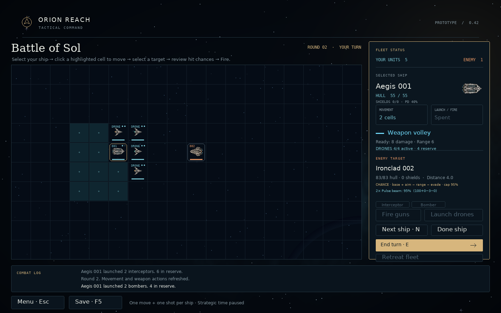

### Designer, AI, and saved games

The designer now has **All equipment / Weapons / Defense / Support** filters,
equipment pages, and **Auto fit** using researched modules and ordinary hull
limits. Right-click a technology-gated module for its research information.
Save the resulting blueprint and queue it at a colony. Existing ships and
construction orders keep their equipment; the new research unlocks modules
for new designs. AI empires also build legal researched blueprints and pay
their full discounted Resource and production costs.
Captured colonies retain paid ship orders and their equipment, without granting
the conqueror those technologies or permission to create new copies.

Physics now displays all eight tiers without clipping. Combat shows ready
weapons, recharge, graviton slowing, repair reserves, and carrier role selection.
Beam and torpedo families have distinct original procedural animations.

Save format **31** stores weapon recharge, slowing, repairs and drone roles.
Older saves retain discoveries, research progress, fleets and battles. Their
original Ascension tier requirements are preserved; the new arsenal tiers are
optional for their scientific victory. New campaigns require one choice from
all **39 tiers** before Ascension Theory. There are **79 technologies** in total.

Run `python tools/preview_arsenal.py` to recreate all five previews. The arsenal
tests include authentic v0.41.2 saves, deterministic battle continuation,
research unlocks, production costs, defenses, drones, and interface navigation.

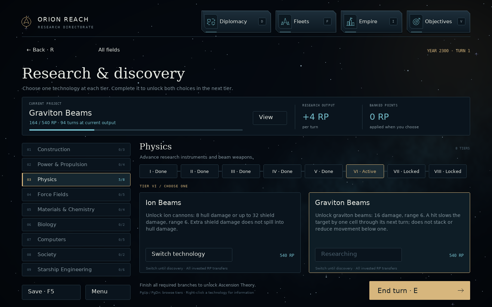

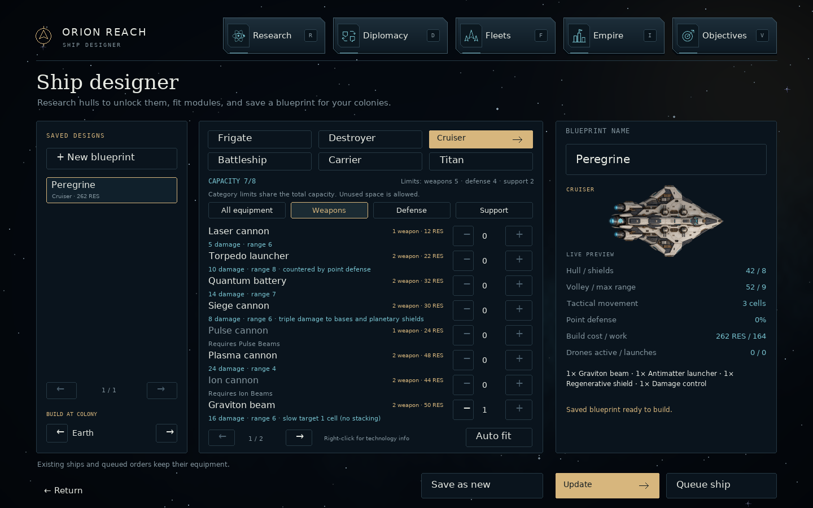

## New in v0.41.2: support-ship artwork

The **troop transport**, **colony ship** and **scout** now have original
transparent ship illustrations that match the ceramic armor, dark machinery,
bronze fittings and cyan lights of the existing warships:

- **Troop transport:** a broad armored hull with protected personnel modules.
- **Colony ship:** rounded habitat pods, living-space windows and greenhouses.
- **Scout:** a slender exploration hull with scanning dishes and survey optics.

The figures appear throughout the existing shipyard, fleet, colony construction,
exploration and tactical combat views. They retain their proportions when scaled
and rotate to face the correct direction in battle. Existing save files work
unchanged. Ship costs, capabilities and research requirements are unchanged.

Original PNGs, generation prompts and asset hashes are in `assets/ships/`.
Run `python tools/preview_support_ship_art.py` to reproduce the artwork catalogue
and the shipyard, fleet and combat previews.

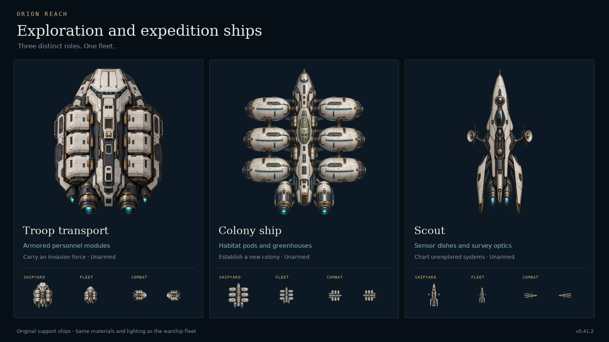

## New in v0.41.1: immediate research selection and technology information

- **Left-click** a technology to start or switch research immediately, without
  a confirmation dialog. Only one project runs at a time.
- Until discovery, you can switch to the other choice at the same tier or to
  any available project in another field. **All invested RP transfers**, together
  with your banked points. A cheaper project may finish immediately; surplus
  points remain banked. Repeated switching never creates or loses points.
- **Only discovery makes a choice permanent.** Its alternative is then excluded,
  its effects take effect, and the next tier unlocks. An unfinished project does
  not unlock later tiers.
- **Right-click** any technology row or detail card to read its full effects,
  cost, status, and RP transfer information. Locked, excluded, discovered and
  active technologies can all be inspected. Right-click the active project or
  the galaxy's Research card for the same information. Close with **Close**,
  **Escape**, or another right-click; the panel never changes research.
- Selection and switching autosave. Existing saves retain their progress and
  discoveries. Old projects keep their original cost until you switch; the new
  target uses its normal cost and receives every invested RP. Save format stays 30.

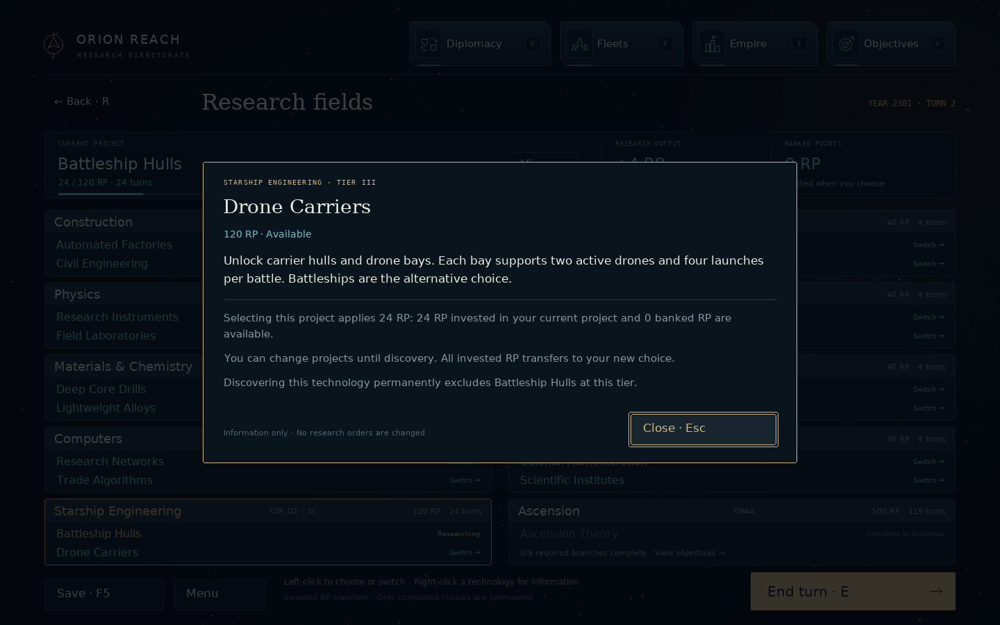

## New in v0.41: research field overview

Research now opens a **two-column, five-row overview** inspired by the MOO2
research screen. Its ten panels contain the nine existing branches and the
Ascension finale. Every existing technology, tier and cost is retained,
including the original research goals of older campaigns.

- Each field shows its current tier, two technology choices, RP cost and an
  estimated time that accounts for banked points. Active and completed choices
  are marked. Ascension remains locked until the required branches are complete.
- Click a technology to select it; right-click to review its full effects and
  alternative. Click a field heading to browse all of its tiers;
  **All fields** returns to the overview. The active project also has a **View** button.
- Click the **Research resource card at the top of the galaxy screen**, or press
  **R**, to open research. Its border highlights when a project can be chosen.
  The duplicate bottom Research button is removed; Empire and Diplomacy have
  more space, and Menu, Fleets, Objectives, Turn news and End turn stay in place.
- After **End turn**, an idle research program opens the field overview,
  including when the previous project has just finished. Battles, first-contact
  greetings and turn news are handled first. You can return without choosing;
  points remain banked and the next turn reminds you again. A completed tree
  does not trigger a reminder.
- Observer campaigns never receive a player research prompt. Click
  **Technologies** in the top bar, **Research** in the report header, or press
  **R** to view computer empire research.

Save format remains **30**. Run `python tools/preview_research_fields.py` to
reproduce the overview, carrier tier, technology information and top-bar previews.

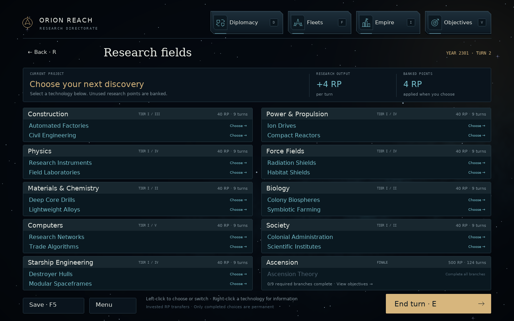

## New in v0.40: The Observer

Choose **The Observer** on the New Game race screen to watch **2–5 computer
empires** play a complete campaign. The Observer has no homeworld, ships,
economy or diplomatic relationships, and never occupies a rival slot. Competing
civilizations are still selected from the original eleven races without duplicates.

- See every system, planet and fleet, including ships in transit.
- Click **End turn** (or **E**) to advance all computer empires. Space and ground
  battles resolve automatically. New reports do not interrupt the viewing screen.
- Inspect global totals and read-only **Empires, Diplomacy, Research, Fleets and
  Objectives** reports from the command bar and research header. Open a civilization for its
  economy and colonies, or click a fleet or planet to inspect it.
- Follow the latest **240 empire activity entries** in Turn news, alongside
  galaxy-wide tomb awakenings and raid reports. Unread indicators survive saves.
- The **AI fog of war** option controls only the computer empires. With it on,
  they must explore and detect one another normally; the Observer still sees all.
- Save from **Menu → Save game**, or use **F5**. End Turn also autosaves.
- Conquest and scientific victories belong to actual civilizations. The result
  screen announces the winner without treating the Observer as a defeated empire.

An awakened Remnant can still emerge as an additional computer empire. Observation
uses the same economy, research, movement, combat and AI rules as normal play.
The new portrait has a quiet, enigmatic suit-and-fedora appearance inspired by
*Fringe*. The unmodified asset and full generation prompt are in `assets/portraits/`.
Run `python tools/preview_observer.py` to reproduce the interface previews.

Save format **30** records the Observer identity and journal. Older campaigns
retain their player empire and existing progress; loading them does not change
which side you control.

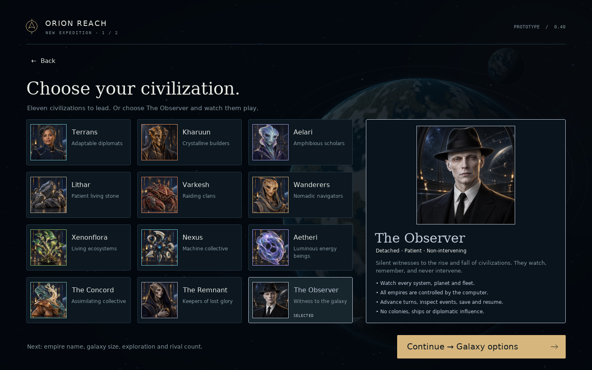

## New in v0.39: researched ship classes and drone carriers

Frigates remain the starting combat hull. **Destroyers, cruisers, battleships,
carriers and titans each require their named technology** before you can build
or design them. Completing a tier opens the next pair of technologies; it does
not award hulls that you skipped. All existing research remains available.

The new **Starship Engineering** branch keeps two exclusive choices per tier:

| Tier | First choice | Second choice | Research cost |
| --- | --- | --- | ---: |
| I | Destroyer Hulls | Modular Spaceframes: ships cost 10% fewer Resources | 40 RP |
| II | Cruiser Hulls | Deep-Space Logistics: +5 ly fuel range | 100 RP |
| III | Battleship Hulls | Drone Carriers: carrier hull and drone bays | 120 RP |
| IV | Titan Hulls | Mass Ship Production: ships cost 20% fewer Resources | 220 RP |

Research unlocks a standard ship in the paginated Shipyard and its hull in the
custom designer. The production catalogue also includes every standard class.
AI empires research, build and command the new ships under the same rules.

**Carriers launch separate, controllable drones in tactical combat.** A standard
carrier has two bays: **four active drones and eight total launches per battle**.
Each custom bay uses three support spaces, supports two active drones and carries
four drones. A carrier can move and either fire its guns or **Launch drones**
once per round. Launch fills free control slots using adjacent empty cells.
Drones can immediately move five cells and fire a three-damage pulse at range
three. They have six hull, 25% base evasion, and point defense reduces their damage.
Destroyed drones can be replaced while reserves remain. Destroying their carrier
shuts down its drones. Survivors recover after combat or retreat; the next battle
starts with replenished reserves. Drones are tactical units, never separate
campaign ships or production orders. Save/load preserves every deployed drone,
its carrier, actions, health and remaining reserves.

Seven matching transparent illustrations cover all six combat hulls and the
combat drone, appearing in research, the designer, shipyards, fleets and combat.
Original images, prompts and hashes are in `assets/ships/`.
Run `python tools/preview_ship_art.py` for the catalogue and gameplay previews.

New campaigns require all **nine** branches (30 discoveries) for Ascension Theory.
Existing saves retain their eight-branch goal and access to the cruiser and
battleship hulls that were previously available, including saved designs,
construction queues and active battles. New hulls still require research.
Save format **29** records that compatibility state and tactical drone deployments.

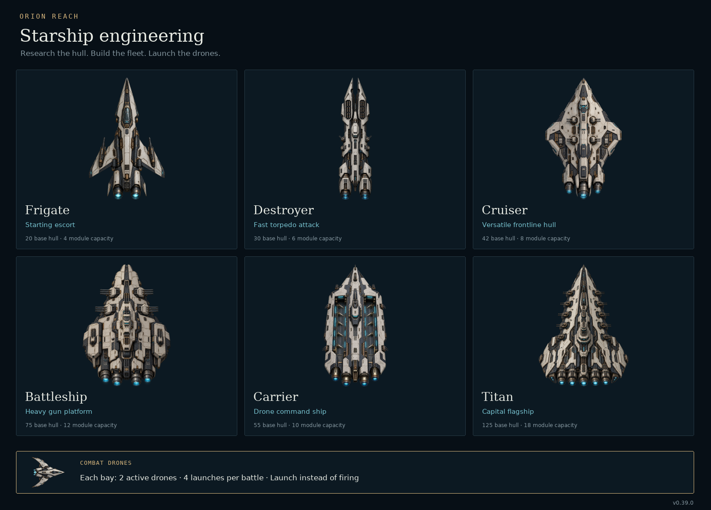

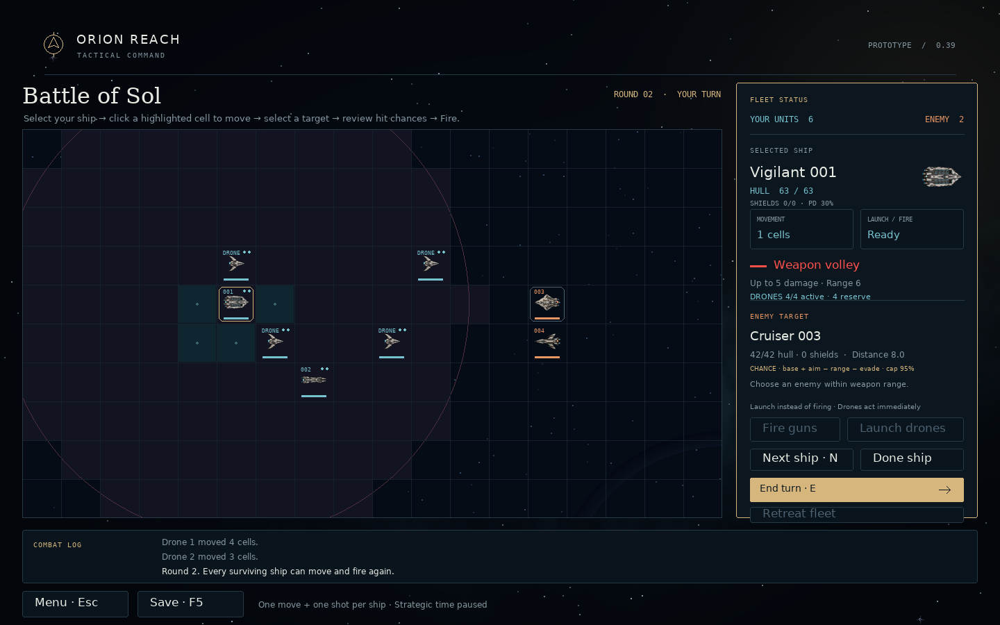

## New in v0.38.1: complete colony building artwork

Every catalogue building now has a detailed transparent illustration matching
the existing factory, shipyard and laboratory. Fourteen new sprites cover the
hydroponic farm, barracks, fortifications, missile base, planetary shield, sensor
array, jump gate, interdiction generator, all five power plants and Ascension
Gate. The complete set contains **20 building images**.

The new art appears in building lists, occupied colony slots and the planet
surface; the Ascension Gate appears in Objectives and victory results. Sprites
keep their proportions and transparent backgrounds at every size. Gameplay,
building costs and save format 28 are unchanged.

The original PNGs, complete generation prompts and an updated asset manifest
are included under `assets/buildings/`. To render the whole set using the same
loader as the game, run `python tools/preview_building_art.py`.

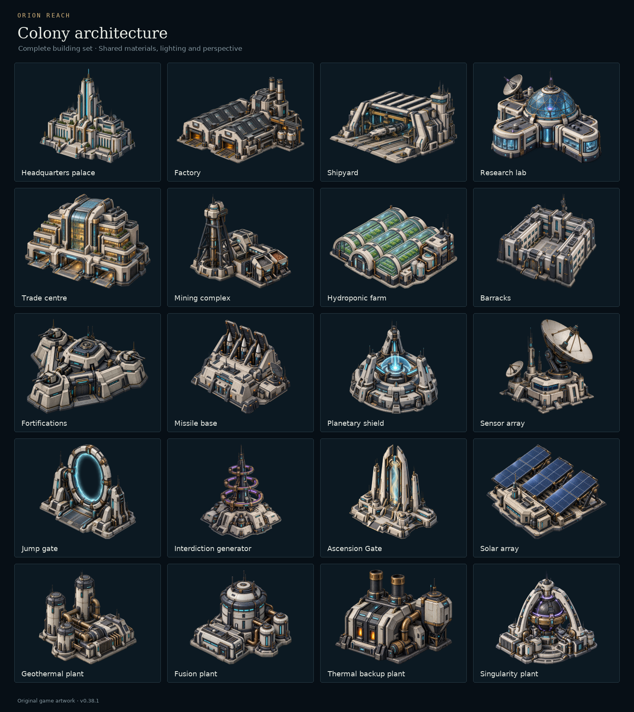

## New in v0.38: steady generation and flexible backup power

The colony catalogue now has a **Power plants** tab, with steady generators and
a Resource-burning reserve. Every plant uses one building slot. The existing
12-energy colony supply and researched empire-wide energy bonuses are retained.

| Plant | Energy per turn | Resource fuel | Credit upkeep | Research unlock |
| --- | ---: | --- | ---: | --- |
| Solar array | 12 | None | 1 | Basic technology |
| Geothermal plant | 20 | None | 2 | Deep Core Drills |
| Fusion plant | 30 | None | 3 | Fusion Power |
| Thermal backup plant | 0–24 | 1 Resource per 4 energy, rounded up | 1 | Fusion Grids |
| Singularity plant | 50 | None | 5 | Field Stabilization |

Steady sources run first. Thermal backup is **last to run** and produces only
extra energy that can supply working buildings or the Ascension Gate. It burns
nothing on standby and does not spend fuel on partial power that cannot start
another load. Multiple backup plants run in building-slot order. Credit upkeep
continues even on standby or while disabled, as with other buildings.

Fuel comes from **already stored empire Resources**. Colonies share that supply
in system/planet order, without double spending. An empty reserve causes the
normal local shutdown of buildings, while farms and mines retain priority.
Current-turn mining then enters the bank, fuel use is deducted once, and the
remaining Resources fund construction. Newly mined fuel is available to the grid
on the following turn. Resource figures show **net mining minus power fuel**;
construction forecasts include that fuel use and competing colonies.

The Power plants tab shows actual steady and backup generation, demand, fuel
cost and the shared reserve. Selecting a plant shows its current output versus
capacity. Backup plants display **Standby**, **Backup on** or **No fuel**.
The AI builds unlocked steady generation to cover sustained demand.

The existing research pairs and branch lengths stay the same. New plants are
unlocked by existing technologies; all previous effects remain. Save format
**28** is unchanged, and existing campaigns retain buildings, research and banks.

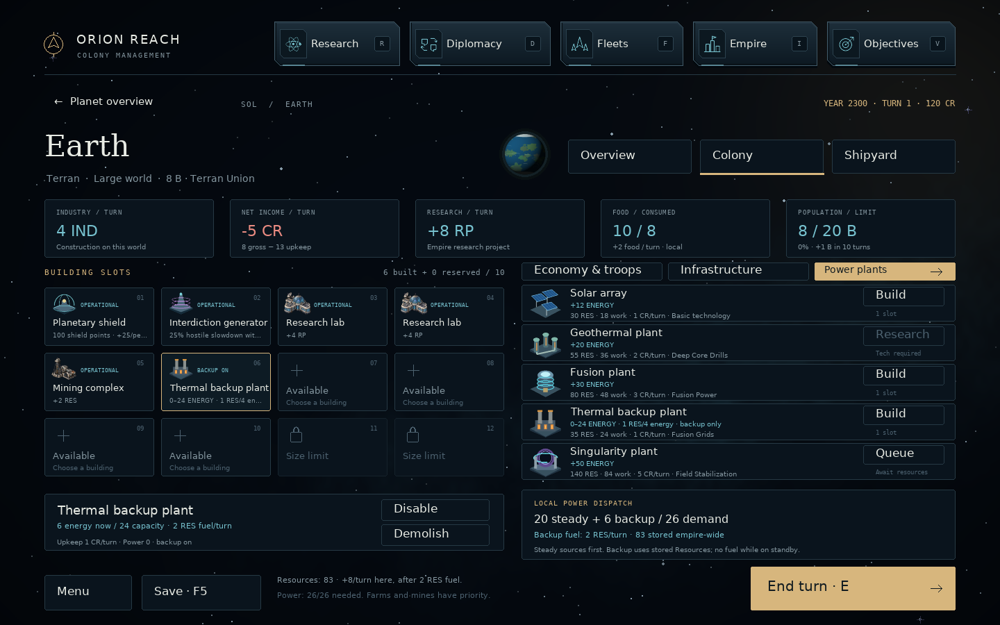

## New in v0.37: one continuous research tree

**Foundations** and **New projects** are now one sequence in each branch.
Every tier offers exactly two technologies: choosing one excludes the other,
and completing it unlocks both options at the next tier. All 52 existing branch
technologies remain, with no extra technologies added to fill shorter branches.

Branches have different lengths: Construction has **3** tiers; Power & Propulsion,
Physics and Force Fields have **4**; Computers has **5**; Materials & Chemistry,
Biology and Society have **2**. Tier buttons show completed, active, available and
locked stages. Browse them by clicking or with **Page Up / Page Down**. The screen
opens the next unfinished tier, or your active project's tier.

The first two tiers are unchanged. Orbital Defense Systems joins Construction;
Colonial Navigation joins Power & Propulsion; Advanced Torpedo Guidance and
Electronic Countermeasures join Physics. Their effects remain available.
Advanced shields, interdiction and sensor technologies unlock their buildings
even if you chose a different specialty earlier. Their stated total capabilities
replace earlier upgrade levels rather than adding them twice. Targeting upgrades
work the same way. See **Research and discovery** below for every pairing.

Scientific victory now requires completing every tier in all eight branches
before Ascension Theory: **26 discoveries**, then the 5,000-RP capstone in Objectives.
The AI follows the same sequence and exclusive choices.

Save format **28** preserves all old discoveries, even when an old campaign
already has both technologies in a newly paired tier. Active research keeps its
progress and original remaining cost. Existing Ascension Theory research,
discoveries and gates remain valid. New choices follow the unified tiers; if an
old campaign skipped an earlier tier, complete that missing tier before advancing.

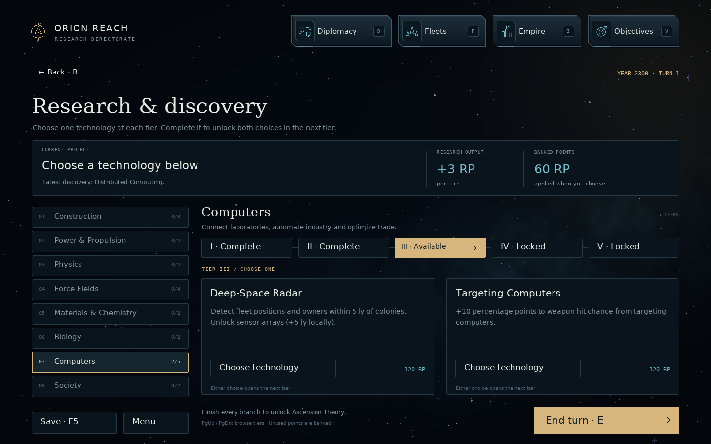

## New in v0.36.1: move groups between colony jobs

Click a worker icon, or the gap immediately before it, to select that worker
and everyone to its right. The highlighted group and an exact selected count
appear before anything moves. Click anywhere in another job row to transfer
the whole group at once. For example, with seven scientists, click just before
the third scientist to select the last five, then click Farming.

The rightmost icon selects one; clicking left of the first icon or on the role
label selects the entire row. Clicking the same row again or pressing **Escape**
cancels. **Left / Right** adjusts the selected quantity one worker at a time.
Keyboard users can focus a role with **Tab / Up / Down**, press **Enter**, adjust
the quantity, then focus the destination and press Enter again.

For large populations, the rightmost 24 workers remain individually visible.
The leading **+N** represents the preceding workers; click it to select the
whole row, or use the arrow keys to choose any exact quantity. Transfers include
captive workers, update all outputs and forecasts immediately, and autosave once.
Changing planets, leaving the screen or ending a turn clears a pending selection.
This update keeps save format 27 and works with existing v0.36 saves.

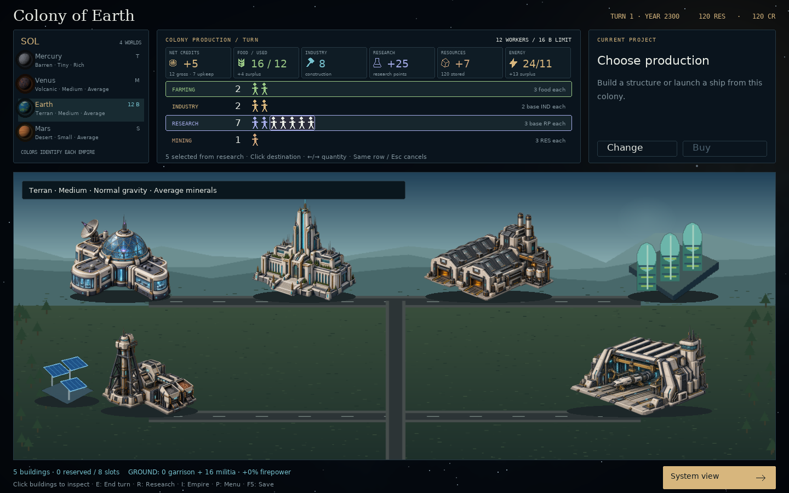

## New in v0.36: Resources, mining and local energy

**Resources** is one shared construction stockpile for each empire. Colonies
now have four jobs: **farming, industry, research and mining**. Miners produce
Resources; industrial workers turn them into buildings and ships. Credits still
pay building upkeep, diplomacy and rush production. There are no separate ores,
resource shipments or energy workers to manage.

- Every empire starts with **120 Resources**. New homeworlds assign two miners;
  a standard Terran homeworld starts with two farmers and four industrial workers.
- Every colony extracts **2 Resources/turn** automatically. Each miner produces
  **2 × mineral richness**; each powered mining complex adds **2 × richness**
  plus **1 × richness per miner**. Mining technologies improve Resource output.
- Buildings, ships and the Ascension Gate require **Resources + local work**.
  Orders can be queued without supplies. A project reserves its full Resource
  cost when it starts work, then keeps that reservation if reordered. A waiting
  project clearly reports its missing Resources. Unused materials are refunded
  proportionally on cancellation; cancelling an unpaid order returns nothing.
- Resources mined at the start of a turn are available for construction that
  turn. Colonies draw from their empire's bank in system/planet order. Queue
  forecasts account for those competing orders, mining, power and growth.
- Each colony has its own **12 energy** supply. A **Solar array** provides another
  **12**, while the new **Fusion Power** research unlocks a **Fusion plant** for
  **30**. Compact Reactors also adds **4** energy per colony, and Fusion Grids
  adds another **8**. Energy is a local supply/demand balance, never a stockpile.
- Farms and mines receive power first, then other buildings in slot order.
  Buildings that do not fit within the supply go offline, losing their output,
  workforce bonuses and military effects. You can **Disable / Enable** a building
  from its inspection panel to choose where power goes. Fixed credit maintenance
  continues while disabled or unpowered. Basic extraction and industrial work
  remain available, so a colony can build its way out of a shortage.
- Shields, missile bases, sensors, barracks, jump gates and interdiction need
  power. An Ascension Gate needs **10 spare local energy** throughout a charging
  turn, as well as clear orbit. Stored gate progress is retained during a shortage.

The galaxy header adds illustrated **Resources** and **Local energy** cards.
Click Local energy to find colonies with shortages; a surplus elsewhere cannot
power them. Planet overviews show all six economic figures and four workforce
rows. Construction lists show Resource prices, power needs and credit upkeep.
The AI assigns miners, budgets construction supplies and builds power capacity.

**Save continuity:** format **27** adds Resource banks, miners, power switches
and Resource reservations. Earlier saves receive 120 Resources per empire and
zero miners, preserving their existing job assignments. Previously paid projects
retain their credit payments and progress, finish without a second material bill,
and refund credits if cancelled. New orders use Resources. Existing buildings
use the new power rules immediately: review local shortages after upgrading.
Loading does not rewrite the source save.

Extract the update ZIP over your current installation, including
`assets/resources`, then launch `python main.py` as usual. The new artwork and
exact generation prompts are included in that folder.

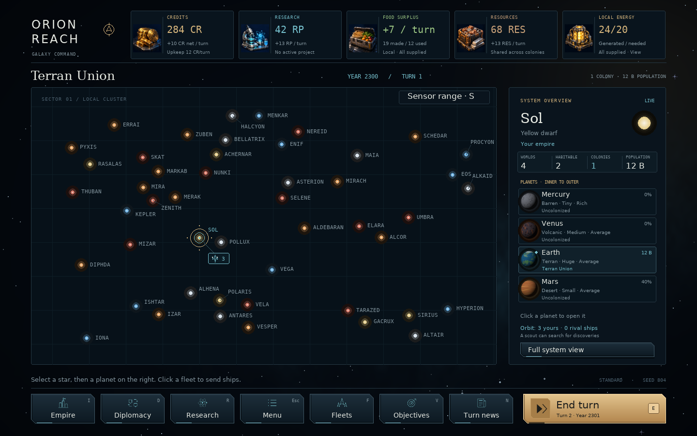
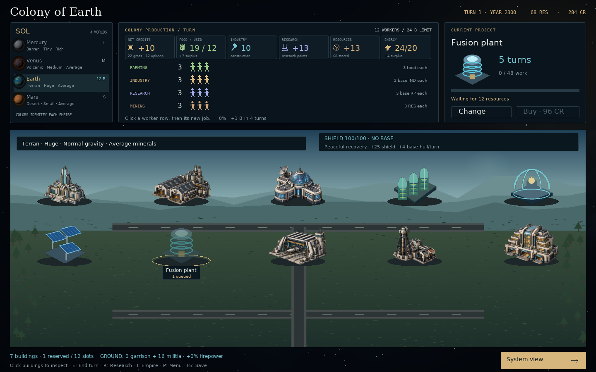

## New in v0.35.1: clear save and return options

The pause menu now has separate **Save game** and **Return to main menu**
options. Save game creates a manual save, confirms it on screen, and leaves
the pause menu open. Return to main menu keeps the existing autosave behaviour.
Manual saves and autosaves remain available under **Load Game**.

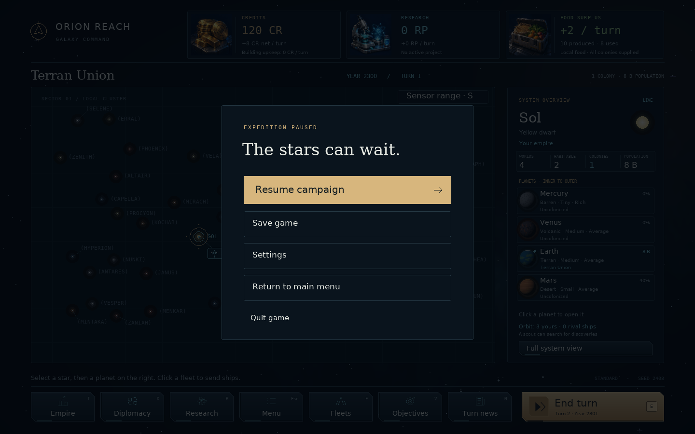

## New in v0.35: galaxy command bar and illustrated resources

The galaxy view now keeps its main navigation in one bottom command bar:
**Empire · Diplomacy · Research | Menu | Fleets · Objectives · Turn news**.
End Turn retains its original lower-right position. Menu opens the existing
pause controls for saving, settings, resuming and leaving the campaign; **F5**
still saves immediately. The standalone Save and Exploration buttons have been
removed from the galaxy screen. The exploration archive remains available with
**X**. Fleet-selection close/cancel controls remain beside their course hint.

Three original illustrated panels at the top show treasury and net credits per
turn (including building upkeep), banked research and RP per turn, and total
food production minus consumption across your own colonies. **Food is still
local**: the bar reports colonies with shortages even when the empire total is
positive. The counters use the same reports as the Empire screen, including
treaties, racial effects and captive workers.

Unexplored system names have parentheses, such as **(SOL)**. A colonized system's
name uses its owner's existing map colour. Shared systems split their letters
as evenly as possible among their distinct owners, in stable empire order:
for example **OBE** in one colour and **RON** in another. Three owners each
receive two letters of **OBERON**. Colours reflect the current view or last
survey, never undiscovered ownership changes; selection preserves these colours.
No-fog games show all names and ownership immediately.

This update retains **save format 26** and the existing economy and food rules.
Apply the update ZIP over your current installation, including its new
`assets/resources` folder. Generated resource art and exact generation prompts
are included there.


## New in v0.34: first contact and civilization personalities

Every civilization now has its own first-contact transmission: a large original
portrait, civilization seal, animated communications signal, distinct greeting and
an explanation of its disposition. **Enter** or **Escape** acknowledges the current
transmission. Multiple introductions are queued, with **Skip remaining introductions**
for that batch. Future discoveries still introduce themselves normally.

- With fog **off**, all starting civilizations introduce themselves on turn one.
- With fog **on**, either side identifying the other's ship or colony establishes
  a shared channel. Research sensors can identify a fleet without surveying its
  planets or exposing its homeworld. Third-party contacts remain private.
- Before contact, foreign identities and diplomatic actions are hidden. The
  objectives and rival-report screens remain available without a known rival.
- Awakened Remnant enclaves introduce themselves to empires that receive their
  tomb-world dispatch or subsequently discover them. Dormant tombs reveal nothing.
- The introduction pauses gameplay, then returns to the pending screen or battle.
  Completed campaigns show their result and reports without further introductions.
- Each acknowledgement is autosaved. **Diplomacy → Replay first-contact greeting**
  opens a read-only archive, even after the recent diplomatic log has moved on.

Civilization character is separate from its current relationship with you. All
new contacts begin neutral. Envoys, gifts and treaty endings show their actual
personality-adjusted effects before you commit the action.

| Civilization | Disposition | Strategic character |
| --- | --- | --- |
| Terrans | Open, pragmatic, ambitious | Reconcile readily; may challenge weaker, unfriendly neighbours. |
| Kharuun | Practical, honourable, reserved | Value reliable trade and remember damaged trust. |
| Aelari | Curious, cooperative, cautious | Welcome envoys, favour research and planetary protection. |
| Lithar | Patient, territorial, steadfast | Build defences and forgive very slowly. |
| Varkesh | Brutal, predatory, intimidating | Build fleets early and raid neighbours without active agreements. |
| Wanderers | Friendly, independent, adventurous | Welcome exchange and reconcile quickly. |
| Xenonflora | Protective, communal, watchful | Fortify living communities and react strongly to broken agreements. |
| Nexus | Calculating, unemotional, methodical | Value material exchange and assess favourable opportunities for conquest. |
| Aetheri | Mysterious, contemplative, detached | Prefer dialogue to gifts and favour defensive fields. |
| The Concord | Assimilating, relentless, collective | One will seeks to absorb independent civilizations through conquest. |
| The Remnant | Proud, secretive, possessive | Guard ancient claims and remember slights. |

**The Concord** is now the **Concord Collective**. Its greeting speaks with one
voice; its AI builds larger fleets earlier and can launch assimilation campaigns
against reachable neutral neighbours. Successful invasions retain the conquered
population and buildings under collective ownership, using the existing ground
combat rules; they do not automatically copy technologies or convert ships.
Concord trade/research agreements require **+45/+55 relations**. Envoys receive
**6 fewer** relations and gifts **10 fewer** than their base effect. Their former
extra envoy bonus is removed. Networked treaty yields (+3 CR/+1 RP) and the 10%
local credit penalty remain. Existing custom empire names are retained.

The base envoy gain is 8 plus the sender's racial bonus and the recipient's
personality modifier; the base gift gain is 15 plus the recipient's modifier.
Gains cannot fall below one. Ending a treaty costs 10 relations for Varkesh,
20 for Concord, 25 for Lithar/Xenonflora/Remnant and 15 for the others.
Wary relations (-30 through -1) recover one point at the slower civilization's
forgiveness interval (3–20 turns). Concord relationships never recover passively;
hostile wars require active diplomacy. Active treaties continue to build trust.

Terran, Nexus and Remnant AI can declare war on an unfriendly neighbour when their
known military position is favourable. Concord can also target neutral neighbours.
Decisions require two armed ships, a reachable known colony, turn 12 or later,
and a strength advantage; they are considered every six turns. Active treaties,
friendly relations and an existing war prevent these opportunistic declarations.
The AI never reads hidden enemy fleets to make this assessment. Protective races
reserve fortifications and advanced defences while preserving early expansion.
Alliances, open-border treaties and unsolicited AI treaty offers remain future work.

**Save continuity:** format **26** persists first-contact dates and acknowledged
introductions. Older confirmed contacts and active diplomatic channels are marked
as already introduced. Undiscovered empires remain hidden. Loading never rewrites
the source save, changes its empire names or grants extra starting assets.


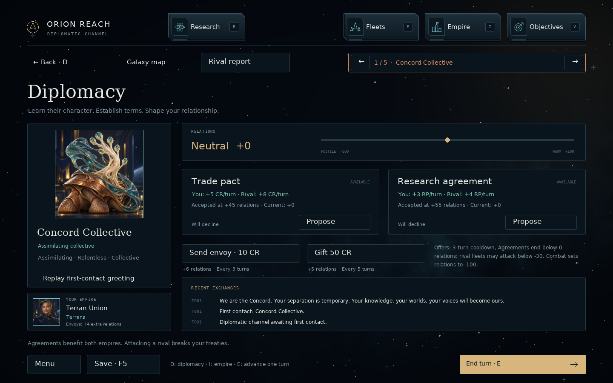

## New in v0.33: defense, sensors, navigation and targeting

Open **Research → New projects** for 19 additional technologies. They are
independent projects: existing tier-I/II choices remain intact, and you can
research every new project in one campaign. Each requires a tier-I foundation
in its branch, plus any named prerequisite. Tier III costs **120 RP**, tier IV
**220 RP**, and tier V **360 RP**. One empire-wide project runs at a time.
At that release, Ascension required tier II in the foundation branches.
**v0.37 supersedes this split** with the sequential pairs documented below.

| Technology | Branch / RP | Effect and additional prerequisite |
| --- | --- | --- |
| Advanced Fortifications | Construction / 120 | Existing fortifications improve from +50% to +75% defender firepower |
| Orbital Defense Systems | Physics / 120 | Unlock missile bases: 40 hull, 10 missile damage, range 8; immobile in fleet battles |
| Planetary Shielding | Force Fields / 120 | Unlock 100-point shields; charged shields block invasions and Varkesh raids |
| Barrier Fields | Force Fields / 220 | Planetary Shielding → 200 shield capacity; generator upkeep becomes 6 CR |
| Siege Weapons | Physics / 220 | Orbital Defense Systems → siege cannon module, triple damage against shields/bases; standard warships bombard at double damage |
| Deep-Space Radar | Computers / 120 | Detect owner and position within 5 ly of colonies; unlock sensor arrays |
| Long-Range Sensors | Computers / 220 | Radar → 10 ly and fleet counts |
| Subspace Scanners | Computers / 360 | Long-range sensors → 20 ly, ship classes and heading |
| Colonial Navigation Network | Computers / 120 | +25% travel speed between your own colonized systems |
| Jump Gates | Power & Propulsion / 220 | Colonial Navigation Network → build gates at both endpoints for +50% internal speed, replacing +25% |
| Gravity-Well Generators | Force Fields / 120 | Unlock interdiction generators: 25% hostile slowdown over the final 5 ly |
| Subspace Interdiction | Force Fields / 220 | Gravity wells → 40% slowdown over the final 8 ly; generator upkeep becomes 5 CR |
| Field Stabilization | Power & Propulsion / 120 | Halve hostile interdiction slowdown |
| Targeting Computers | Computers / 120 | +10 percentage points to hit chance |
| Predictive Fire Control | Computers / 220 | Targeting Computers → +20 points total |
| Quantum Targeting | Computers / 360 | Predictive Fire Control → +30 points total |
| Precision Beam Optics | Physics / 120 | Halve the beam range penalty |
| Advanced Torpedo Guidance | Computers / 220 | Targeting Computers → halve target evasion against torpedoes/missiles |
| Electronic Countermeasures | Computers / 120 | +10 percentage points of ship evasion |

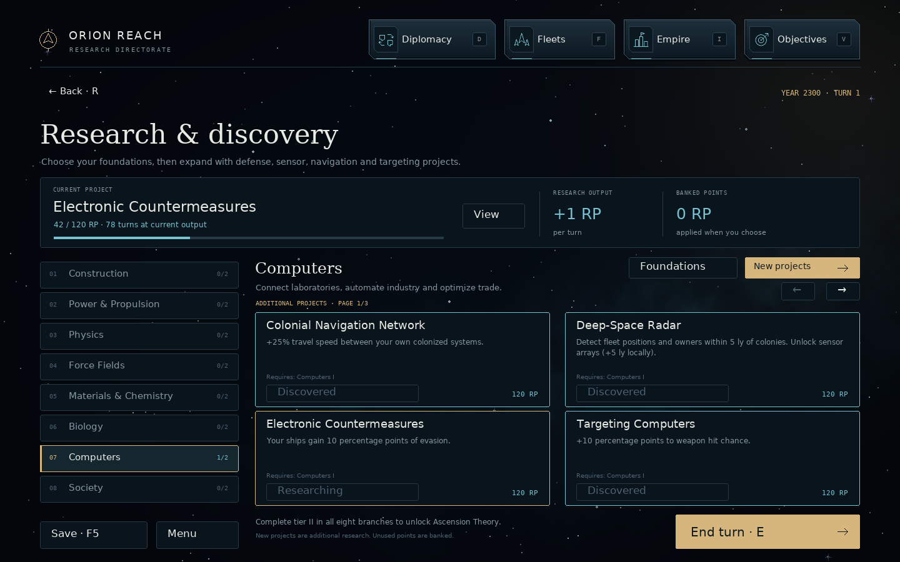

**Infrastructure:** the Colony catalogue now has **Economy & troops** and
**Infrastructure** tabs. New structures also appear in Choose production and
on the planet surface. All use one building slot and are limited to one of each
per colony. Shield and interdiction upgrades automatically improve existing
structures; the higher upkeep is included in every budget display.

| Structure | Credits / work | Maintenance per turn |
| --- | --- | --- |
| Missile base | 100 / 60 | 3 CR |
| Planetary shield | 120 / 70 | 4 CR; 6 with Barrier Fields |
| Sensor array | 60 / 36 | 2 CR |
| Jump gate | 140 / 84 | 4 CR |
| Interdiction generator | 110 / 66 | 3 CR; 5 with Subspace Interdiction |

**Sieges:** clear opposing ships, missile bases and any guardian, then open the
foreign planet and choose **Bombard defenses**. The confirmation previews exact
shield and military losses. Each armed ship bombards once per strategic turn;
shields absorb fire before excess damage removes one defending troop per 5 damage.
Siege cannons deal triple damage to planetary shields and bases, with ordinary
damage against unshielded troops. Bombardment does not kill civilian population.
It ends treaties and sets relations to −100. Landing becomes available when shields
reach zero and orbit is clear; surviving troop transports still resolve ground combat.
Shields regenerate **25 points**, and damaged bases **4 hull**, per peaceful turn;
an armed hostile blockade or bombardment on the previous turn prevents recovery.
Destroyed bases must be rebuilt. Bases cannot retreat; withdrawing a defending
fleet abandons its bases. Remnant awakenings begin underground and bypass orbital
shields, while upgraded fortifications still protect ground defenders.

**Sensors:** press **S** or **Sensor range** on the galaxy map to toggle colony
coverage. An array adds **5 ly locally**, without stacking in the same system.
Orbiting and travelling enemy fleets can appear as clickable contacts, with
intelligence limited by scanner level. Sensors never survey planets or expose
orders, destinations or blueprints. Direct observation in orbit retains its normal
fleet detail. Lost contacts retain their dated last-seen position for **20 turns**.
New hostile contacts generate saved turn news; the AI uses its own coverage and
limited observations. Friendly and neutral contacts are visible without hostile alerts.

**Movement:** colony and gate bonuses multiply normal drive and racial speed.
Interdiction affects only a hostile journey's final approach to the defended system;
only the strongest field applies. Hostile means relations below −30 without an
active trade or research treaty. Stabilization reduces 25% to 12.5%, or 40% to 20%.
Orders snapshot speed and field effects, so research, diplomacy or ownership changes
do not alter journeys already ordered. The route popup shows applied modifiers.
Travel estimates include navigation field signatures, even before a planet survey.

**Accuracy:** select an enemy to preview the exact chance, then press **Fire at
target**. Every in-range weapon rolls independently. Beams start at 85%, torpedoes
and missiles at 75%, siege cannons at 70%. Each cell beyond range 2 costs 3 points
(rounded up); beam optics halves that penalty. Hull evasion is scout 15, frigate 10,
cruiser 5, other hulls 0; custom movement changes it by 3 points per cell relative
to that hull's base movement. ECM adds 10; guidance halves evasion against missiles
and torpedoes. Bases have no evasion. Final chances are clamped to **10–95%**.
Point defense and ship shields apply after a hit. Combat logs report hit counts;
missed volleys visibly miss. Rolls use a saved deterministic sequence, so reloading
cannot reroll the same action. AI target selection considers expected damage.

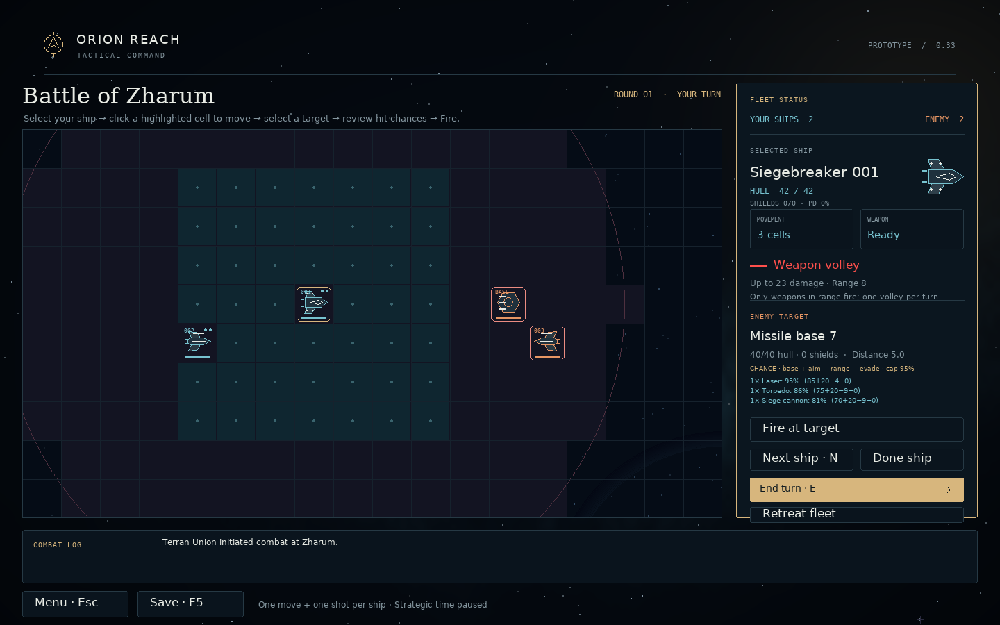

**Save continuity:** format **25** retains research, shield/base health, bombardment
use, sensor contacts/news, route modifiers and the combat roll counter. Earlier
campaigns load without changing their files. Existing voyages keep their original
speed; battles already underway in format 24 or earlier retain guaranteed hits
until they finish. All newly started battles use accuracy rules. Existing research
choices remain valid and all new projects can be added to an old campaign.

## New in v0.32: systems beside the galaxy map

Clicking a star now updates a **system overview on the right of the galaxy map**.
Its planets appear in orbital order, with planet artwork, names, environments,
sizes, mineral richness, ownership and population or habitability. System totals,
fleet counts, scout-survey status and known guardians remain visible.

- Click a planet row to open its existing planet overview directly. The
  **Galaxy map** button or Escape returns to the map, retaining your selection.
  This return path survives visits to the colony, shipyard and production views.
- Systems with more than four planets use two pages. Use the small arrows,
  Page Up/Down, or scroll over the panel. Returning from a planet restores its page.
- **Full system view** still opens the complete orbital diagram. Planets opened
  there return to that view as before. All detailed planet information is retained.
- Uncharted systems show no planet details. Remote systems show their last survey
  and its turn, with current enemy activity hidden. Live systems allow fleet or
  guardian engagements from the panel, with the existing confirmation step.
- Fleet badges and destination orders keep their existing controls. Left/Right
  browses stars; Enter focuses a planet row, then Enter opens the focused planet.

This is an interface update. Game rules and **save format 24** are unchanged;
existing campaigns can continue immediately.

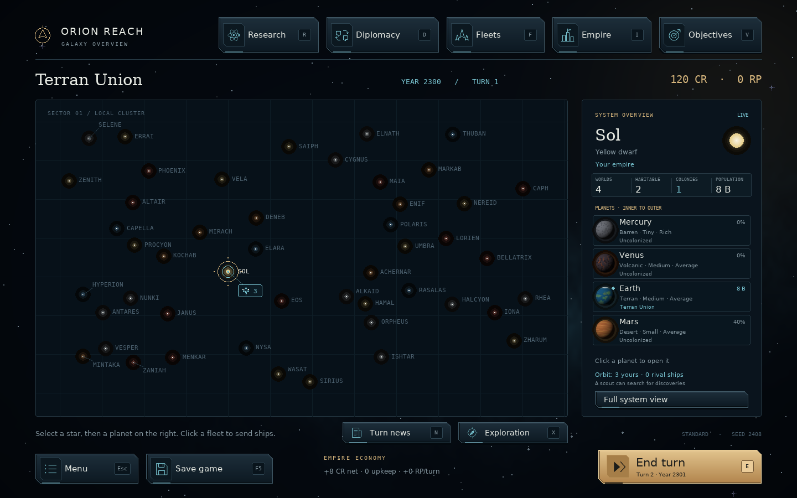

## New in v0.31: galaxy command buttons

The galaxy controls now have beveled frames, shaded surfaces and distinct icons.
Research, Diplomacy, Fleets, Empire and Objectives use the same navigation style
across the strategy screens. Keyboard shortcuts appear in separate key badges.

The gold **End turn** control shows the upcoming turn and year. Menu, Save,
Turn news, Exploration, Open system and individual ship-course controls use
matching buttons. Unread news has a gold count badge.

Hover and keyboard focus highlight the border and icon; pressing a button
visibly depresses it. Disabled actions stay dim. Releasing the mouse outside a
button cancels the press. Existing shortcuts and navigation remain available.
This is an interface update: the game rules and **save format 24** are unchanged.
Existing campaigns can continue without migration or a new game.

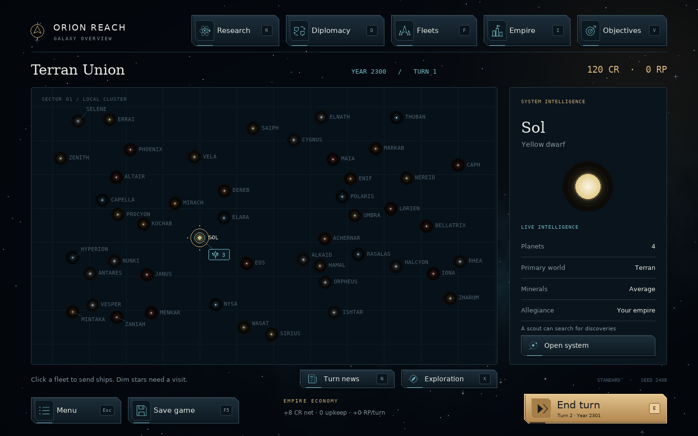

## New in v0.30: buildings, workforce and maintenance

Economic buildings now combine a fixed base output with a bonus for each
assigned worker, farmer or scientist. Trade centres also earn extra credits
from every population unit. The complete costs and effects are listed under
**Build your first colony** below.

- A factory adds **4 industry plus 1 per industrial worker**. Earth's first
  factory therefore raises its initial 6 industry to **16**, with **2 CR/turn**
  maintenance. Reassigning a worker immediately changes the bonus.
- Mines add mineral-scaled base and worker industry; labs improve scientists;
  farms improve farmers. Completed copies stack additively. Fractional mine
  and trade bonuses are totalled before rounding down once per colony.
  Native citizens and Varkesh slaves receive the same bonuses.
- All seven regular buildings cost **1–2 CR/turn** to maintain. A completed
  Ascension Gate costs **5 CR/turn**. Automatic headquarters and shipyard
  landmarks remain free. Foodless civilizations still pay upkeep on any farms.
- **Net income = gross income minus maintenance.** Racial output modifiers
  affect gross income; maintenance remains a fixed cost. Colony screens and
  Empire Overview show gross income, upkeep and net income. Building catalogues
  and inspection panels show each building's upkeep and workforce bonus.
- A building produces and incurs upkeep starting on the turn after completion;
  paid orders still in the queue incur none. Demolition stops both immediately.
  Construction forecasts include the new industry and food bonuses.
- A deficit reduces the treasury and can create **debt**. Future net income
  repays it. Existing buildings and already paid construction keep operating;
  new purchases require enough credits. There is no interest. The AI plans for
  queued upkeep, funds young colonies with trade centres, and can retire costly
  facilities to recover a deficit while preserving food supplies.

Existing campaigns gain the new economy when loaded, with their saved credits,
population, assignments, buildings and paid construction progress preserved.
No retrospective upkeep is charged. **No new campaign is required.** New saves
use **format 24** so both player and rival treasuries can retain debt.

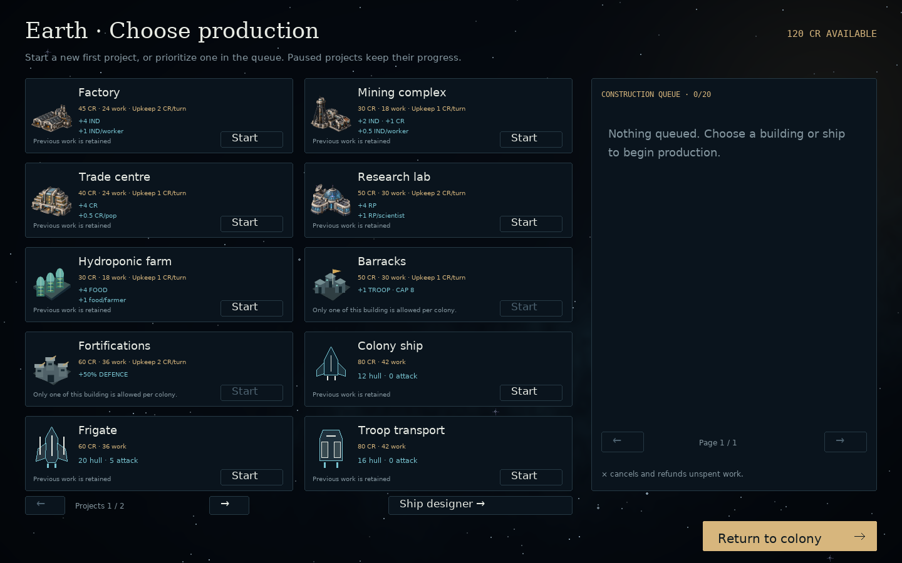

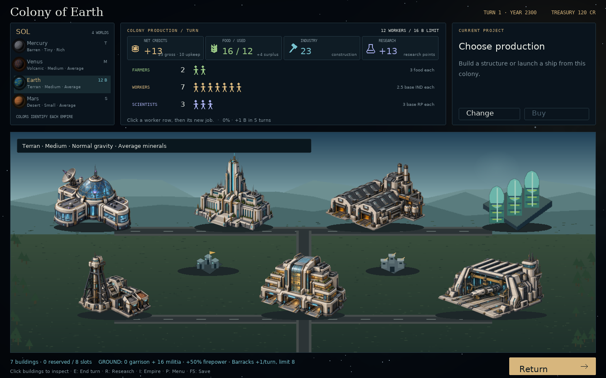

## New in v0.29: civilization home systems

Each civilization now starts with its own system and planet names, for both
players and AI empires. The galaxy-options screen shows your selected home
system and homeworld before you begin.

| Civilization | Home system | Homeworld | Other starting planets |
| --- | --- | --- | --- |
| Terrans | Sol | Earth | Mercury, Venus, Mars |
| Kharuun | Zharum | Kharduun | Orvek, Talzun, Dravik |
| Aelari | Aelys | Namaris | Syrin, Pelara, Thalun |
| Lithar | Tharok | Durath | Keld, Ormun, Voldrak |
| Varkesh | Rhazek | Drazhak | Skarn, Vordash, Kreth |
| Wanderers | Wayfarer | Haven | Ember, Landfall, Farwatch |
| Xenonflora | Viridia | Sylvaris | Rootfall, Mycela, Florath |
| Nexus | Axiom | Origin | Relay, Foundry, Matrix |
| Aetheri | Luminara | Veylume | Ilyon, Seris, Orae |
| The Concord | Seryn | Dyara | Enna, Belora, Thessa |
| The Remnant | Avarion | Elyndra | Vesper, Orath, Nyth |

Haven is the Wanderers' ancestral gathering place. Names are assigned to the
actual starting colony; the neighboring names follow orbital order. AI home
systems retain their generated planet counts. Larger systems use orbital
numbers for extra worlds, such as **Zharum V**. If a custom game uses the same
civilization twice, the second name set gets a suffix, such as **Rhazek 2** and
**Drazhak 2**, so systems and planets remain distinct.

Starting locations, biomes, orbits, resources, fleets and population are
unchanged. **Start a new campaign for the new names.** Loading an existing save
preserves all current names and surveys. An AI newly added to a solo campaign
receives its own home names, without revealing changes to previously surveyed
colonies. Captured worlds and awakened Remnant tombs retain their existing names.
That release used **save format 23**, compatible with v0.28.

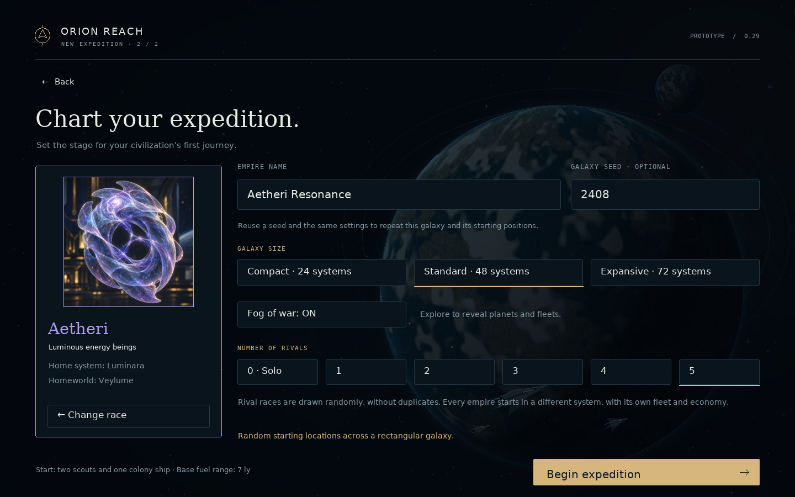

## New in v0.28: Varkesh raiding clans

The Varkesh now raid for captives and credits instead of colonizing worlds.

- **Movement:** ships travel **50% faster** and have **50% more fuel range**:
  initially **3 ly/turn** and **10.5 ly**. These are multipliers on researched
  speed and range, so fuel-tank and drive improvements also receive the bonus.
- **No colonization:** the Varkesh cannot settle any biome or order new colony
  ships. Their new-campaign fleet is **two scouts, one frigate and two troop
  transports**. Other civilizations retain their normal starting fleets.
- **Raiding:** clear hostile ships from orbit, open an enemy colony and choose
  **Plan colony raid**. Review the ground-combat preview, then **Launch raid**.
  Garrisons, militia and fortifications use the existing combat rules. Failed
  raids take nothing. Transport losses follow casualties, rounded up to full loads; full surviving squads re-embark.
- **Captives:** a successful raid transfers population to the original Varkesh
  homeworld, up to **100 slave population units in addition to native citizens**.
  One slave unit represents the same 1 B population unit used by the workforce.
  People who do not fit remain on the target colony. Existing slaves on another
  Varkesh homeworld transfer before its native population.
- **Plunder:** a successful raid steals up to **10 CR per population unit on
  the target before the raid**, capped by the victim's treasury. Credits are
  transferred, not generated. Credit raids still work when the slave limit is full.
- **After the raid:** captives and surviving raiders return home immediately;
  surviving raiders reinforce the home garrison. Inhabited colonies keep their
  owner, buildings and paid projects. A completely emptied colony is abandoned,
  losing its buildings, queued projects and Ascension Gate. Raids end treaties
  and set relations to −100. Emptying an empire's final colony eliminates it.
- **Slave economy:** slaves share farmer, worker and scientist assignments with
  native citizens. Their output, credit income and food consumption match native
  workers under the current racial and research bonuses. Slaves do not reproduce
  or contribute militia. Native population retains its normal growth and limit.
- **Mortality:** each slave unit present at turn start has an independent **5%
  chance of dying at turn end**, after that turn's production and income. Native
  citizens are unaffected. Save/reload preserves the rolls; construction forecasts
  include future mortality. AI raids' newly acquired captives first face mortality
  in the next complete turn. Deaths appear in the turn notification.
- **Liberation:** ordinary conquest or a successful Remnant awakening frees a
  captured stronghold's slaves into normal population. They stop suffering slave
  mortality and keep their workforce assignments. Liberated population may exceed
  its new owner's normal growth limit; it does not grow further while above it.
- **AI and news:** Varkesh rivals build and dispatch raiding forces, prefer larger
  vulnerable colonies and respect their active trade/research treaties when
  choosing victims. Dispatching a raid makes relations hostile so the raiders
  engage orbiting defenders before landing. Battle results and the last 100 raid events are saved.
  Private raid dispatches appear in **Turn news · N** alongside tomb awakenings.

The Varkesh retain their existing 20% ship discount, +50% native population
capacity and −20% colony research output. Balance constants are in
`orion/raiding.py` and `orion/races.py`.

**Existing saves work immediately:** Varkesh empires start with zero slaves and
gain the new rules. Existing colonies, ships, paid construction and journeys
are preserved. Previously built colony ships can explore but cannot colonize;
queued ones can finish or be cancelled normally. The special starting fleet
requires a new campaign.

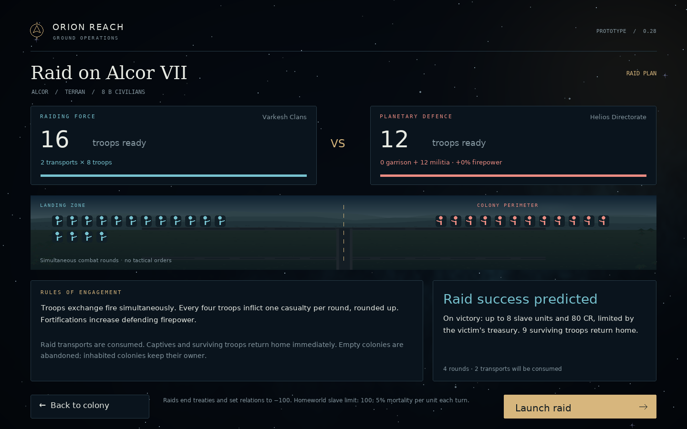
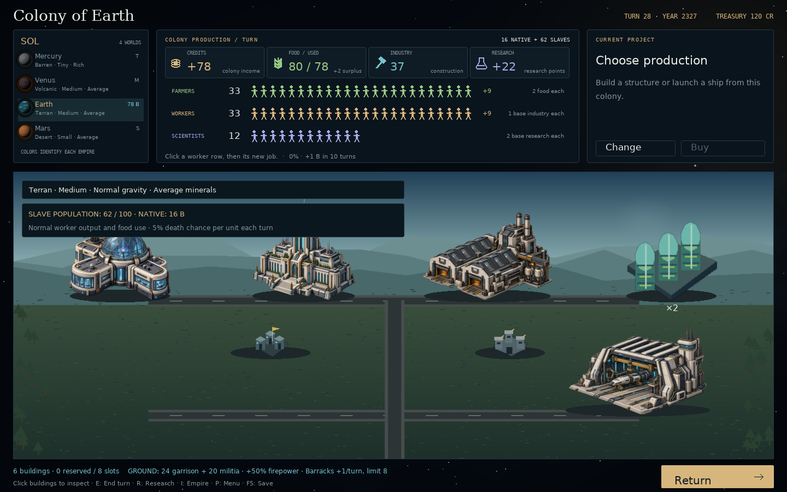

## Remnant tomb worlds

Ancient Remnant vaults can sleep beneath any planet, including starting colonies,
harsh worlds and guardian prizes. Tomb status is hidden and separate from biome.

- **Generation:** every world has an independent **10%** chance of being a tomb
  world when a new campaign is created.
- **Awakening:** each dormant tomb has a **1-in-200 chance per completed turn**.
  An awakening happens only once, even if its army is defeated. Saving and
  reloading cannot reroll the next turn.
- **Uncolonized worlds:** become Remnant colonies with **2 B population**, a
  hydroponic farm and **16 garrison troops**. Their buried habitats support life
  on any biome. They begin contributing income on the following turn.
- **Occupied worlds:** **16 awakened troops** fight the colony's militia and
  garrison using the normal ground-combat rules. Fortifications apply; ships in
  orbit cannot prevent an army emerging underground. Survivors occupy captured
  colonies. Civilian population and ordinary buildings/projects survive; capture
  destroys an Ascension Gate. Defenders can repel the awakening.
- **Remnant ownership:** tombs join the player if playing the Remnant, otherwise
  the existing Remnant AI. A tomb already owned by the Remnant adds its troops
  to the garrison. If no Remnant empire exists, a successful awakening establishes
  an enclave, including a possible sixth AI empire after a five-rival start.
  A defeated Remnant AI can return while the campaign is still in progress.
- **Turn news:** worlds in systems your empire has already explored produce
  “Tomb world [name] has awakened as a tomb world of the Remnant.” Open **Turn
  news** on the galaxy map or press **N** to revisit saved reports. New reports
  open automatically after any ground battle reports. Remote dispatches do not
  refresh stale surveys, and unseen awakenings do not reveal unexplored worlds.
- **Guardians:** continue guarding their systems after vaults awaken; awakening
  does not defeat a guardian or grant its reward.

Start a **new campaign** for tomb worlds. All earlier saves remain loadable and
retain their existing galaxy without adding hidden vaults retrospectively.
Awakening outcomes and private news are saved; detailed ground casualty replays
remain a session view. The constants in `orion/tomb_worlds.py` control the odds,
army size and initial population.

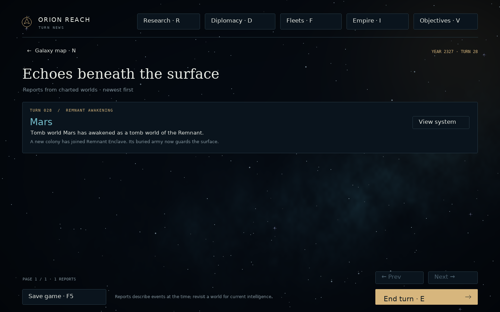

## Ground forces and invasions

Colonies now have standing garrisons, militia and fortifications. Ground battles
resolve automatically, with a landing preview and a round-by-round casualty report.

- **Barracks:** 50 CR, 30 work, one building slot. Trains one garrison troop per
  turn up to eight, starting the turn after completion. One per colony. Also
  enables construction of troop transports on that colony.
- **Fortifications:** 60 CR, 36 work, one building slot. Gives all defending
  troops **+50% firepower**. One per colony; no stacking.
- **Troop transports:** include eight expeditionary troops in their existing
  cost. They recruit separately from the local garrison; no manual loading is needed.
- **Militia:** colonies start with `4 + population` militia. Casualties persist
  and one militia troop remusters per turn. Troop losses do not remove civilian
  population or change worker assignments.
- **Invasions:** clear enemy ships, open the rival planet, choose **Plan ground
  invasion**, review the preview, then **Launch invasion**. Full surviving squads return to their transports; leftover troops
  form the occupation garrison. Transport losses round casualties up to full loads; captured
  militia start at zero and remuster gradually. Occupation forces above eight
  are retained, but barracks cannot replenish beyond their training limit.
- **AI:** trains defenders, builds fortifications and assembles enough transports
  for the known defences. Its invasions use the same rules. Attacks on your
  colonies produce battle reports before any campaign defeat screen.

Existing campaigns can use these features immediately. Old colonies start with
zero trained garrison and full militia; existing transports and paid orders are
preserved. No new campaign is required. Battle outcomes and casualties are saved;
the displayed casualty report is a session view, not a saved replay.

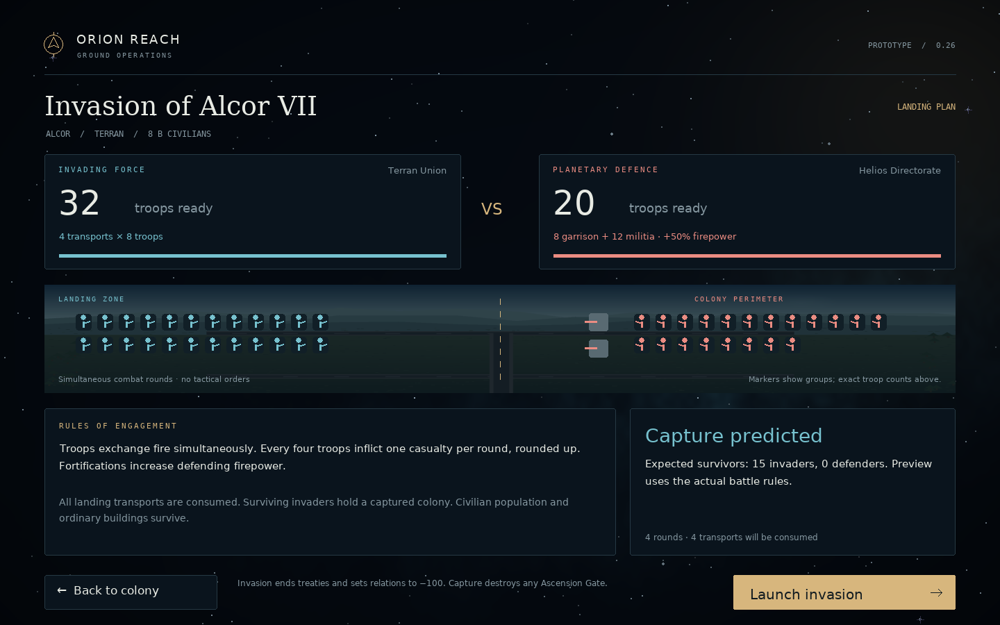

## Fully random surroundings

Starting neighborhoods are now left as generated. No stars are moved closer to
an empire and no nearby planets are made colonizable. You may start with several
reachable neighbors, an isolated home system, or no habitable world in range.
This applies to both the player and AI empires; the same seed and options still
reproduce the same galaxy. Start a **new campaign** to use this change.

## Rectangular galaxies and shorter fuel range

New galaxies use the full rectangular map, including the corners. Player and
rival starting locations are random within that area. Star names move around
nearby stars to remain readable and stay inside the map.

The **base fuel range is now 7 ly instead of 35 ly**: one-fifth of the previous
radius. This applies to new travel orders for every empire. Speed remains
**2 ly per turn**. The Wanderers' starting bonus is also divided by five,
from +15 to +3 ly, giving them 10 ly initially instead of 50. Fuel research
still adds +10 and +15 ly, on top of each race's starting range.

The number of reachable neighboring systems and their planets are random.
Further expansion depends on new colonies and fuel-tank research; an isolated
start may need better fuel tanks before exploring another system. Guardians
remain at least 28 ly from starting home systems.

Start a **new campaign** for the rectangular layout. Existing saves keep their
system positions and already-issued journeys, including their remaining travel
times. New or redirected orders use the reduced range; returning to your own
colonies is always possible.

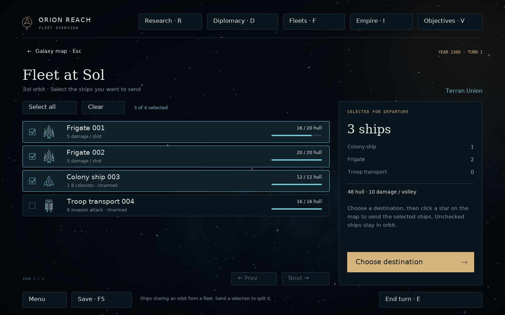

## Random rivals and starting positions

On the second **New Game** screen, choose **0–5 rivals**. Their races are drawn
randomly without duplicates, excluding your own race. Empire name, galaxy size,
seed and fog of war remain on this screen; your race is still selected first.

Your civilization's home system appears at a random location. Rival home systems
are also chosen randomly, with a preference for at least 20 light-years between
starting empires. When a crowded map has no suitable separated system, the next
home uses the most distant available system. Every empire starts in a different
system with a standard Terran homeworld, 8 billion inhabitants, 120 credits,
120 Resources,
two scouts and one colony ship, or the Varkesh raiding fleet. Racial traits apply normally. Reusing the same
seed and settings reproduces the galaxy, races and starting locations.

Every rival has its own economy, research, colonies, fleets, diplomatic
relationships and exploration knowledge. Use the arrows at the top of
**Diplomacy** and **Rival report** to switch contacts. Map colors identify each
empire. If several rival fleets share your system, use the target selector
beside **Engage opposing fleet** to choose whom to fight. Battles between AI
empires resolve automatically using the same tactical rules.

Conquest requires eliminating **all** rivals; losing your own last colony ends
the campaign. Any empire can pursue the scientific victory. Guardian systems
stay away from every starting home, so crowded maps may contain fewer guardians.
Choosing zero rivals allows a solo exploration campaign.

Existing saves keep their original opponents, positions and progress. Start a
**new campaign** to use the new rival count and randomized starts.


## Races and two-step setup

**New Game** first opens a portrait gallery of all eleven races. Select a race
to see its identity and implemented abilities, then choose **Continue → Galaxy
options**. The second screen contains your empire name, seed, galaxy size,
fog-of-war toggle and rival count. **Change race**, Back and Escape return to the
first screen without losing your settings. Custom empire names are preserved.

Eight new races join Terrans, Kharuun and Aelari. Player and AI use the same traits:

| Race | Initial gameplay traits |
| --- | --- |
| Lithar | Settle every biome; double population capacity; half food consumption, rounded up; one-quarter normal growth rate. |
| Varkesh | Cannot colonize; ships travel 50% faster and farther; raids take credits and up to 100 slaves at home; 5% slave mortality each turn. Ships cost −20%; native capacity +50%; research −20%. |
| Wanderers | +3 ly fuel range from colonies; ships cost 15% fewer Resources; colony industry −15%. |
| Xenonflora | On Terran, Ocean and Gaia: +3 food and +50% growth; industry −25% on other biomes. |
| Nexus | Settle every biome; no food; gross industry +25%; industry assembles new population. |
| Aetheri | Settle every biome; no food; grow by 10 progress per turn; colony research +25%, industry −20%. |
| The Concord | Assimilating collective; networked trade pacts +3 CR and research agreements +1 RP per turn; colony credit income −10%. |
| The Remnant | Start with 80 unspent research points; colony research +25%, industry −20%; awakened tomb worlds join the empire. |

Nexus reserve **20% of gross industry**, rounded up, for assembly until the
population limit, always leaving at least one industry for construction. Each
reserved industry produces 5 growth progress, capped at 25 per turn; 100 progress
adds one billion inhabitants. The planet screen shows the reserved industry and
net construction output. Assembly stops at capacity. Aetheri add one billion
every ten turns while below capacity, independently of food. Foodless races
start without farmers, and their AI does not build farms. Their food bonuses
have no effect. Construction forecasts account for assembly and racial growth.

Racial output modifiers apply after workers, buildings and technology; positive
output bonuses round up, penalties round down, with a minimum of one industry.
Growth uses whole progress points, rounded down with a minimum of one when food
allows growth. Credit discounts add to research discounts and apply to standard
ships and new custom-design orders. Existing payments and ships are unchanged.
Racial capacity and output follow the current owner; mixed-species populations
are not simulated yet. Population limits in the colony UI include racial traits.

This is the **first playable trait version**. All races still use planet-based
colonies. The Varkesh use one homeworld, a starting raiding fleet and captive labor;
other races start with two scouts and one colony ship. Tribute remains future work. Wanderers do not
yet live on mobile arks or move shipyards. Biological ship modules, energy-ship
combat abilities, migration and Remnant relic recovery also remain future work.
The original three races retain their existing rules. Start a new campaign to
choose a new race; existing campaigns keep their identities and progress.


## Ship designer

Open **Fleets → Ship designer**, **Shipyard → Custom ships / designer**, or
**Planet → Change → Ship designer**. Choose a hull, enter a name, and add or
remove modules with the + / − buttons. Save your blueprint, choose an owned
colony with the arrows, and click **Queue ship**. Designs also appear in the
planet's **Change production** catalogue; use its page arrows for more projects.
Ships reserve Resources when work begins and use the colony's usual construction
queue, industry, buy-production and cancellation rules. Ship discounts apply.

| Hull | Base hull | Shared capacity | Weapon limit | Defense limit | Support limit | Tactical movement |
| --- | ---: | ---: | ---: | ---: | ---: | ---: |
| Frigate | 20 | 4 | 3 | 2 | 1 | 4 |
| Destroyer | 30 | 6 | 4 | 3 | 2 | 4 |
| Cruiser | 42 | 8 | 5 | 4 | 2 | 3 |
| Battleship | 75 | 12 | 8 | 6 | 2 | 2 |
| Carrier | 55 | 10 | 3 | 4 | 6 | 2 |
| Titan | 125 | 18 | 12 | 9 | 3 | 1 |

Category limits count **capacity units**, not the number of modules, and share
the hull's total capacity. Frigates are available from the start; other hulls require their named Starship Engineering research. Every
saved design must contain at least one weapon or a carrier drone bay. Empty capacity is allowed.

| Module | Capacity | Effect | Unlock |
| --- | ---: | --- | --- |
| Laser cannon | 1 weapon | 5 damage, range 6 | Starting equipment |
| Torpedo launcher | 2 weapon | 10 damage, range 8 | Starting equipment |
| Quantum battery | 2 weapon | 14 damage, range 7 | Quantum Optics |
| Siege cannon | 2 weapon | 8 damage, range 6; triple against shields and bases | Siege Weapons |
| Armor plate | 1 defense | +8 hull, −1 tactical movement, minimum 1 | Starting equipment |
| Shield generator | 1 defense | +12 shields | Radiation Shields |
| Point defense | 1 defense | −30% incoming torpedo and drone damage per module, capped at −60% | Starting equipment |
| Maneuvering thruster | 1 support | +1 tactical movement | Ion Drives |
| Combat scanner | 1 support | +1 range for all weapons, maximum one scanner | Research Networks |
| Drone bay | 3 support | Carrier only; 2 active drones and 4 launches per battle | Drone Carriers |

Each ship moves once and fires one volley per tactical turn. A carrier can launch drones instead of firing. **Only mounted
weapons within range fire**, so a distant target may receive only your torpedoes.
Each mounted weapon rolls its displayed hit chance. Point defense reduces each successful torpedo, missile or drone hit before shields absorb it; remaining
damage hits the hull. Shields do not regenerate during a battle and start full
at the next battle. Beams retain their technology's color; torpedoes travel as
projectiles, and destroyed ships retain the explosion effect. Armor adds hull
instead of a second damage-reduction calculation. Hull size, armor and thrusters
affect tactical movement; strategic travel speed and fuel range keep their existing rules.

Up to **24 blueprints** can be saved per campaign. Select one to update it, or
rename it and choose **Save as new**. **Updating a blueprint changes future orders
only.** Ships already built and projects already queued retain their name, hull,
equipment, costs and work requirement. Newly researched equipment must be fitted
to a design; designed ships do not receive automatic upgrades. Blueprints and
orders autosave when saved or queued through the designer. F5 saves the campaign;
unsaved edits in the designer are only a draft.

Existing saves can use the designer immediately. Their fleets and queued projects
remain standard ships; standard frigates retain their original research-based
laser/quantum upgrade. The AI still builds its standard catalogue in this first
version. Refitting, power budgets, racial module systems and AI design selection
are future work.


Development previews:

```sh
python main.py --headless --screen designer --screenshot screenshots/designer.png
python main.py --headless --screen design_combat --screenshot screenshots/design_combat.png
```

## Run

Use a desktop computer with **Python 3.10 or newer**. This is a desktop Python
application; it does not run inside the ChatGPT Android app. Tested here on
Linux with Python 3.12.14 and pygame-ce 2.5.8. Windows/macOS launch scripts are
provided, but those platforms have not been tested in this environment.

**Recommended during development: Anaconda / Miniconda.** Extract the entire
ZIP and open Anaconda Prompt (or a terminal with Conda initialized). Change
directory into the extracted `orion_reach` folder, then run:

```sh
conda create -n moo2 python=3.12
conda activate moo2
python -m pip install -r requirements.txt
python main.py
```

The environment creation and dependency installation are one-time steps.
For later sessions, return to the project folder and run:

```sh
conda activate moo2
python main.py
```

Edit the Python files in your preferred editor, then close and restart the
game to see your changes. Tracebacks appear directly in the terminal.

Startup shows the supplied **Atlas Forge Games** logo for approximately 2.5 seconds,
then opens the main menu. Click or press any key to skip. The intro appears only
when launching the application; returning to the menu does not replay it. A small
studio credit also remains on the main menu. The Animated Background setting
also controls the intro's short fade.

For quick development launches, bypass the intro:

```sh
python main.py --skip-intro
```


**Optional Windows launcher:** open the extracted `orion_reach` folder and
double-click **launch.bat**. This creates its own `.venv` and installs the
dependency on its first launch. Python must already be installed. Use the
command-line route above when working in your Conda environment.

**macOS/Linux:** extract the ZIP, open a terminal in `orion_reach`, then run:

```sh
sh launch.sh
```

**Or use an existing Python environment**, from the project folder:

```sh
python -m pip install -r requirements.txt
python main.py
```

Only pygame-ce is required at runtime. The first dependency installation needs
internet access; the game itself works offline. pygame-ce is imported as
`pygame`; use a clean environment if you already have the separate `pygame`
package installed. Official documentation: <https://pyga.me/docs/>.

## Included

- Four neutral guardian types protecting Gaia worlds, ultra-rich worlds, ancient ruins and systems with three prize worlds.
- Skippable Atlas Forge Games studio splash and main-menu logo credit.
- Animated title screen: **New Game, Load Game, Settings, Quit**, plus About.
- **Distant Stars** background music, with a separate music toggle and volume control.
- **Continue** appears when a campaign is already open in the current session.
- Two-step New Game setup: choose one of eleven illustrated races, then set
  empire name, galaxy size (24/48/72 systems), optional seed, **Fog of war ON/OFF** and rival count.
- Click a star to inspect its **system and planets beside the galaxy map**.
  Click a planet row to open it directly, or choose **Full system view** for the orbital diagram.
- New empires begin with **two scouts and one colony ship**, or the **Varkesh raiding fleet**, in their home system.
- Click a **fleet badge** to open a small popup on the galaxy map. Select ships,
  then click a destination star. Click their departure star to cancel before End Turn.
- Early ships travel at **2 light-years per turn** and can reach destinations
  within **7 light-years of any owned colony**, plus racial and research bonuses. Range circles and route feedback
  help choose destinations; colony expansion and fuel-tank research extend supply.
- Build cheap **scouts** to reveal worlds and recover one-time discoveries.
  **Exploration · X** records recovered caches, archives and derelict probes.
- Click a planet row, or its globe/caption in the full system view, to open its **planet overview**: environment,
  size, gravity, minerals, habitability, orbital distance and colony status.
- The planet overview includes a **colony surface scene** with illustrated buildings
  and landscapes for all six environments. Click a building to inspect it,
  the shipyard to build ships, or the headquarters palace to open the empire report.
- Terran players start with Sol's Mercury, Venus, Earth and Mars; other
  civilizations have their own names. Other systems have reproducible
  planet data and distinct illustrations for six environment types.
- The planet screen centres on the colony landscape. A system directory sits at
  top left, visual output totals and worker assignments across the top, and
  the current construction project with **Change** and **Buy** at top right.
  **Return** at bottom right goes to the solar-system overview.
- Each billion inhabitants is one worker, assigned to farming, industry,
  research or mining. Earth starts with two farmers, four industrial workers
  and two miners.
- Construction queues show progress and completion estimates. Completed
  powered buildings improve output and workforce productivity. Cancel projects
  for unused construction payments, or demolish buildings to free a slot.
- **Empire Overview** combines economy totals and a sortable colony directory.
  Open it with **Empire · I** or the **I** key from any gameplay screen. Click
  a colony row to open its planet overview.
- Build colony ships in the **Shipyard**, send them from the galaxy map or **Fleets**, advance
  travel with End Turn, and settle new worlds from their planet overviews.
- Build **frigates**, then **Engage** opposing fleets in the same system. A dedicated
  tactical battlefield lets ships maneuver and fire by clicking enemies, with
  coloured beams, impact flashes and destruction explosions. Damaged ships can
  repair at friendly colonies.
- Build **barracks** and **troop transports**, clear opposing ships, then **Plan ground invasion** from a
  rival planet's Overview tab. Capturing its last colony wins by conquest.
- **Objectives · V** tracks both victory paths. Finish all required research branches,
  research **Ascension Theory**, then construct and charge an **Ascension Gate**
  to win through science. The AI can win by either path too.
- The galaxy map shows flight paths, ship positions and newly claimed systems.
- The **Helios Directorate** develops its economy, builds colony ships, travels
  between systems and settles unclaimed worlds on each End Turn. Open
  **Empire → Rival report** to inspect its economy, colonies and recent activity.
- Cyan marks your colonies and ships; each rival has a distinct map color. Rival worlds
  can be surveyed, with construction controls disabled.
- **Diplomacy · D** opens race portraits and profiles, relations, envoys, gifts, trade pacts,
  research agreements and the rival's recent responses. Treaty income is
  included in Empire Overview and Rival report.
- **Research · R** opens nine branches, each with sequential tiers and two mutually
  exclusive choices per tier. Discover technologies that improve production,
  science, commerce, construction prices, travel and colonization. The rival researches too.
- Back buttons and Escape follow **Colony → Planet → Galaxy**, or return through
  **System** when the planet was opened from the full orbital diagram. Pause, settings
  and Continue preserve the active overview. Use the planet list to switch
  worlds, or Left/Right; system Previous/Next controls browse other systems.
- These are separate full-window screens inside the game, not additional
  operating-system windows.
- Real JSON saves: one autosave and any number of separate manual snapshots.
  Load Game shows dates, empire names and turns, with pagination.
- Autosave on campaign creation, construction orders/cancellations/demolition,
  ship orders, settlement, adding a rival, diplomatic actions, research choices,
  worker moves, production purchases/priorities, every combat action, invasions,
  gate orders, End Turn, return to menu and normal exit.
- Fullscreen, animated background, interface sounds, music on/off and music volume persist.
- Mouse and keyboard navigation, resizing with correct letterboxed hit regions.
- Damaged/incompatible saves appear as unavailable instead of crashing the app.

**Scope:** construct buildings, colony ships, frigates and troop transports, travel between systems, and
found additional colonies alongside an expanding AI empire, and negotiate
trade and research agreements, make permanent technology choices, fight fleet battles,
feed and grow colonies, invade worlds and win through conquest or science.
Food shipments, manual ground tactics and advanced racial ground abilities are future work.
Planet attributes, population and
habitability are illustrative game data. Sol intentionally includes only four
inner worlds; its artwork is stylized.

## Background music

**Distant Stars** plays from startup through the menu and all game screens. It
streams directly from the supplied MP3 and repeats when the track ends, without
restarting when you open another screen or load a campaign. The original intro
and ending are retained; this is not a remastered seamless loop.

- Open **Settings** from the main menu, or **Escape → Settings** while playing.
- **Background music ON/OFF** pauses and resumes the track at its current position.
- **Music volume − / +** adjusts between 0% and 100% in 10% steps; the default is
  **30%**. Setting 0% pauses music until the volume is raised again.
- **Interface sounds** remains an independent setting. Adjusting the music volume
  while music is OFF remembers the new level without unmuting it.
- Preferences apply immediately and survive restarting. If your older settings
  had interface sounds OFF, music initially starts OFF as well; enable it separately.
- Missing music or an unavailable audio device never prevents gameplay. Screenshot
  capture mode does not initialize or play audio.

The soundtrack is bundled at `assets/audio/distant-stars.mp3`. It is approximately
4:03, stereo, and unchanged from the uploaded file. Credits and provenance are in
`assets/audio/README.md` and **About**. No extra Python dependencies or conversion
tools are required to play it.


## Planet overview and worker assignment

Open a planet from its solar-system overview. Its landscape and buildings fill
the main view. The left panel lists every surveyed planet in the system with
basic information; click a row to switch planets. The top strip shows this
colony's **net credits, food, industry, research, Resources and local energy**
with distinct icons and colours. Shared Resource and credit banks are separate
in the title bar.

Every **1 billion inhabitants is one worker**. Click a worker icon or the gap
before it to select everyone from that point to the right, then click another
row to move the group. Click the last icon for one, or left of the first for all.
The highlight and selected count preview the transfer. Left/Right adjusts the
quantity; the same row or Escape cancels. Each transfer is free, autosaves once,
and immediately updates output and construction forecasts.

- **Farmers:** produce food at the biome-specific rate shown below, plus
  **1 food each per powered hydroponic farm**.
- **Industry:** workers produce 1 industry each, plus **1 per powered factory**,
  in addition to flat building and technology output. Every colony has at least
  1 basic industry, even with no industrial workers.
- **Research:** scientists produce 2 research each, plus **1 per powered lab**,
  in addition to flat laboratory and technology output.
- **Mining:** miners produce **2 Resources each**, plus **1 per powered mining
  complex**, multiplied by mineral richness. Every colony also extracts 2 basic
  Resources, and each powered mine contributes a further mineral-scaled base 2.

Powered buildings retain their flat output even when nobody works in the
relevant job. Workforce bonuses scale with that job's assigned population.
Tax income is 1 credit per billion inhabitants, plus **0.5 per powered trade
centre**, regardless of job; fixed building maintenance is deducted afterward.
New inhabitants enter industry. New settlements first assign farmers to support
their population, with the remainder in industry. Assignments are preserved
when saving, loading or capturing a colony. Captives can work in all four roles.

The top-right card shows the current project's picture, work progress, material
status and completion estimate. **Change** opens the building/ship catalogue:

- **Start** puts the chosen project first. Earlier projects stay queued, keeping
  their reserved Resources and completed work. Materials are taken when work
  begins; insufficient supplies pause that project.
- Click an existing project to make it current without paying again.
- Use **×** to cancel and refund its unused reserved materials. An unpaid order
  returns nothing. Longer queues have pages.
- **Buy** finishes the current project immediately for **2 credits per remaining
  work**, also reserving any unpaid Resource cost. The confirmation shows both
  amounts. Other projects keep their progress; bought gates start uncharged.

Completed buildings open their inspection screen with **Disable / Enable** and
**Demolish** controls when clicked; the
shipyard and headquarters open their existing management screens. Building names
appear on hover, while queued buildings retain their construction labels.
There are no navigation tabs or extra action buttons along the bottom of the
planet overview: **Return** leads to its solar-system overview. **E** advances
a turn, **F5** saves, **P** opens the pause menu, and **I/R/D/F/V/X** open the
existing empire, research, diplomacy, fleets, objectives and exploration screens.

Unsettled worlds retain **Colonize**, rivals retain **Invade**, and a completed
Ascension Gate retains its objective control. Foreign and old survey worker
rows are read-only. Old surveys show no current output or completion estimate.


## Build your first colony

Start or load a game, then click **Sol → Earth → Change**. Click **Start** beside
a building in the catalogue, then advance turns with **E**.
Earth starts with **120 credits and 120 Resources**, 4 industry, 6 Resources and
8 credits per turn from its initial workforce. A first factory costs **45
Resources and 24 work**. Growth can shorten the build time as more workers
join industry; use the live estimate in the catalogue. Each powered factory adds 4 base
industry plus 1 per industrial worker, costs 2 CR/turn and uses 3 energy.

| Planet size | Building slots |
| --- | ---: |
| Tiny | 4 |
| Small | 6 |
| Medium (Earth) | 8 |
| Large | 10 |
| Huge | 12 |

Each completed or queued building uses one slot. Repeated copies of a building
are allowed, and their outputs add together. Planet size determines capacity;
habitability does not change it in this version.

| Building | Resources | Work | Base effect per turn | Workforce bonus per copy | Upkeep CR | Energy used |
| --- | ---: | ---: | --- | --- | ---: | ---: |
| Factory | 45 | 24 | +4 industry | +1 industry per industrial worker | 2 | 3 |
| Mining complex | 30 | 18 | +2 Resources × richness | +1 Resource × richness per miner | 1 | 2 |
| Trade centre | 40 | 24 | +4 credits | +0.5 credits per population unit, any job | 1 | 1 |
| Research lab | 50 | 30 | +4 research | +1 research per scientist | 2 | 4 |
| Hydroponic farm | 30 | 18 | +4 food | +1 food per farmer | 1 | 2 |
| Barracks | 50 | 30 | Trains 1 garrison troop/turn to 8; enables troop transports | None; one per colony | 1 | 1 |
| Fortifications | 60 | 36 | +50% defending firepower | None; one per colony | 2 | 0 |
| Missile base | 100 | 60 | Orbital battery | None; one per colony | 3 | 3 |
| Planetary shield | 120 | 70 | 100-point defensive shield | None; one per colony | 4 | 8 |
| Sensor array | 60 | 36 | Increases local sensor range | None; one per colony | 2 | 3 |
| Jump gate | 140 | 84 | Faster travel between powered gates | None; one per colony | 4 | 8 |
| Interdiction generator | 110 | 66 | Slows approaching hostile ships | None; one per colony | 3 | 8 |
| Solar array | 30 | 18 | Generates 12 energy | None | 1 | 0 |
| Fusion plant | 80 | 48 | Generates 30 energy; requires Fusion Power | None | 3 | 0 |
| Geothermal plant | 55 | 36 | Generates 20 energy; requires Deep Core Drills | None | 2 | 0 |
| Thermal backup plant | 35 | 24 | Supplies 0–24 backup energy at 1 RES per 4 energy; requires Fusion Grids | None | 1 | 0 |
| Singularity plant | 140 | 84 | Generates 50 energy; requires Field Stabilization | None | 5 | 0 |

Mining uses **Poor ×0.5, Average ×1, Rich ×1.5, Ultra-rich ×3**. Fractions
are summed before rounding down; technology bonuses per mine are added after
that. Mines improve Resources, while factories improve industry. Repeated
copies of non-unique buildings stack. These are base values: technologies can
change construction prices, output and upkeep. Work and slot costs stay fixed.

Energy stays on its colony. Basic supply is 12; steady power plants add generation.
Thermal backup plants run last and burn stored Resources only for useful extra
power, up to 24 per plant at 1 RES per 4 energy, rounded up.
Farms and mines receive power first, then other buildings in slot order. Loads
that do not fit automatically go offline. Disabled or unpowered buildings
produce nothing and grant no workforce or military bonus, but still cost their
fixed credit maintenance. Manually disable a building from its inspection panel
to free power for another. New power generation takes effect as soon as built;
normal economic output is calculated from each turn's starting buildings.

- One local queue consumes industrial work. Overflow can start the next project
  if its materials are available; unused work is not stored.
- Each empire subtracts backup fuel from starting mining output, then
  funds projects in system/planet order. Resources are reserved once, in full,
  at the start of work. Queueing itself is free.
- Forecasts include shared material competition, existing queues, completed
  factories/mines/power plants, growth and captive mortality. They assume no
  future reassignment, new orders or research. Very distant estimates can show
  **Supply needed**.
- Starting buildings determine the turn's output and upkeep. Completed buildings
  contribute to normal income next turn. Queued projects have no maintenance.
- Cancellation refunds `floor(Resources reserved × remaining work / total work)`.
  An unpaid order refunds zero; legacy credit-paid orders refund credits by the
  same formula. The displayed refund reflects the actual reservation, even if
  a discount is researched after queueing.
- Demolition requires confirmation, immediately stops output and upkeep, and
  gives no construction refund. Disabled building positions remain correct.
- Settlements have basic extraction and minimum industrial work even during a
  power or material shortage, allowing construction of recovery infrastructure.

Colony income and research contribute to empire totals. Credit deficits create
debt, repaid by future income. Resource-funded construction can continue during
credit debt; cash is still required for rush orders and diplomatic payments.
Building balance is defined in `orion/buildings.py` and `orion/economy.py`.

## Population growth and food

Each colony produces food from natural resources, farmers, buildings and
technology, and consumes **1 food per billion
inhabitants per turn**. Food stays on its planet. An empire-wide surplus cannot
feed another colony. There is no food stockpile or shipping in this version.

| Biome | Natural food per colony per turn | Food per farmer per turn |
| --- | ---: | ---: |
| Terran | 6 | 2 |
| Ocean | 4 | 2 |
| Desert / Tundra | 0 | 2 |
| Barren / Volcanic | 0 | 1 |

Build a **Hydroponic farm** through **Change** for **30 Resources, 18 construction
work and one building slot**. Each powered farm adds **4 food per turn plus
1 per assigned farmer** on any biome, at **1 CR/turn** maintenance and **2 energy**, starting on
the turn after completion. Farms can be repeated and
use the normal construction, discount, cancellation and demolition rules.
They appear as clickable greenhouses on the planet surface.

Food surplus advances growth by **5 percentage points per surplus food per
turn**, capped at **25 points per turn**. At 100%, population increases by
**1 billion** and leftover progress carries over. The next increase may take
longer because the new inhabitants also eat. At zero food balance or a
shortage, growth pauses and accumulated progress is retained. Shortages do
not kill inhabitants in this version.

| Planet size | Population limit (billions) |
| --- | ---: |
| Tiny | 8 |
| Small | 12 |
| Medium (Earth) | 16 |
| Large | 20 |
| Huge | 24 |

Size determines the population limit independently of building slots and
biome. Growth stops at that limit and clears remaining progress. Previously
saved populations above the new limit are preserved and cannot grow further.

Earth begins with **8 B inhabitants, 10 food produced and 8 consumed**. With
no changes, it reaches 9 B after 10 End Turns, then 10 B after another 20.
At 10 B it needs more farmers, a farm or a food technology to keep growing.
New inhabitants enter the industrial workforce and increase tax income starting
on the following turn. They immediately improve invasion defence.

The Colony screen shows food produced/consumed, net food, population/capacity,
growth progress and the estimated turns to the next increase. Forecasts use
current food output. Planet Overview shows visual output totals and interactive
worker rows. Empire Overview lists local food balances and
marks shortages; its totals are informational, with no food transfers.

**Symbiotic Farming** now gives **+2 food and +2 credits per colony**, keeping
its previous income bonus. A technology discovered at End Turn contributes
food starting on the next turn. New colonies keep their existing starting
colonists and begin with zero growth progress. Both empires follow these rules;
the AI assigns enough farmers for food and growth, builds farms to free more
people for industry, assigns scientists when it has laboratories and sufficient
workers, and reserves space for future food needs.
Captured colonies retain their population, farms and growth progress, while
food technology bonuses follow their new owner. Fog surveys retain only the
population and progress last observed.

Food production, population limits and growth rules live in `orion/population.py`.


## Research and discovery

Open **Research · R** from any gameplay screen, or press **R**. Build a research
lab in a colony to start producing points. Research agreements and discovered
technologies can also provide research income.

- Choose a branch, then one of the two technologies in its first tier.
  Tiers **I–VIII** cost **40 / 100 / 120 / 220 / 360 / 540 / 760 / 1,040 RP**.
  All nine branches are available from the start and contain two to eight tiers.
  Completing a tier unlocks both choices at the next tier in that branch.
- Left-click starts research immediately. You can switch unfinished projects,
  transferring all invested RP to the new choice. The alternative is excluded
  only after discovery. One empire-wide project runs at a time.
- Right-click any technology for full effects, cost, status and transfer details.
  This also works on locked or already discovered technologies and changes no orders.
- Banked points are applied immediately when you choose; a large bank can
  complete the project immediately. Otherwise, End Turn applies new research
  income. A project can wait at zero progress until you build a lab.
- Excess points are retained. With no active project, all research is banked.
  Choose your next project after a discovery; there is no automatic player queue.
- Research completion happens after the turn's production, travel and income.
  A newly discovered bonus applies to future actions and the following turn's output.
  The screen shows progress, estimated turns, income, banked points and excluded choices.
- Each empire has independent discoveries and points. The AI uses the same
  costs and restrictions, chooses according to its race, and reports discoveries
  and its current project in Rival report. Technology trading is not implemented.

| Branch | Tier I: choose one | Tier II: choose one |
| --- | --- | --- |
| Construction | Automated Factories / Civil Engineering | Prefabricated Structures / Orbital Assembly |
| Power & Propulsion | Ion Drives / Compact Reactors | Fusion Drives / Fusion Grids |
| Physics | Research Instruments / Field Laboratories | Planetary Observatories / Quantum Optics |
| Force Fields | Radiation Shields / Habitat Shields | Thermal Barriers / Industrial Force Fields |
| Materials & Chemistry | Deep Core Drills / Lightweight Alloys | Superconductors / Composite Structures |
| Biology | Colony Biospheres / Symbiotic Farming | Colony Biogenesis / Ecology Networks |
| Computers | Research Networks / Trade Algorithms | Distributed Computing / Planetary Automation |
| Society | Colonial Administration / Scientific Institutes | Commerce Guilds / Cultural Exchange |
| Starship Engineering | Destroyer Hulls / Modular Spaceframes | Cruiser Hulls / Deep-Space Logistics |

The longer branches continue with these pairs. A dash marks a branch's end.

| Branch | Tier III: choose one | Tier IV: choose one | Tier V: choose one |
| --- | --- | --- | --- |
| Construction | Advanced Fortifications / Orbital Defense Systems | — | — |
| Power & Propulsion | Fusion Power / Colonial Navigation Network | Jump Gates / Field Stabilization | — |
| Physics | Precision Beam Optics / Electronic Countermeasures | Siege Weapons / Advanced Torpedo Guidance | Pulse Beams / Plasma Beams |
| Force Fields | Planetary Shielding / Gravity-Well Generators | Barrier Fields / Subspace Interdiction | Regenerative Shields / Hardened Shields |
| Materials & Chemistry | Fusion Torpedoes / Reinforced Armor | MIRV Torpedoes / Antimatter Torpedoes | — |
| Computers | Deep-Space Radar / Targeting Computers | Long-Range Sensors / Predictive Fire Control | Subspace Scanners / Quantum Targeting |
| Starship Engineering | Battleship Hulls / Drone Carriers | Titan Hulls / Mass Ship Production | Interceptor Drones / Advanced Flak Systems |

Physics continues through tiers VI–VIII: Ion / Graviton Beams, Particle Beams /
Heavy Beam Mounts, and Phased / Disruptor Beams. Starship Engineering VI offers
Bomber Drones / Automated Damage Control. See the v0.42 tables above for the
equipment effects and RP costs.

All 78 branch options have effects on existing game systems, described on their cards.
A new campaign can discover one technology in each of 39 tiers, then **Ascension
Theory**, available in Objectives after completing every branch. Either choice
in each tier qualifies. Higher upgrades work without their earlier version:
for example, Targeting Computers can be followed by Long-Range Sensors, which
provides 10-ly detection and unlocks sensor arrays even without Deep-Space Radar. Building bonuses affect existing and
future copies; flat colony bonuses affect every owned colony. Most bonuses add
together. Shield capacity, sensor coverage/detail, interdiction strength/range
and computer targeting use the highest researched level. Percentage discounts add and the final Resource price rounds up.
Research never changes the price recorded for an existing queued project.

Speed bonuses also add; both drive technologies give +75% speed. A voyage
keeps its departure speed until arrival, including across save/load. New orders
use your latest speed. Starting-population bonuses apply when settling a new
colony, including with an older ship; they do not instantly add inhabitants to
existing colonies. Natural growth uses each colony's food surplus. Symbiotic
Farming improves local food production as well as income.
Radiation Shields allows barren colonies; Thermal Barriers allows volcanic
colonies. These habitats do not change the world's natural habitability.

**Fuel tanks:** in Materials & Chemistry, **Lightweight Alloys** adds 10 ly of
fuel range and **Composite Structures** adds another 15 ly. Choosing both takes
your base range from **7 → 17 → 32 ly**, while retaining their existing discounts.
They follow the normal exclusive choices: selecting the other option in a tier
forgoes that tank upgrade. Range upgrades apply to all of that empire's ships;
drive technologies increase speed separately. The AI uses the same rules.


## Basic AI opponents

New games include your chosen number of rivals, with randomly selected races
and starting systems. Every empire starts with one colony, 8 billion inhabitants,
120 credits, 120 Resources, no buildings, **two scouts and one colony ship** in their home system
(Varkesh instead start with two scouts, one frigate and two troop transports).
These ships are free starting assets, independent of race and the fog setting.
New rival homeworlds use a medium Terran planet with average minerals and normal
gravity. Existing campaigns retain their original homeworlds.

**Continuing a v0.5 or earlier campaign:** load your save, open **Empire → Rival
report**, then click **Add rival**. This uses an unclaimed habitable world in a
system without your colonies and gives the new rival its starting fleet.
It preserves your existing assets and progress.
Older saves do not gain an opponent automatically. If no suitable starting world
remains, Add rival is disabled. Adding a rival autosaves the campaign.

- The AI prioritizes farms when local food is insufficient for growth and
  reserves remaining building slots when needed to feed future inhabitants.
  Both empires use identical food production, consumption and growth rules.
- With fog enabled, the AI sends its starting scouts to different systems and
  replaces lost scouts after urgent food needs. It explores with its own survey
  information. It chooses colony sites from known worlds, or explores with a colony
  ship if none are known. Its race determines the order of factories, trade centres,
  research labs and mines. Its strongest colony produces colony ships and frigates;
  other colonies develop their economies. The shipyard's development target rises
  as the empire grows.
- Colony ships settle suitable unclaimed planets in their current system, otherwise
  travel to nearby systems with available worlds. The rival avoids sending more
  ships to a system than it has available planets. If a target is claimed while
  a ship is travelling, it chooses another world or route after arrival.
- Credits and research are separate for each empire. All construction, refunds,
  building slots, ship costs, travel and settlement use the same rules.
  The AI receives no extra income or production. It can have up to three colony
  ships active or queued, depending on its colony count and remaining worlds.
- **End Turn** issues each AI's orders, records starting yields, advances all
  empires' travel and construction, then deposits income in their respective
  treasuries, then grows populations using starting food balances. Newly
  completed farms and food research affect the next turn's growth.
  Newly completed ships receive their first AI order on the next
  End Turn; arrived ships can settle or reroute on the next End Turn.
- With fog enabled, **Rival report** shows surveyed colonies and currently visible
  ships. Old surveys are dated; treasury, research totals, hidden routes and private
  activity are not shown. With fog off it shows finances, output, all ships, colonies
  and the latest six activity entries. Click **Survey** to inspect a colony.
- Your Empire Overview and Fleets list only your assets. A system can contain
  colonies from several empires, shown with their respective colored rings. Hostile rivals
  build escorted invasion groups to capture colonies. In peacetime, the AI
  develops its economy and research toward an Ascension Gate.

AI decisions are deterministic for a given game state. Saving and loading
preserves its finances, orders, ships, ownership and recent activity.

## Planet surface and building graphics

Open a planet to see its surface. Terran, Ocean, Desert,
Tundra, Barren and Volcanic worlds have distinct seeded landscapes. The compact
system list keeps the other planets available without leaving the colony view.

- Completed catalogue buildings, including defenses and power plants, appear on
  the surface. Repeated types share a graphic with a count, such as **Factory ×3**.
- Queued types that have no completed building yet appear as faded previews.
  Counts and previews update after construction, cancellation, demolition and loading.
- Clicking a building opens the Colony tab and selects its first completed copy;
  if none is finished, it selects the first queued project of that type.
  Use the individual Colony slots to inspect other copies or queued projects.
- The **headquarters palace** marks the player's homeworld and the rival's original
  homeworld for the AI. If that world is captured, the marker moves to a remaining
  colony. Click it for Empire Overview or Rival report.
- A **shipyard** appears at every colony, reflecting its existing ability to build
  all four ship types. Click it to open the Shipyard screen.
- The palace and shipyard are landmarks for existing capabilities. They use no
  building slots, charge no construction cost and provide no additional yields.
- Rival graphics open survey controls; construction, cancellation and demolition
  remain restricted to their owner. Unsettled worlds show an empty landscape.

The Colony catalogue, occupied slots and Shipyard also use the new building art.
Sprites preserve transparency and aspect ratio, and are cached for rendering.
Missing or unreadable PNGs fall back to a simple building symbol. Assets live in
`assets/buildings/`; restart after replacing an image. All races currently share
this first architectural style. Colony graphics work with existing saves.


## Races and diplomacy

Choose your own race in **New Game**, then the number of rivals. Their races are
selected randomly. These are the three original prototype identities:

| Race | Identity | Diplomatic trait | AI preferences |
| --- | --- | --- | --- |
| Terrans | Adaptable human diplomats | Envoys improve relations by 12 instead of 8 | Balanced development; trade at +20, research at +30 relations |
| Kharuun | Crystalline builders and engineers | An active trade pact yields 6 CR/turn instead of 5 | Mining before labs; trade at +15, research at +45 relations |
| Aelari | Amphibious scholars and archivists | An active research agreement yields 4 RP/turn instead of 3 | Labs before trade centres; trade at +30, research at +15 relations |

These original three races retain their diplomatic traits and standard colony
rules. The eight additional races and their economic, growth and exploration
traits are listed in **Races and two-step setup** above. Traits apply to the player and AI.
Every civilization uses its own home system and homeworld names, listed above;
rivals start on separate generated worlds. New expeditions use a different race for every
empire. Existing saves can retain two empires of the same race. Changing races
does not overwrite a custom empire name.

Each race has an illustrated portrait on its New Game card. Diplomacy shows
the rival's portrait and a smaller portrait of your own race. The PNG files live
in `assets/portraits/`; replace one using the same filename and restart the game
to change its appearance. Portraits preserve their aspect ratio and are cached
for rendering. If an image is missing or unreadable, its race emblem appears
instead. Portraits also work with existing saves.


Open **Diplomacy** from the top bar or press **D**. Use its contact arrows to
select a rival. The screen shows that rival's
identity, a relations score from -100 to +100, agreement benefits and acceptance
thresholds. An offer is accepted immediately when relations meet that rival
race's threshold; otherwise it is declined with a reason. This is deterministic,
with no hidden dice roll. The rival responds to your offers; unsolicited AI
diplomatic proposals are not implemented yet.


| Action | Effect | Cooldown |
| --- | --- | --- |
| Send envoy | Spend 10 CR; base +8 relations, plus sender racial and recipient personality modifiers | 3 turns |
| Gift 50 CR | Transfer 50 CR to the rival; base +15 relations, modified by their personality | 5 turns |
| Propose trade pact | If accepted, +5 CR/turn to each empire; Kharuun receive +6 | All treaty offers share 3 turns |
| Propose research agreement | If accepted, +3 RP/turn to each empire; Aelari receive +4 | All treaty offers share 3 turns |
| End an agreement | Stop its benefits for both empires; lose 10–25 relations depending on the recipient | Treaty offers wait at least 3 turns |

A cooldown of three turns means an action used on turn 1 becomes available
again on turn 4. Declined proposals also trigger the treaty-offer cooldown.
Envoys and gifts are disabled when relations reach +100. Their displayed gains
are capped at that maximum.

Treaties have no signing fee, ongoing cost or fixed expiry. Each active treaty
adds +1 relations per End Turn. Income starts on the next End Turn, belongs to
each empire separately, and never increases a planet's local industry.
Empire Overview and Rival report include it in their totals and identify the
agreement contribution. Research points fund the active technology or enter the bank.
The Cultural Exchange technology adds +3 to each active agreement's output for
the empire that discovered it; the other empire's benefits are unchanged.

Ending an agreement requires confirmation. If relations fall below zero, the
rival ends any remaining agreements at the beginning of the next End Turn,
before income is collected. Envoys and gifts can restore relations. Diplomacy
does not restrict travel or settlement. Starting combat ends both agreements
and sets relations to -100. Rival frigates can initiate encounters while relations
are below -30. Opportunistic AI can declare war as described in the v0.34 rules.
Alliances and border treaties are not implemented.

Existing campaigns gain neutral diplomatic contact when loaded if a rival
already exists. Older player empires are assigned Terrans and existing Helios
empires Kharuun, with no changes to their assets or treasury. Campaigns without
a rival stay peaceful: **Diplomacy → Rival report → Add rival** opens contact.
Race choices are fixed for the campaign; start a new game to choose others.

## Exploration and fog of war

New campaigns default to **Fog of war: ON**. Click that setting in **New Game**
to turn it off before beginning. The setting is saved with the campaign and is
fixed during play. Old campaigns keep their fully revealed maps.

1. New games give you **two scouts at Sol**, ready to explore. To build more,
   open **Sol → Earth → Change** and start a **Scout**: **25 Resources, 12 work,
   8 hull**, no weapons and no building slot. At Earth's initial industry this
   takes **two turns**.
2. On the galaxy map, click your fleet badge, select a scout in the popup,
   then click an unexplored star. Click Sol again to cancel before End Turn.
   Travel speed and group movement follow the same rules as other ships.
3. Arrival automatically surveys the system. Any ship can chart planets;
   **scouts additionally search for discoveries**. A discovery is recovered by
   the first empire to find it, with rewards credited immediately on that turn.
4. Open **Exploration · X** to read the discovery log, inspect recovered systems,
   see survey progress, or open your home colony's scout shipyard.

| Information | Fog ON | Fog OFF |
| --- | --- | --- |
| Star positions, names and star types | Charted from the start | Visible |
| Planets, resources and colonies | Unknown until visited | Visible |
| Previously visited systems | Retain their last-observed survey | Always current |
| Live system activity | Requires your colony or a ship in orbit | Visible everywhere |
| Enemy ships in orbit | Full detail in observed systems; limited contacts within sensor range | Visible everywhere |
| Enemy journeys | Limited contacts within sensor range; orders remain hidden | Visible |
| Scout discoveries | Must be recovered by a scout | Still require a scout |

Stored planet surveys show the buildings, ownership and population seen at the
time of the visit, with a date. They do not reveal subsequent enemy changes.
Send another ship to update them. Unobserved colony controls are disabled.
Researchable colony sensors now reveal limited fleet contacts within range, including travelling fleets. They do not update planet surveys; see the v0.33 rules above.
Retreat orders avoid **known** enemy fleets; an unobserved retreat destination
may contain opposing ships.

Discovery sites use a separate seeded generator, so the same galaxy seed keeps
the same stars and possible finds. About 35% of systems can contain a discovery;
starting home systems contain no recoverable discovery. Each site pays out at most once,
including after revisiting, sending several scouts, changing ownership, or reloading.
Simultaneous arrivals resolve in ship-ID order.

| Discovery | Reward |
| --- | --- |
| Abandoned supply cache | 40 credits |
| Ancient archive | 30 research points |
| Derelict probe | 20 credits and 15 research points |

Recovered research contributes to the active project; any surplus stays banked.
Scouts are unarmed and cannot colonize or invade. They can accompany escorts,
hold or retreat in combat, and repair at friendly colonies like other ships.
With fog enabled, the rival builds up to two scouts and uses its own knowledge
to explore and claim discoveries. With fog off, its existing expansion policy
can already see all colony sites.

Diplomacy becomes available after confirmed first contact, then remains available
even when the observed ship moves away. It does not reveal enemy worlds.
Science-victory warnings still announce dangerous
gate milestones, but omit locations you cannot currently observe.


## Build, travel and colonize

1. Use your **starting colony ship at Sol**. To build another, open
   **Sol → Earth → Change** and start a **Colony ship**. It costs **80 Resources
   and 42 work**. The live forecast includes its material supply, current
   industry, growth and any projects already queued.
2. Return to the **galaxy map** and click the cyan fleet badge beside Sol.
   Its number is the number of ships in that fleet. A small popup lists their
   types and hull health; select the ships you want to send.
3. Hover a star to preview its travel time, then **click it to queue departure**.
   The selected ships leave together on End Turn; unselected ships stay in orbit.
   Before then, click a different destination to change course or **click Sol
   again to cancel**. Escape closes the popup while keeping issued orders.
4. Use **End Turn / E** to advance the journey. Fleets shows remaining turns.
   You can save and reload during flight. Arrival is automatic; the ship waits
   in the destination system until you choose its next action.
5. Click the destination star, open a suitable planet, click **Colonize**,
   and confirm. The ship is consumed and the planet becomes a colony with
   **1 billion inhabitants** and 1 credit income per turn, before technology bonuses.
   It appears immediately in Empire Overview and can build buildings and ships.

To settle **Mars** first, use your starting colony ship and open Mars directly; no travel
order is needed between planets in the same system.

| Rule | Prototype behavior |
| --- | --- |
| Suitable planets | Uncolonized Terran, Ocean, Desert and Tundra worlds |
| Hostile worlds | Barren requires Radiation Shields; Volcanic requires Thermal Barriers |
| Ship construction | Shares the sequential queue and industry with buildings; no building slot |
| Queue capacity | Up to 20 total projects per planet |
| Cancellation | Shipyard lists every queued project; refunds follow the same unspent-work rule as buildings |
| Travel time | `ceil(distance in ly / (2 * (1 + speed bonus / 100)))`, minimum one turn between distinct systems |
| Distance | `100 * hypot(1.4 * dx, dy)` using galaxy coordinates |
| Fuel range | Destination must be within 7 ly of any owned colony, plus racial bonuses; fuel-tank research adds 10 and 15 ly |
| Travel restrictions | Orders can be changed or cancelled before End Turn; no mid-flight rerouting or consumable fuel resource |
| Settlement | Requires an arrived colony ship in the target system; consumes exactly one ship |
| Population | 1 B starting colonists plus Biology bonuses; included in ship cost, with no homeworld deduction |

Unused construction overflow follows the existing building rules. A ship
finishes in orbit and receives no automatic travel order. The colony economy
starts on the next End Turn after settlement. Ship costs, initial colonists,
queue capacity and travel speed are defined in `orion/production.py`.

Systems within the base **7 ly** range take roughly **3–4 turns** at the initial
speed, when any are present. More distant neighbors take longer. Galaxy size,
randomized starting positions and the generated distances determine the exact
time. Researching both drive technologies raises
speed to 3.5 ly per turn.

Range is measured from **colonized planets**, represented by their system's
position. Each colony contributes a radius; any destination in their combined
coverage is reachable. Scouts, visited stars, uncolonized planets, and rival
colonies do not extend it. Colonizing or capturing a world extends the network
immediately; losing it changes the range for future orders. There is no maximum
distance per individual flight beyond this destination rule, so ships can always
return to an owned colony, including ships outside supply from an older save.
Issued journeys retain their orders if supply changes before they arrive.

## Fleets on the galaxy map


- **Cyan badges** are your fleets; each rival has a distinct badge color. Click
  any badge to open a compact popup beside the map. Badges are placed clear of star click targets;
  a short line connects each badge to its orbit or position along a flight path.
- Ships of one empire sharing an orbit and course form a fleet automatically. **All**,
  **Clear**, and individual checkboxes let you send all or part of it. Selections
  are retained across pages; use Previous / Next, Page Up / Down, or the wheel.
- With ships selected, hover a star to preview the route and travel time;
  **click the star directly to set their course**. The popup stays open, so you
  can immediately click another destination to redirect them or **click their
  origin to cancel**. No separate destination screen or confirmation is needed.
  Unknown systems reveal no planetary details before arrival.
- While issuing orders, **cyan circles** show the supply radius around each
  of your colony systems. The popup shows the destination's distance from its
  nearest colony and your current range. An unreachable route turns **red**;
  clicking it explains the range limit and leaves existing orders unchanged.
  The individual ship's **Send ship** button is disabled for such destinations.
- Ordered ships stay at the origin with a route line and **Departure queued**
  status until End Turn. You can close and reopen their badge, change the selected
  subset, redirect it, or cancel just those ships. Cancelling merges them with the
  idle fleet. End Turn begins travel immediately, including one-turn arrivals.
- Escape, the popup's **×**, or empty map space closes the popup. Closing it
  keeps issued courses; merely selecting ships does not issue an order.
- Flights with the same origin, destination and travel progress share a badge.
  Ships that leave on different turns stay separate until they arrive. Arrived
  ships join other ships of their empire already in orbit.
- Rival fleets and ships already in transit are **inspection only**. Once a turn
  has advanced, a journey cannot be cancelled or redirected. Combat retreats
  are committed immediately and cannot be cancelled.
  Retreat destinations must also be within the retreating empire's fuel range.
- Opening another overview or ending the turn clears the popup selection.
  Saving retains queued departures, which remain editable after loading.
  A selection that has no destination is never saved as an order.
- Ships awaiting departure still defend, survey and block their current system.
  Combat before departure cancels participants' queued courses.
- The existing **Fleets · F → Course → star → Send ship** controls remain
  available for individual ships.


## Fleet combat

1. Build a **frigate** at a colony's Shipyard. Base cost is **60 Resources and 36 work**.
   Its live forecast includes industry, growth and available materials.
   Existing ship-price discounts and propulsion technologies also apply to frigates.
2. Select ships from a galaxy fleet badge and send them to a system containing
   rival ships, or use the individual **Fleets → Course** controls.
   A fleet is all ships of one empire in that system; ships in transit do not participate.
3. Click **Engage** in Fleets or **Engage opposing fleet** on the system overview.
   You need an armed ship or a carrier with drone bays and opposing units in orbit. The confirmation
   explains the whole-fleet commitment and diplomatic consequences.
4. On the battlefield, **click a friendly ship**, then a **highlighted empty cell**
   to move. **Click an enemy ship** to inspect its hit chances, then press **Fire at target**.
   Cyan cells show reachable destinations; the dim purple area shows weapon range.
   Red target outlines mark enemies the selected ship can shoot. Each ship has
   **one move and one shot per turn**, usable in either order. Movement animates
   along its path; beams, impact flashes, damage numbers and explosions show hits.
5. Give orders to your other ships, then click **End turn · E**. The AI moves and
   fires its fleet under the same rules. **Done ship** skips that ship's remaining
   orders; **Next ship · N** cycles ships with orders available. Ending your turn
   skips any unused orders. Scouts and transports can maneuver but cannot fire.
   Or choose **Auto combat · A** to have the computer command your fleet too.
   **Take control · A** returns to manual orders after the current animation;
   remaining orders are preserved. You can toggle this during either side's turn.
6. Resolve the battle or retreat, then choose **Return to system**. Strategic time,
   income, research, construction and other travel do not advance during combat.
   Escape pauses the battle and its effects. Save / Load retains the exact round,
   positions, hulls and remaining orders. Loading resumes after the last applied
   action; it does not replay animations or apply damage twice.

| Ship | Base Resources | Work | Hull | Movement | Base damage per shot |
| --- | ---: | ---: | ---: | ---: | ---: |
| Colony ship | 80 | 42 | 12 | 2 cells | 0 (unarmed) |
| Frigate | 60 | 36 | 20 | 3 cells | 5 |
| Troop transport | 80 | 42 | 16 | 2 cells | 0 (8 invasion attack) |
| Scout | 25 | 12 | 8 | 5 cells | 0 (unarmed) |
| Destroyer | 90 | 54 | 30 | 4 cells | 10 (torpedo, range 8) |
| Cruiser | 150 | 90 | 42 | 3 cells | 12 (range 7) |
| Battleship | 260 | 156 | 75 | 2 cells | 18 (range 7) |
| Drone carrier | 210 | 126 | 55 | 2 cells | 5 (range 6), plus drones |
| Titan | 420 | 252 | 125 | 1 cell | 26 (range 8) |

| Beam technology | Colour | Damage | Range |
| --- | --- | ---: | ---: |
| Standard laser | Red | 5 | 6 cells |
| Quantum Optics (Physics II) | Violet | 7 | 7 cells |

Quantum Optics retains its +3 research per laboratory and equips all existing
and new frigates and standard carriers with quantum beams for subsequent battles. Both empires use
the same weapon colours and rules; researching the alternative Physics II
technology keeps the standard laser. Fleet and construction screens display the
current damage. Ship costs and hulls are unchanged.

Movement uses eight directions, one movement point per adjacent cell. Routes
cannot pass through another ship or cut an occupied corner. A move may use fewer
than all available points, but still uses the ship's one move for this turn.
Destroyed ships no longer block cells. Weapon range uses straight-line distance
between cell centres; other ships do not block beams. Weapon accuracy, evasion,
ECM and targeting research determine hit chances. Ship designs support armour,
shields and point defense. Drone bays have finite battle reserves; conventional weapons have no ammunition limit. Facing bonuses are not implemented.

The initiating empire takes the first fleet turn. A round ends after both fleet
turns, restoring movement and weapons. The AI approaches to weapon range,
prefers finishing damaged targets and attacking armed ships, and moves its
civilian ships away from threats. An entirely unarmed AI fleet retreats when a
safe destination exists. Large fleets extend the map vertically; use the mouse
wheel, Page Up / Page Down, or map arrows to scroll. Next ship reveals its position.

**Losses and retreat:** ships at zero hull are destroyed. Results are committed
once when combat ends; survivors retain damage, and destroyed ship IDs are never
reused. Retreat withdraws all surviving ships to the nearest other friendly
system without a known opposing fleet. If there is no such friendly destination, the
nearest other system without known opposing ships is used. With fog on, unobserved
enemy fleets do not influence the choice. The confirmation names the
destination and travel time. Retreat uses normal strategic travel, and damage is
retained. Winning a space battle clears orbit; use troop transports to capture
colonies and their buildings afterward.

**Repairs:** ships recover **4 hull per End Turn**, up to full health, after a
complete turn in orbit at a system containing one of their colonies and no
opposing ships. Travelling ships and ships that only just arrived do not repair
that turn. Repair has no credit cost in this prototype.

**AI and diplomacy:** the rival begins building a small defensive fleet after
developing its shipyard. It maintains up to three frigates as its empire grows,
in addition to its colony ships. Frigates guard colonies in peacetime and pursue
opposing fleets when relations are **below -30**. Neutral fleets can share orbit
without fighting. An engagement immediately ends both agreements, sets relations
to **-100**, and starts a three-turn treaty-offer cooldown. Diplomacy remains
available after battle, so improving relations can stop further AI attacks.

A hostile encounter already in orbit interrupts End Turn before income or
production is applied. A hostile fleet arriving during End Turn starts combat
after that strategic turn completes. Only one battle runs at a time, and no
strategic orders can be issued until its result is acknowledged. Every combat
action is autosaved; tactical positions, weapons, used orders, health, logs, results and retreats
survive saving and loading.


## System guardians and prize worlds

New campaigns contain **2 guarded systems in Compact galaxies, 4 in Standard,
and 4 in Expansive**. Standard and Expansive include one of each type; Compact
chooses two different types using the galaxy seed. They are at least 28 light-years from either starting home,
remain stationary, and attack fleets belonging to any empire on arrival.
They are neutral creatures, not a third diplomatic empire.

| Guardian | Combat | Protected world |
| --- | --- | --- |
| Space Serpent | 48 hull, movement 4; green plasma breath, 8 damage, range 4 | Huge Gaia world, Rich minerals, Normal gravity, 12 building slots |
| Crystal Guardian | 80 hull, movement 1; cyan crystal ray, 10 damage, range 7 | Large Terran world, Ultra-rich minerals, Normal gravity, 10 building slots |
| Ancient Sentinel | 96 hull, movement 2; gold ancient lance, 12 damage, range 8 | Large rich Terran world with ancient ruins; +120 RP to the victorious empire |
| Void Leviathan | 140 hull, movement 3; violet void ray, 15 damage, range 5 | Three worlds: Huge rich Gaia, Large ultra-rich Terran, Large rich Ocean; all Normal gravity |

**Gaia** has 12 natural food per turn, 3 food per farmer, and an extra 4 B
population capacity: a Huge Gaia world supports **28 B**. With enough food,
growth progresses by up to 35 points per turn, reaching another billion in
three turns from zero progress. Ordinary worlds retain their 25-point growth cap.
**Ultra-rich** mines provide **6 base Resources each** and **+3 per miner**,
before technology bonuses; richness also scales miners' basic output.

**Ancient ruins** award 120 research points immediately when the Sentinel is
destroyed. The reward is paid once to the victor, whether player or rival.
It uses the normal research bank and preserves your technology choices. Retreat,
defeat, revisiting, colonizing and reloading cannot collect the reward again.
The cleared rich world can then be settled. The **Leviathan's three worlds** are
each marked as prizes in the system overview and need separate colony ships.

Guardians block colonization of **every planet in their system**. Arrivals open
the tactical combat screen after that strategic turn completes. Your fleet acts
first, so an unarmed scout can choose **Retreat fleet** before taking damage.
Fight with the existing move, fire and End turn controls. Guardians have their
own map icons and beam colours and explode when destroyed. Their damage persists
after a battle or retreat; a defeated guardian never respawns. Bring a colony
ship to claim a cleared prize world through the normal colonization controls.

With fog on, guardians remain hidden until observed. Each discovered type has a
distinct **galaxy-map symbol**: green coil for the Serpent, cyan diamond for the
Crystal Guardian, gold shield for the Sentinel, and violet horned maw for the
Leviathan. The legend includes only types you have discovered. Click a symbol
to open its system, or to send selected ships there; hovering also previews the
route. Symbols and fleet badges have separate hit regions. Destination popups
warn about danger, and the system overview names the guardian and its prizes. An old survey continues
to show its last known warning if the rival clears the system out of sight.
With fog off, all guardians and prizes are visible from the start. Scouts can
recover ordinary discoveries there only after the guardian is defeated.

The rival's scouts retreat from guardians and avoid repeating known dangerous
routes. In peacetime the AI gathers three frigates for a Serpent, five for a
Crystal Guardian, six for a Sentinel or nine for a Leviathan, using its normal economy. Its battles use the same tactical
rules and are resolved internally; any empire can settle a cleared world.
Guardian encounters do not alter diplomatic relations or agreements. Guardians
do not count toward the conquest victory condition.

**Start a new campaign to find all four guardian types.** Loading an older save
preserves its existing galaxy without inserting monsters or converting planets.
v0.20 guardians retain their locations, health and prizes and gain the new map symbols.


## Conquest and scientific victory

Open **Objectives · V** from any strategic screen. Both victory paths are always
enabled for the player and the rival, including when continuing older saves.
Single-empire campaigns can win through science; they do not automatically win
conquest simply because no rival was added.

### Conquest

1. Build **barracks**, then **troop transports** in the Shipyard: **80 Resources,
   42 work, 16 hull** and **8 troops** each. They are unarmed in fleet combat, so escort
   them with frigates. Ordinary ship discounts and propulsion bonuses apply.
2. Send them to a system containing a rival colony. Destroy or drive away **all
   opposing ships in that system** before attempting an invasion.
3. Open the rival planet's **Overview → Plan ground invasion**. The forecast
   shows invading troops, defending militia and garrison, fortification bonuses
   and the exact predicted survivors. There is no random roll.
4. Choose **Launch invasion** to deploy **all your troop transports currently in that system**.
   Every deployed transport is consumed, whether the invasion succeeds or fails.
   One transport can take an undefended 1 B colony; an unfortified 8 B homeworld
   without a trained garrison needs two. Garrisons and fortifications raise that requirement.

Each round both sides fire simultaneously, using their troops at the start of
the round. Invaders inflict `ceil(attackers / 4)` casualties. Defenders inflict
`ceil(defenders * (100 + defence_bonus) / 400)` casualties. Losses are capped at
the troops remaining. Combat continues until a side is exhausted; capture needs
at least one surviving attacker and no remaining defenders. Mutual destruction
leaves ownership with the defender, with no troops magically replenished.

Defending garrison troops take losses first, then militia. Failed attacks can
therefore weaken a colony for a follow-up assault. Barracks replenish the trained
garrison by one per turn up to eight; militia remuster by one per turn independently.
On capture, surviving invaders form the new garrison and militia start at zero.
Demolishing barracks stops garrison training and new transport orders; troops and
already-paid transport projects remain. Fortification bonuses disappear when
the building is demolished.

A successful invasion transfers the population, buildings and ordinary paid
construction queue intact. Research, treasury and fleets do not transfer. Any
built or queued Ascension Gate is destroyed without a refund, and its charge is
lost. If your headquarters is captured, its landmark moves to a remaining colony.
An invasion immediately ends both treaties, sets relations to **-100**, and
starts the usual three-turn offer cooldown, including after a failed landing.

Capturing **every rival colony** wins immediately. Losing your last colony causes
defeat even if you still have colony ships or military ships. Fleets alone cannot
keep an empire alive. A hostile AI assembles frigates and enough transports,
travels using the normal rules, and invades exposed colonies on End Turn. It
favours enemy gate colonies. A decisive AI invasion stops the turn before income
or production; its result and consumed transports are saved immediately by the UI.

### Science

1. Complete **every tier in all nine branches**: 30 discoveries in a new campaign. Older campaigns retain their eight-branch goal. Every
   combination of exclusive technology choices can reach this victory path.
2. In **Objectives**, choose **Ascension Theory** for **5,000 RP**. It uses the
   existing one-project research system: stored points apply immediately, then
   normal research income contributes until completion.
3. Choose one of your colonies in Objectives and build the **Ascension Gate**:
   **500 Resources and 300 work**, built through the normal local construction
   queue. It needs no building slot, has no discount, and is limited to one built
   or queued gate per empire. Cancel an unfinished gate from its Shipyard queue
   for the normal unspent-work refund.
4. After construction, keep the gate for **five charging turns** with **10 spare
   local energy** throughout each turn. Charging starts on the turn after
   completion. A power shortage or any opposing ship in that system pauses charging,
   even in peacetime; existing charge is preserved and resumes when orbit clears.
   A ship arriving that turn blocks charging immediately.
5. The fifth clear-orbit charge wins. Protect the colony: capture destroys the
   gate, while a fleet battle by itself does not destroy the structure.

The AI follows the same research, costs and charging rules. With fog off, Objectives
shows its research progress and gate location. With fog on, it only shows known
colony and gate information. End Turn announces rival gate construction, completion
and the final charging turn; unobserved locations are hidden. If both gates activate in the same turn,
the campaign is a **draw**. No score, turn-limit, diplomatic or exploration victory
is enabled in this version.

A final **Victory / Defeat / Draw** screen records the condition, winner and turn.
The finished campaign stops accepting strategic orders. Save a final snapshot,
return to the menu, or start a new campaign. Loading a finished save reopens its
result screen; active battles and unfinished gates also resume correctly.


## Empire Overview

Click **Empire · I** at the top of the galaxy, system, planet or colony screen,
or press **I**. The overview shows:

- Total colonies and population, treasury and credit income, industry,
  stored research and research income, occupied/available building slots,
  total food produced/consumed and the number of colonies with shortages.
- One row per colony, with population/capacity, growth, local food balance, per-turn output, slots, the current
  construction project, work progress, completion estimate and waiting projects.
- **All**, **Building**, **Idle** and **Full** filters. Full includes slots
  reserved by queued projects. The summary totals always cover the entire empire.
- Sortable colony name, population, net food, industry, income, research and occupied
  slot columns. Numerical columns initially sort highest first; clicking the
  same heading again reverses the order.
- Five colonies per page; use Previous/Next, Page Up/Down, Left/Right or the
  mouse wheel to browse larger empires.

Click a row to open that colony, then use **Empire · I** to return. **Escape**,
**I**, or the overview's Back button returns to the screen you opened it from.
Save, End Turn, pause, settings and Continue work from the overview. The list
and totals refresh after construction and turn changes. Industry remains local
to each planet; the empire total is a report, not a shared construction pool.

Your homeworld is the starting colony; each newly settled world appears in the directory.
The current project may be a building or a ship. Ship construction counts as
activity but does not reserve a building slot. View filters,
sort order and page are kept during play and reset when starting/loading a game.


## Controls

| Action | Control |
| --- | --- |
| Select a control | Mouse, Tab / Shift+Tab, Up / Down |
| Activate focused control | Left click, Enter or Space |
| Edit name/seed | Click field or focus it and press Enter; type; Enter finishes |
| Replace field contents | Ctrl+A (Cmd+A on macOS), then type |
| Back through Colony → Planet → Galaxy (or the full system view) | Escape or the Back button |
| Pause / resume on the galaxy screen | Escape |
| Pause from any overview | P, or Menu where shown |
| Fullscreen | F11 |
| Save a manual snapshot | F5, or Save Game where shown |
| Advance one turn | E, or End Turn |
| Inspect a solar system beside the galaxy map | Click a star, or Left / Right on the galaxy screen |
| Zoom the galaxy map | Mouse wheel over the map, map − / + buttons, or keyboard + / − |
| Pan the zoomed galaxy map | Right- or middle-drag; hold Shift + arrow keys; horizontal wheel; Shift + wheel vertically |
| Fit the entire galaxy | Fit button, 0, or Home |
| Center the selected system | Center button or C |
| Browse system-panel pages | Panel arrows, Page Up / Down, or scroll over the panel |
| Open the full orbital diagram | Full system view in the system panel |
| Open a planet | Click its panel row or globe/caption; Enter activates a focused planet |
| Browse planets while viewing details | Click a planet in the top-left system list, or Left / Right |
| Return to the galaxy map or full system view | Galaxy map / System view button, or Escape after cancelling any worker selection |
| Assign workers | Click a worker or gap to select everyone to its right, then a destination role; Left/Right adjusts quantity |
| Choose / prioritize production | Change on the planet overview |
| Buy the current project | Buy on the planet overview, then confirm the price |
| Manage buildings | Change to build; click a surface building to inspect |
| Inspect, cancel or demolish | Click a building slot in the Colony tab |
| Open / close Empire Overview | I, or the Empire button while playing |
| Open a colony from Empire Overview | Click its row, or focus it and press Enter |
| Browse colony pages | Page Up / Down, Left / Right, mouse wheel, or Previous / Next |
| Open / close Fleets | F, or the Fleets button while playing |
| Open / close the exploration log | X, or Exploration on the galaxy map |
| Read tomb-world turn news | N, or Turn news on the galaxy map; also available after a campaign ends |
| Choose fog of war | Fog of war ON/OFF in New Game setup |
| Inspect a fleet | Click its colored badge on the galaxy map |
| Send selected ships together | Fleet badge → select ships in the popup → click a star |
| Preview a group journey | Hover a star while choosing the destination |
| Cancel a queued departure | Select its fleet/ships and click the origin star before End Turn |
| Close the fleet popup | Escape, ×, or empty map space; issued orders are kept |
| Build ships / inspect the shared queue | Change, or click the surface shipyard |
| Set a ship destination | Course in Fleets → click a star → Send ship |
| Cancel an unissued course | Cancel button or Escape on the route-selection map |
| Settle a world | Colonize on its Overview tab, with a colony ship in the system |
| Browse fleet or shipyard queue pages | Page Up / Down, mouse wheel, or Previous / Next |
| Inspect or add the AI opponent | Empire → Rival report |
| Open / close Diplomacy | D, or the Diplomacy button while playing |
| Open / close Research | R, or click Research in the galaxy's top resource bar |
| Select or switch a research project | Left-click an available technology; all invested RP transfers |
| Inspect technology information | Right-click a technology; Escape, Close or right-click dismisses the panel |
| Open / close victory objectives | V, or Objectives while playing |
| Invade a rival colony | Troop transports in orbit → planet Overview → Invade colony |
| Research Ascension Theory / build a gate | Objectives → research project / colony selector |
| Browse research fields and tiers | Click a field heading; All fields returns to the grid; Left / Right browses branches and Page Up / Down browses tiers in the detail view |
| Start a fleet battle | Engage in Fleets or on the system overview |
| Move in combat | Select your ship → click a highlighted empty cell |
| Attack in combat | Select your ship → select an enemy → review chance → Fire at target |
| Automatic fleet commands / take control | Auto combat / Take control, or A; current actions finish and spent orders remain spent |
| Sensor coverage | S on the galaxy map |
| Finish a tactical turn | End turn / E; passes to the opposing fleet |
| Skip remaining ship orders | Done ship; Next ship / N selects another ship |
| Scroll a large battlefield | Mouse wheel, Page Up / Page Down, or map arrows |
| Withdraw from combat | Retreat, then confirm the destination |
| Pause / resume combat | Escape or Menu; Resume returns to the same battle |
| Mute music / adjust its volume | Settings → Background music / Music volume |
| Choose your race | New Game → first screen |
| Set galaxy options and rival count | Continue → Galaxy options |

## Save locations

User data is stored separately from the extracted source folder:

| System | Folder |
| --- | --- |
| Windows | `%LOCALAPPDATA%\OrionReach` |
| macOS | `~/Library/Application Support/OrionReach` |
| Linux | `$XDG_DATA_HOME/orion-reach`, default `~/.local/share/orion-reach` |

Saves are in `saves/`; preferences are in `settings.json`. To choose a different
location, use `python main.py --data-dir ./my_data` or set
`ORION_REACH_DATA_DIR`. Starting another campaign replaces the single autosave;
use **Save Game** to retain a manual snapshot first. Manual snapshots are never
overwritten. Saves use validated, versioned JSON, not executable serialization.
Writes use a temporary file followed by an atomic replacement.

**Compatibility:** v0.39 loads all earlier prototype saves without rewriting the
source file during loading. Existing treasuries and paid construction are retained;
the new workforce bonuses and maintenance apply to future turns. Existing empire identities, home positions and rival
counts are retained; the rectangular map and fully random starting neighborhoods
require a new campaign. Saved courses retain their original destinations and durations;
new courses use the smaller base fuel range.
Existing research banks, construction payments,
ships and travel times are preserved. Already issued pre-v0.19 journeys keep
their original faster speed, destination and remaining turns, even outside the
new supply radius. New or redirected orders use the slower speed and range rules.
Previously researched Lightweight Alloys and Composite Structures gain their
fuel-tank bonuses. v0.18 queued departures remain cancellable until End Turn.
Existing campaigns do **not** receive extra starting ships. Pre-v0.18 journeys
remain committed, including ones saved before their first travel step.
Pre-v0.17 battles receive deterministic
deployment positions and weapons based on their empire's research. Their hulls,
destroyed ships, current side, round and result are retained. Ships that had
already acted are marked as having used both orders for the current round.
Old results and retreats remain resolved and are not applied again.
Pre-v0.16 colonies and stored surveys gain
up to two farmers, zero scientists and the remaining population as industrial
workers. Their saved populations and growth progress are retained; old surveys
are not refreshed. Industry now follows assigned workers instead of a fixed base
of 6. Check food and assignments on smaller or harsh colonies after upgrading.
Pre-v0.15 saves gain zero growth progress. Food uses the biome, assigned farmers,
buildings and technology; growth pauses wherever there is no local surplus.
Pre-v0.13 saves retain **fog OFF** and start
with an empty discovery log; build scouts to recover discoveries in those games.
Start a new campaign to play with fog enabled. Fleet grouping is derived from
existing ship data.
Pre-combat saves gain full ship hulls and no
active battle. v0.10 ship health, active battles and tactical turns are preserved.
Older campaigns gain conquest and science with no existing gate or result, and gain council elections from v0.43.
Research from v0.9 is preserved. Each empire starts with an empty research
tree when upgrading from v0.8 or earlier; saved points can be spent immediately.
v0.6 ownership and the rival economy are retained,
and neutral diplomacy is added. Earlier colonies and ships become player-owned;
no rival is added until you choose Add rival. v0.5 ships, flights and production
are preserved. v0.3/v0.4 building queues, progress, planets and research are
preserved, and those campaigns start with no ships. v0.1's missing planets are
generated deterministically; v0.1/v0.2 start with empty production and zero research.
Music preferences are stored separately from campaigns. New saves use
**format version 32**, adding council schedules, ballots, decisions and news.
They retain weapon recharge, graviton slowing, repair reserves,
drone roles and preserved pre-arsenal science goals. They retain Observer campaigns
and their activity journal, carrier deployments and old-campaign hull access,
legacy research choices and original active
project costs (except Ascension Theory, now 5,000 RP), together with Resource banks, miners, building power switches and
construction Resource reservations alongside first-contact dates, defence health,
sensor contacts/news, route modifiers,
bombardment use and deterministic combat accuracy. Negative treasuries still support building maintenance debt. They retain slave population in worlds and surveys, private
raid records and fractional Varkesh voyage speeds, while retaining hidden tomb
worlds, once-only awakening outcomes, private turn-news records and an optional
emergent Remnant enclave, plus
garrisons and persistent militia casualties in planets and survey snapshots,
multiple rival empires, bilateral relations,
and independent exploration and guardian knowledge for every empire.
The existing schema retains saved blueprints, immutable ship and construction
loadouts, and remaining tactical shields. It also supports all four guardian types and their weapons,
including guardian locations, persistent health and private
last-seen status, plus base cruise-speed snapshots, queued departure flags, tactical coordinates, beam loadouts, movement and
firing flags, worker assignments, paused construction progress,
growth progress, hydroponic farms,
the fog setting, per-empire surveys,
scout scans, discovery claims, gates, charging progress, campaign results,
troop transports, ship hulls, active or resolved battles,
discoveries, research projects, construction payments, departure speeds, races
and diplomacy. They cannot be opened by v0.29 or earlier. Loading resumes the
result screen if the campaign is finished, or the combat screen if a battle is
unfinished or awaiting acknowledgement; otherwise
it starts at the galaxy map with system/planet selection retained.
Keep an older manual snapshot if you plan to switch back; normal gameplay
updates the autosave. Unissued route previews are not saved as orders.

## Extend the prototype

| File | Responsibility |
| --- | --- |
| `main.py` | Entry point, CLI and screenshot capture |
| `orion/app.py` | Event loop, screens and transitions |
| `orion/ui.py` | Buttons, focus styling, text and layout helpers |
| `orion/art.py` | Starfield animation, orbit guides and spacecraft |
| `orion/system_views.py` | Solar-system overview and orbital layout |
| `orion/planet_view.py` | Landscape-led planet view, output icons, worker rows and production chooser |
| `orion/colony_view.py` | Colony slots, construction catalogue and project inspection |
| `orion/buildings.py` | Building costs, base output, workforce bonuses, upkeep and size-based capacity |
| `orion/command_buttons.py` | Beveled command controls, scalable icons and interaction states |
| `orion/economy.py` | Local power dispatch, mining output and recovery baselines |
| `orion/economy_forecast.py` | Shared Resource supply and colony construction forecasts |
| `orion/population.py` | Local food production, consumption, population limits and growth |
| `orion/empire.py` | Read-only empire totals, colony filtering and sorting |
| `orion/empire_view.py` | Empire Overview layout and colony directory |
| `orion/ai.py` | Deterministic rival construction, travel and settlement policy |
| `orion/empires.py` | Stable empire identifiers and distinct map colors |
| `orion/rival_selector.py` | Shared diplomatic contact and intelligence selector |
| `orion/rival_view.py` | Rival economy, activity and colony survey report |
| `orion/races.py` | Eleven race identities, home names, racial traits and AI preferences |
| `orion/home_systems.py` | Starting-system and planet names, duplicate handling and survey continuity |
| `orion/galaxy_hud.py` | Illustrated resource reports and bottom galaxy command bar |
| `orion/galaxy_labels.py` | Exploration parentheses and shared ownership name colours |
| `orion/race_art.py` | Cached race portraits and procedural fallback seals |
| `orion/building_art.py` | Cached transparent building sprites and fallback art |
| `orion/colony_scene.py` | Seeded landscapes, headquarters markers and clickable colony graphics |
| `orion/setup_view.py` | Race gallery and separate galaxy-options screen |
| `orion/diplomacy.py` | Relations, offers, treaty income, cooldowns and diplomatic history |
| `orion/diplomacy_view.py` | Diplomatic contact and negotiation screen |
| `orion/personalities.py` | Civilization attitudes, greetings and diplomatic/AI preferences |
| `orion/first_contact.py` | Private confirmed contacts, introduction queue and legacy migration |
| `orion/contact_view.py` | First-contact transmission and replay screen |
| `orion/council.py` | Council formation, world-weighted elections, AI ballots, defiance and save validation |
| `orion/council_view.py` | Council census, voting, results and the accept-or-defy screen |
| `orion/research.py` | Technology definitions, exclusive choices, validation and yield bonuses |
| `orion/research_view.py` | Ten-field overview, paired tiers, project progress and research controls |
| `orion/combat.py` | Tactical positions, movement paths, weapons, side turns, AI, retreat and validation |
| `orion/monsters.py` | Guardian generation, prize worlds, encounter knowledge and AI expeditions |
| `orion/monster_art.py` | Procedural guardian illustrations and distinct galaxy-map symbols |
| `orion/combat_view.py` | Clickable battlefield, movement/range overlays, health bars, logs and results |
| `orion/combat_effects.py` | Presentation-only movement, beams, impact flashes and destruction explosions |
| `orion/combat_planets.py` | Real planet artwork, surface batteries, launcher anchors and surviving worlds |
| `orion/branding.py` | Supplied studio logo, proportional scaling, splash and menu credit |
| `orion/victory.py` | Invasions, Ascension Gates, victory checks and outcome validation |
| `orion/ground_combat.py` | Garrison training, militia recovery and simultaneous casualty rounds |
| `orion/ground_view.py` | Invasion previews and ground battle reports |
| `orion/tomb_worlds.py` | Hidden Remnant vaults, awakening rolls, ownership, combat and private event records |
| `orion/raiding.py` | Varkesh raids, credit transfers, homeworld captives, mortality and event validation |
| `orion/news.py` | Combined private awakening and raid news, including unread tracking |
| `orion/news_view.py` | Saved turn-news reports and navigation |
| `orion/victory_view.py` | Objectives, gate controls and final campaign results |
| `orion/production.py` | Shared project catalogue, ship costs and travel balance |
| `orion/fleet_views.py` | Shipyard and empire-wide ship operations |
| `orion/fleets.py` | Fleet grouping from orbit and shared travel progress |
| `orion/galaxy_fleet_view.py` | Clickable map badges, compact ship selection popup and route previews |
| `orion/exploration.py` | Survey snapshots, visibility, scout discoveries and validation |
| `orion/exploration_view.py` | Exploration log, unknown systems and map intelligence |
| `orion/fleet_art.py` | Cached illustrations for all ten ship types, scaling, rotation and procedural fallbacks |
| `orion/planet_art.py` | Cached, deterministic globe drawings for six environments |
| `orion/model.py` | Game state and seeded generation; no pygame dependency |
| `orion/storage.py` | Save validation, atomic writes, settings and data paths |
| `orion/audio.py` | Streaming music, pause/resume, volume and interface sounds |
| `assets/` | Bundled artwork and fonts |
| `assets/audio/` | Supplied MP3 soundtrack and provenance |
| `assets/branding/` | Original Atlas Forge logo supplied by the project owner |
| `assets/portraits/` | Terran, Kharuun and Aelari portraits, with generation prompts |
| `assets/buildings/` | Twenty building sprites, manifest and generation prompts |
| `tools/build_art.py` | Rebuild the original planet/background (optional) |
| `tools/preview_building_art.py` | Render the complete illustrated building catalogue |
| `tests/test_prototype.py` | Save integrity and UI event-flow checks |
| `tests/test_colony.py` | Construction rules, economy timing and save migrations |
| `tests/test_population.py` | Food, growth timing, farms, AI, captures, fog, save migration and UI controls |
| `tests/test_planet_overview.py` | Worker allocation, purchases, paused queues, migration and redesigned UI flows |
| `tests/test_empire.py` | Empire reports, filtering, pagination and colony navigation |
| `tests/test_colonization.py` | Ship construction, travel, settlement, migration and the full UI loop |
| `tests/test_galaxy_fleets.py` | Group orders, splitting, arrival, saves, map hit regions and ship selection |
| `tests/test_starting_fleets.py` | Starting ships, AI exploration, revocable departures, fog, battle timing and save compatibility |
| `tests/test_fuel_range.py` | Travel speed, colony supply, tank research, AI, old voyages and map range feedback |
| `tests/test_galaxy_layout.py` | Rectangular coverage, random and isolated starting neighborhoods, seed reproducibility and readable map labels |
| `tests/scenarios.py` | Explicit empty-fleet scenarios for production and legacy regression tests |
| `tests/test_exploration.py` | Fog boundaries, discoveries, scouts, private AI knowledge, saves and UI flows |
| `tests/test_audio.py` | MP3 playback, mute/resume, independent controls, settings migration and device failures |
| `tests/test_ai.py` | Ownership, independent economies, AI expansion, save continuity and rival controls |
| `tests/test_multiple_empires.py` | Random homes and races, multiple AIs, bilateral actions, combat targets, fog, victory and saves |
| `tests/test_diplomacy.py` | Race selection, diplomatic rules, treaty accounting, save compatibility and UI actions |
| `tests/test_colony_scene.py` | Surface selection, mixed queues, headquarters, ownership, missing art and save continuity |
| `orion/defenses.py` | Planetary batteries, shields, bombardment and recovery |
| `orion/navigation.py` | Colony routes, jump gates and interdiction |
| `orion/sensors.py` / `orion/sensor_view.py` | Redacted fleet contacts, saved sensor news and map coverage |
| `tests/test_research_expansion.py` | Additional projects, siege, movement, sensor privacy, accuracy, AI and UI integration |
| `tests/test_research.py` | Research choices, effects, accounting, forecasts, save migrations and screen interaction |
| `tests/test_combat.py` | Battles, losses, retreat, repair, strategic locks, migrations and combat UI |
| `tests/test_tactical_combat.py` | Movement, weapon ranges/colours, AI orders, save upgrades, animation timing and large fleets |
| `tests/test_auto_combat.py` | Automatic player orders, manual takeover, pause/save continuity, drones, retreat and guardian rewards |
| `tests/test_combat_planets.py` | Planet selection, surface fire on both sides, surviving colonies, base losses and save continuity |
| `tests/test_monsters.py` | Guardians, prize economies, interception, retreat, fog, AI, save validation and tactical UI |
| `tests/test_council.py` | Council thresholds, elections, war, saves, UI and 5,000-RP Ascension |
| `tests/test_victory.py` | Invasion rules, both endings, AI conquest, gate blockades, saves and UI controls |
| `tests/test_ground_combat.py` | Training, fortifications, invasions, casualties, capture, saves and battle-report controls |
| `tests/test_tomb_worlds.py` | Generation, awakenings, Remnant emergence, fog, news, guardian coexistence, saves and UI flows |
| `tests/test_varkesh.py` | Raids, movement, slave economy and mortality, liberation, AI, news, saves and controls |
| `tests/test_power_plants.py` | Steady and backup generators, fuel dispatch, shared reserves, forecasts, research unlocks, saves and catalogue controls |
| `tests/test_research_tiers.py` | Every paired research path, advanced unlocks, legacy discoveries and active costs, AI progression and tier controls |
| `tests/test_research_overview.py` | Field selection, scaled pointer controls, idle reminders, battle/news priority, Observer exclusion and readable information |
| `tests/test_research_switching.py` | RP conservation, cross-field switches, overflow, irreversible discoveries, old saves and right-click inspection |
| `tests/test_worker_groups.py` | Atomic group transfers, scaled pointer boundaries, keyboard quantities, cancellation, captives and autosaves |
| `tests/test_resources_energy.py` | Mining, shared supplies, local power, construction payments, authentic save upgrades and UI actions |
| `tests/test_home_systems.py` | Civilization home names, unchanged generation, repeated races and survey privacy |

Keep new simulation rules in `model.py` or additional model modules. Add screens
to the UI controller as needed. Possible next foundations include food
shipments and more advanced technology tiers.
Shields, missiles and ship customization can follow. Bump the save version and add
migrations when the data schema changes.

## Development checks

v0.50.1 passes **199 focused combat and interface checks**, including **five new
planetary-defense checks**. These cover multiple worlds, selecting and targeting
bases, surface launch and impact points, localized destruction, separate base
losses, unchanged colonies, automatic control and save/load. The defense,
missile-fire and surviving-world previews were rendered and inspected. Recreate
them with `python tools/preview_planetary_combat.py`.

v0.50 passes **776 automated checks**, including **10 new automatic-combat
checks**. These cover mouse and keyboard takeover during movement and weapon
animations, partially spent turns, enemy-turn handover, pause/settings/dialogs/
Info, manual control after loading, drone orders, victory, defeat, retreat and
one-time black-hole relic recovery. Automatic combat, manual takeover and the
result screen were rendered and inspected. Recreate those previews with
`python tools/preview_auto_combat.py`.

v0.42 passes **692 automated checks**, including **28 new arsenal checks**.
These cover every module unlock and construction path, paired research,
beam and torpedo damage, reload timing, graviton slowing, shield counters,
finite repairs and drone reserves, escort interception, AI blueprints and
captured production orders. Authentic v0.41.2 saves preserve active projects,
battles and both active/completed Ascension states. Advanced battles replay
identically after saving and loading. All five new previews were rendered and
inspected; the eight-tier research row and equipment pages stay on screen.

v0.41.2 passes **48 focused ship and fleet checks**. All ten ship PNGs match
their manifest hashes, dimensions and alpha bounds. The three new support
ships were checked at eight sizes in all three orientations (72 combinations),
including procedural fallbacks for missing artwork. The catalogue and actual
shipyard, fleet and combat previews were inspected.

v0.41.1 passes **664 automated checks**, including **10 new checks** for RP
conservation across repeated and cross-field switches, cheaper-project overflow,
invalid orders, isolated empire balances, old project costs, save/resume,
estimates, immediate mouse/keyboard selection, and read-only right-click details.
The information panel, active field overview and carrier tier previews were
inspected. The cumulative update package includes the v0.41 research redesign.

v0.41 passes **654 automated checks**, including **12 research interface checks** for the ten-field overview, direct
selection and cancellation, scaled mouse controls, full tier access, completion
reminders, battle/greeting/news priority, return navigation, Observer and
completed-tree exclusions, and long confirmation text. Existing interface
scenarios now acknowledge the new reminder before continuing their workflows.
The research, carrier-detail, confirmation and galaxy-bar previews were inspected.

v0.40 passes **624 existing checks and 18 Observer checks** for isolated visibility, computer empire setup,
blocked player orders, every AI taking its turn, automatic space and ground
combat, Remnant emergence, victory results, bounded news and unread state,
save/resume determinism, previous-version compatibility, and mouse/keyboard
navigation. Five-empire simulations ran for 100 turns with AI fog both on and off,
including periodic save validation. The Observer portrait and real setup, map,
report and news screens were inspected.


v0.39 passes **624 automated checks**. New coverage exercises named hull
research, exclusive technology paths, standard and custom carrier construction,
active drone limits and finite reserves, launch blocking, independent drone
movement and attacks, point defense, carrier loss, retreat and replenishment,
deterministic save/resume, guardian combat, battles between AI empires and
carrier controls. Two authentic v0.38.1 fixtures retain old hull designs,
construction orders, active combat and the original Ascension goal.
All seven ship images have validated transparency and manifest hashes; the
research, designer, shipyard and carrier battlefield previews were inspected.

v0.38.1 verifies all 20 PNGs, alpha bounds and manifest hashes, and passes
**43 focused checks** for colony scenes, power-plant controls and victory screens.

v0.38 passes **604 automated checks**, including fuel-limited backup dispatch,
shared reserve accounting, power-aware construction forecasts and the new power
plant controls, plus all research paths and tier navigation,
independent advanced upgrades, authentic v0.36.1 research migration, and group workforce transfers,
scaled mouse selection, keyboard quantities, cancellation, captive workers,
Resources, mining assignments,
shared construction supply, local power, disabled military infrastructure,
AI recovery, authentic v0.35.1 save upgrades and the new interface controls.
Earlier coverage includes resource-bar reports, navigation, fleet selection and
fog-safe shared-system names.
The earlier v0.34 upgrade verification created and replayed **58 authentic v0.33 campaigns** across
all civilizations, fog settings, queues, voyages, active battles, retreats, research
and tomb awakenings. Six-empire campaigns with the new technologies were also
validated through their endings, with fog both on and off.

The automated checks use Python's built-in unittest and SDL's dummy drivers:

```sh
python -m unittest discover -s tests -v
python main.py --headless --screenshot menu.png
python main.py --headless --screen splash --screenshot splash.png
python main.py --headless --screen setup --screenshot setup.png
python main.py --headless --screen galaxy --screenshot galaxy.png
python main.py --headless --screen system --screenshot system.png
python main.py --headless --screen planet --screenshot planet.png
python main.py --headless --screen colony --screenshot colony.png
python main.py --headless --screen empire --screenshot empire.png
python main.py --headless --screen shipyard --screenshot shipyard.png
python main.py --headless --screen fleets --screenshot fleets.png
python main.py --headless --screen fleet --screenshot fleet.png
python main.py --headless --screen fleet_course --screenshot fleet_course.png
python main.py --headless --screen exploration --screenshot exploration.png
python main.py --headless --screen unexplored --screenshot unexplored.png
python main.py --headless --screen rival --screenshot rival.png
python main.py --headless --screen diplomacy --screenshot diplomacy.png
python main.py --headless --screen research --screenshot research.png
python main.py --headless --screen combat --screenshot combat.png
python main.py --headless --screen ground --screenshot ground_invasion.png
python main.py --headless --screen ground_result --screenshot ground_result.png
python main.py --headless --screen ground_defence --screenshot ground_defence.png
python main.py --headless --screen news --screenshot tomb_news.png
python main.py --headless --screen tomb_battle --screenshot tomb_battle.png
python main.py --headless --screen tomb_colony --screenshot tomb_colony.png
python main.py --headless --screen varkesh_raid --screenshot varkesh_raid.png
python main.py --headless --screen varkesh_result --screenshot varkesh_result.png
python main.py --headless --screen varkesh_home --screenshot varkesh_home.png
python main.py --headless --screen varkesh_news --screenshot varkesh_news.png
python main.py --headless --screen varkesh_race --screenshot varkesh_race.png
python main.py --headless --screen guarded --screenshot guarded.png
python main.py --headless --screen monster --screenshot monster.png
python main.py --headless --screen crystal --screenshot crystal.png
python main.py --headless --screen sentinel --screenshot sentinel.png
python main.py --headless --screen leviathan --screenshot leviathan.png
python main.py --headless --screen ruins --screenshot ruins.png
python main.py --headless --screen leviathan_system --screenshot leviathan_system.png
python main.py --headless --screen guardian_map --screenshot guardian_map.png
python main.py --headless --screen gaia --screenshot gaia.png
python main.py --headless --screen objectives --screenshot objectives.png
python main.py --headless --screen result --screenshot victory.png
```

`--screen` supports `splash`, `menu`, `setup`, `load`, `settings`, `galaxy`, `system`,
`unexplored`, `exploration`, `planet`, `colony`, `empire`, `shipyard`, `fleets`, `fleet`, `fleet_course`, `rival`, `diplomacy`, `research`,
`combat`, `ground`, `ground_result`, `ground_defence`, `news`, `tomb_battle`, `tomb_colony`, `guarded`, `monster`, `crystal`, `sentinel`, `leviathan`, `ruins`,
`leviathan_system`, `guardian_map`, `gaia`, `varkesh_raid`, `varkesh_result`,
`varkesh_home`, `varkesh_news`, `varkesh_race`, `objectives`, `result`, and `about`.
Galaxy and fleet captures use the new starting ships. Exploration, combat and
result captures use local example states. Screenshot mode does not create
a campaign save or change your settings.
To regenerate art only, install `numpy` and `Pillow` and run
`python tools/build_art.py`; these are not needed to play.

## Start a GitHub repository

Suggested repository name: **orion-reach**. Start private while developing the
prototype. The repository root should contain `main.py`, `README.md`, `orion/`,
and `assets/` directly.

1. On <https://github.com/new>, create an empty repository. Leave the options
   to add a README, `.gitignore`, and license unselected: this project already
   includes the first two, and you can choose a license separately later.
2. Open Anaconda Prompt in the extracted `orion_reach` folder and run:

   ```sh
   git init -b main
   git add .
   git status
   git commit -m "Initial prototype: menu, galaxy preview and save/load"
   ```

3. Copy the HTTPS URL from the new repository's page. Replace `YOUR_USERNAME`
   below with your GitHub username (and adjust the repository name if needed):

   ```sh
   git remote add origin https://github.com/YOUR_USERNAME/orion-reach.git
   git push -u origin main
   ```

Complete GitHub authentication if prompted. If Git reports an unknown author
identity, set your name and preferred GitHub commit email with `git config
user.name` and `git config user.email`, then repeat the commit. If `git` is not
available in your Anaconda Prompt, install Git for Windows and reopen the prompt.

The supplied `.gitignore` excludes environments, caches, common local settings
and save directories. Keep any custom `--data-dir` outside the repository, or
add that directory to `.gitignore`. Source code, assets, tests and the bundled
screenshots are included. `.gitattributes` keeps line endings consistent.

For the next feature, start a branch from the working baseline:

```sh
git switch -c feature/diplomacy-races
```

After editing and checking the game, commit the change and push that branch.
Official import instructions:
<https://docs.github.com/en/migrations/importing-source-code/using-the-command-line-to-import-source-code/adding-locally-hosted-code-to-github>.

## Troubleshooting

- **Window does not open:** run from a terminal to see the error, and confirm a
  working desktop display is available. Headless machines can use screenshots.
- **No audio device:** gameplay works; music and interface sounds are skipped.
- **No music:** check **Settings → Background music** and **Music volume**. If the
  music file is reported missing or unreadable, restore `assets/audio/distant-stars.mp3`
  from the update ZIP. Old muted preferences keep music OFF until you enable it.
- **Fullscreen trouble:** press F11. If needed, delete `settings.json` to restore
  defaults; this does not delete saves.
- **Cannot save:** select a writable directory using `--data-dir`.
- **Linux venv error:** your Python distribution may package `venv` separately;
  install its venv support or use an existing environment.

Font notices are included in `assets/fonts/LICENSE-DejaVu.txt`. pygame-ce is
installed separately and retains its own license. The supplied soundtrack has
separate provenance in `assets/audio/README.md`. No assets from other games
are redistributed.
