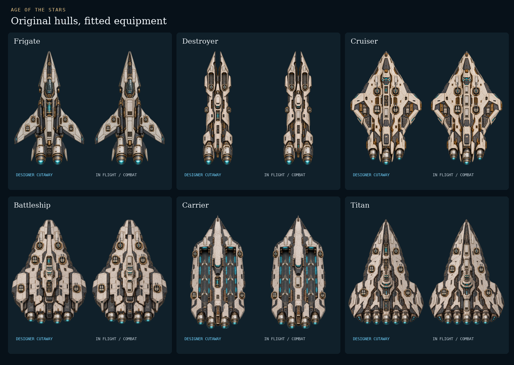
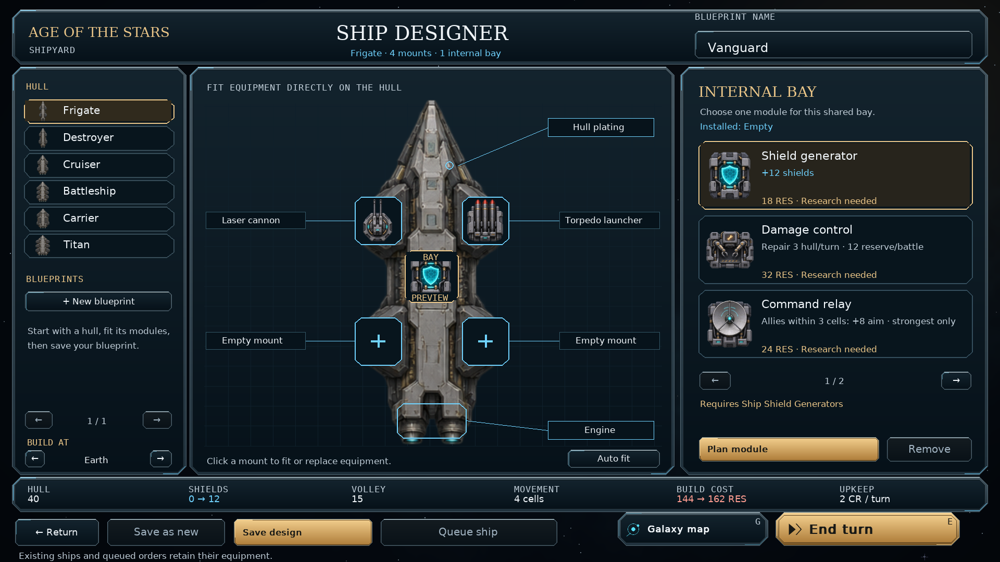
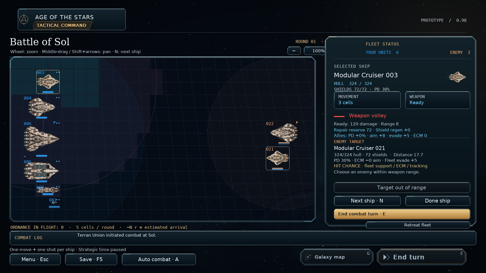

# Age of the Stars — v0.98.1 modular ship artwork

The original six combat hulls now use the same modular appearance in the ship
designer, fleet views, galaxy map and tactical combat. Installed weapons occupy
their hull-specific mounts; engine and armor upgrades are visible, and fitted
carrier hangars contain drones. Internal systems are visible in the designer
cutaway and covered by hull panels during flight and combat.

Standard ships use stock loadouts. Existing custom ships and construction orders
use their saved equipment snapshots. Changing a blueprint only changes future
orders. Slot counts, equipment effects and combat rules are unchanged.

## Install

Extract this incremental ZIP into your existing repository beside `orion/`,
`assets/`, `tests/`, `tools/` and `docs/`, replacing the included files. Restart
the game. The required base is **v0.98.0**, commit `14403f0`.

Existing saves remain compatible. Campaign save format stays **66**, and no new
dependencies are required. Civilian ships and special vessels use their existing
artwork. The earlier designer atlases may remain in the installation.

## Preview







These are actual game renders. See [the designer guide](docs/ship-designer.md)
and [artwork notes](assets/ships/modular/README.md).

## Validation

**126 tests and 151 subtests passed** across modular rendering, designer fitting
and planning, stock and AI designs, combat scenarios, fleet support, arsenal,
map icons and flagship inspectors. Every mounting point was clicked on all six
hulls at 980×900, 1280×800 and 1920×1080. Real designer, map and combat screens
were also rendered and inspected.

The tests verify that mount selection changes all views, internal bays close
outside the designer, engine/armor/hangar fittings change the artwork, and
existing ships retain their visual and gameplay snapshots after a blueprint edit.

A save made with unmodified v0.98.0, containing a legacy v2 blueprint, a queued
ship and an active battle, loaded and rendered correctly. Combat advanced and
the new save round-tripped exactly; the original file and saved equipment were
preserved.

A separate planet-overview run passed 13 tests and 12 subtests, with four
pre-existing failures reproduced on unchanged v0.98.0: obsolete starvation,
construction-cost and ship-hull expectations, and a v11 colony-layout migration
fixture. No new failures remain in the affected checks.

Run the focused checks:

```bash
python -m pytest tests/test_modular_art.py tests/test_visual_designer.py tests/test_designer.py::DesignerUITests tests/test_designer_planning.py::BlueprintPlanningUITests tests/test_combat_simulator.py tests/test_ship_scaling.py tests/test_fleet_support.py tests/test_arsenal.py tests/test_galaxy_fleet_icons.py tests/test_flagships.py -q
```

Regenerate the screenshots:

```bash
python tools/preview_modular_ships.py --output screenshots/modular-preview
```

## Commit commands

```bash
git status
git add README.md docs/ship-designer.md assets/ships/modular
git add orion/__init__.py orion/modular_art.py orion/designer_art.py orion/fleet_art.py
git add orion/combat_view.py orion/combat_inspector.py orion/combat_simulator_view.py
git add orion/galaxy_fleet_icons.py orion/galaxy_fleet_view.py orion/fleet_views.py orion/planet_view.py
git add tests/test_modular_art.py tools/preview_modular_ships.py
git add screenshots/visual_ship_designer.png screenshots/modular_ship_catalogue.png screenshots/modular_combat.png
git diff --cached --stat
git commit -m "Use original modular hulls across ship designer, fleets and combat (v0.98.1)"
git push
```
