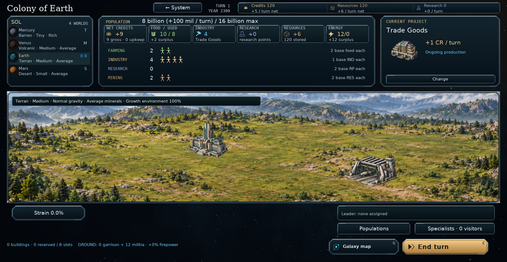

# Clearer colony panels — v0.95.2

The six output cards now allow for the actual minimum font size, separating
their labels, resource icons, values and captions. Long totals use the existing
abbreviation and hover-detail behavior instead of overflowing the card.

The Farming, Industry, Research and Mining rows sit centrally below the output
cards. Labels, population counts, worker figures and per-worker output share a
vertical center in each row. Selection highlights and click regions follow the
rows, including group transfers and workforces with more than 24 figures.

When Trade Goods is active, Current project no longer displays “30% of industry,
then credit strain” or “No resource cost or building slot.” Its income, artwork,
Change button and any paused-queue status remain visible. The conversion details
are still available by right-clicking Trade Goods in Choose production.

The shared panels apply to colonies and Wanderer motherships. No economy,
construction or save rules change; save format remains **62**.

## Install and commit

Extract `orion_reach_v0952_colony_panel_cleanup_update.zip` over **v0.95.1**,
replacing the included files, then restart. The package is based on commit
`59cd096`.

From the repository root:

```bat
git add README.md orion/__init__.py orion/planet_view.py docs/colony-panel-cleanup.md screenshots/colony_panel_cleanup.png
git diff --cached --stat
git commit -m "Align colony workforce panels and simplify Trade Goods (v0.95.2)"
git push
```

## Validation

46 tests and 252 subtests passed across worker transfers, production breakdowns,
colony controls, population information, window layouts, campaign navigation
and right-click production details:

```sh
python -m pytest tests/test_worker_groups.py tests/test_production_breakdown.py tests/test_planet_overview.py::PlanetOverviewInterfaceTests tests/test_population_info.py tests/test_window_layout.py tests/test_campaign_navigation.py tests/test_production_info.py -q
```

Real screens were inspected at 1900×984 and 1440×900 with 100% interface size,
and at 1280×800 with 175% interface size. Additional captures covered selected
workers, a paused construction queue and a 50-billion-population mothership.
Rendering preserved serialized campaign data. Compilation and
`git diff --check` passed.

An additional run of the complete `test_planet_overview.py` found three existing
failures. They also fail with the unchanged v0.95.1 source: two tests still expect
older ship costs/hull values, and one v11 save-migration fixture is rejected as
invalid data. This update does not change those tests or the simulation rules.


