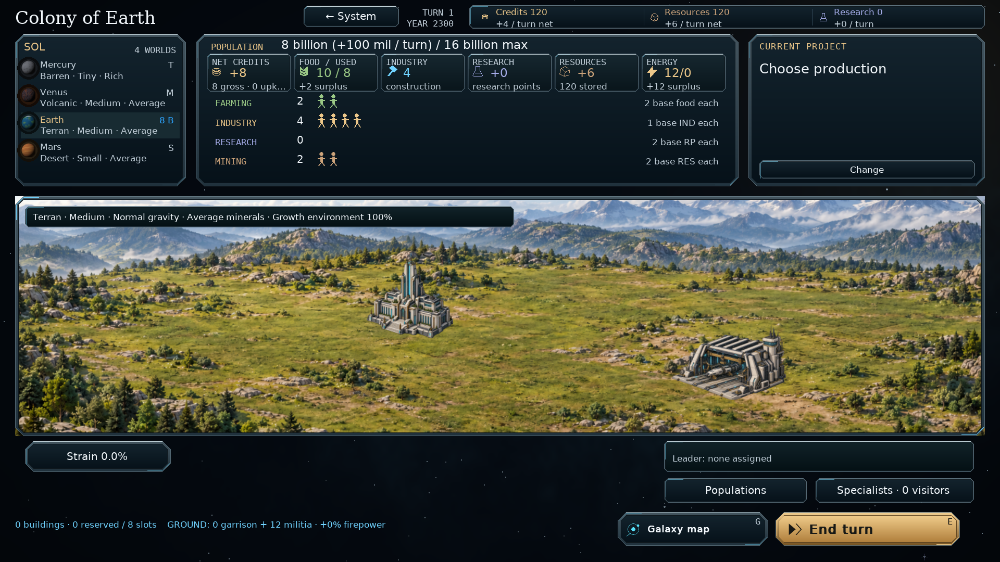
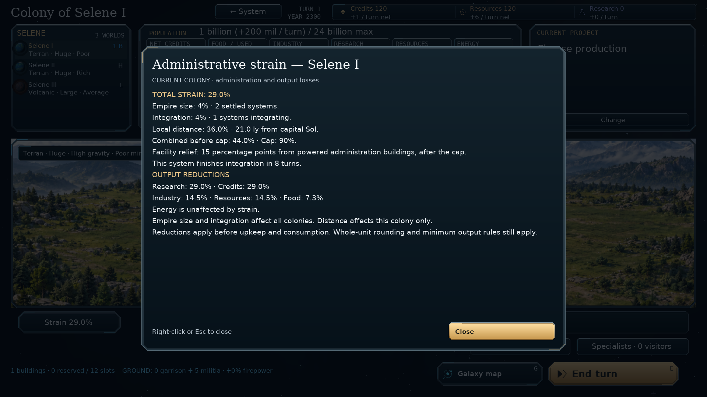

# Colony screen cleanup — v0.94.1

The colony overview keeps its resource values, population, workers, construction
controls and landscape, while removing these permanent helper labels:

- The bottom building-management and keyboard-instruction line.
- The idle project's “Build a structure or launch a ship” explanation.
- The worker assignment instructions, including the hover instructions.
- “Right-click: growth”, “Colors identify each empire” and “Empire stockpile”.

Selected workers retain a short count and source-role caption. Stored surveys,
foreign ownership, slave population and other game-state information remain
visible. Production and mothership views inherit the shared stockpile heading
cleanup; the mothership also inherits the shared worker and idle-project cleanup.

## Strain inspector

The former four-line administration block becomes a compact **Strain n.n%**
button below the landscape. Right-click opens a themed report showing the
current empire-size, integration and local-distance contributions, capital,
cap, powered administration relief, integration time and output reductions.
It reads the existing simulation report, including relief under partial power.

Left-click and keyboard activation also open the report. Right-click, Escape
or Close dismisses it. Inspection restores keyboard focus and preserves worker
selection, campaign state and the underlying page position. Foreign colonies
and stored surveys do not expose private strain details. Observer mode can
inspect visible colonies.

The report fits the available window at the chosen interface scale. Longer
details wrap and paginate; the Close button stays visible without sideways
scrolling.

No game rules, building placement coordinates, hotkeys or save format change.
Existing saves continue to use format **62**. No additional dependencies are
required.

## Install and commit

Extract `orion_reach_v0941_colony_cleanup_update.zip` into the **v0.94.0**
project root, alongside the existing `orion`, `tests`, `tools`, `docs` and
`screenshots` directories. Replace the included files and restart the game.
This incremental package is based on commit `e344229`.

From that project directory:

```bat
git add README.md orion/__init__.py orion/app.py orion/planet_view.py orion/strain_info.py
git add tests/test_administration.py tools/preview_all_screens.py docs/colony-ui-cleanup.md
git add screenshots/colony_cleanup.png screenshots/colony_strain_details.png
git diff --cached --stat
git commit -m "Simplify colony UI and add strain inspector (v0.94.1)"
git push
```

## Validation

- The focused administration, colony, mothership, window-layout, campaign
  navigation and readability suite passed **78 tests and 251 subtests**.
  Navigation and layout checks include every preview state, with the new
  strain dialog added to the preview fixtures.
- Real right-click input opens and closes the report at 1920×1080 / 100%,
  1280×800 / 175% and 900×1200 / 125%. Tests also cover Enter/Escape,
  worker selection retention, read-only inspection, survey privacy and
  separation from building controls. The large-interface check also verifies
  paging, visible controls and the absence of popup scrollbars.
- The report is checked against capped strain, powered and disabled
  administration facilities, expired integration and the resulting output
  reductions.
- An existing save-roundtrip test still expected obsolete save version 52.
  That failure was reproduced on v0.94.0. It now checks `SAVE_VERSION`,
  retaining its integration-timer and strain roundtrip assertions.
- Population information, production breakdown, worker groups, surface
  construction and building information tests also passed.

The screenshots show the implemented game:




