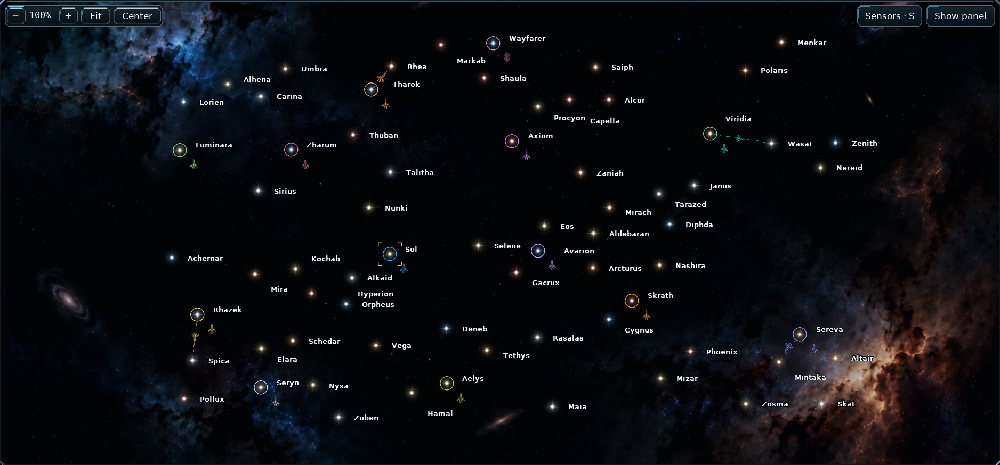
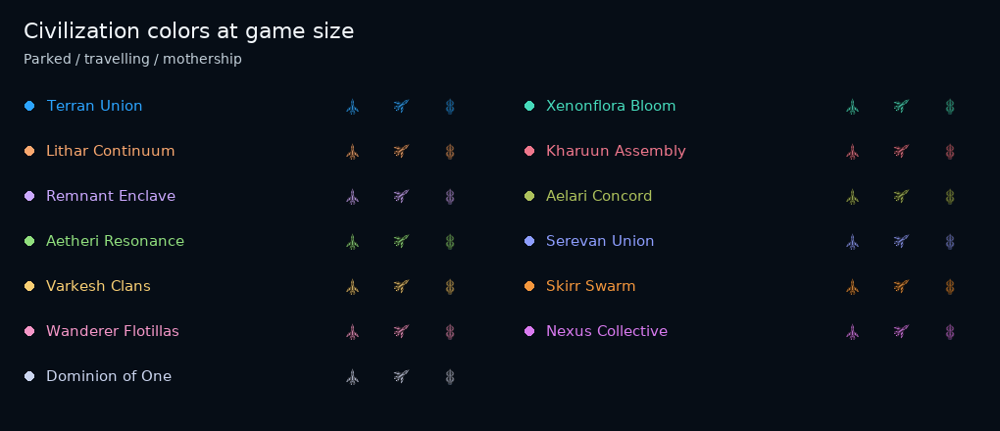

# Compact faction fleets — v0.96.3

Clean-map ship artwork and system names are rendered at **70% of their previous
linear size**, with final raster sizes rounded to whole pixels. The illustrated
ship's maximum dimension changes from 24 to 16.8 logical pixels, and the name
font from 16 to 11.2. Both are rendered directly at the display resolution.

Parked fleets remain in fixed lower-right slots. The first slot is now 22 pixels
right and 22 pixels below the system center, compared with 30/30 previously;
this offset follows the existing star zoom scale. Additional groups are spaced
30 pixels apart. The invisible 28 × 28 click targets remain easy to select.
Names avoid those targets. When a queued departure would overlap a parked
fleet, its icon advances along the displayed route until clear where space
permits. This changes presentation only, not the voyage's saved position or ETA.

Each civilization already has a distinct empire color. The renderer now applies
that color across the full ship hull, preserving shading and small highlights.
It also colors motherships. Ships match ownership rings, fleet panels and the
existing blue/turquoise player preference. Existing campaign color assignments
are preserved. Classic-map sizes and names retain their existing presentation.

## Installation

Extract `orion_reach_v0963_compact_factions_update.zip` into the existing
**v0.96.2** game folder, allowing the included files to replace their older
copies, then restart. This is an incremental update, not a standalone game.
Save format remains **64**. No campaign migration is needed.

## Validation

Based on repository commit `8599f605f40220a9a5014c3daf2a3bd067a117a7`.

The targeted regression run completed with **28 passed and one pre-existing
failure** (plus eight passing subtests). It covers fleet artwork and fallback,
fixed docking slots, departures and arrivals, all eight headings, clipped click
targets, name avoidance, zoom, preferences, route previews, fog and distinct
colors for every empire identity.

The remaining failure is
`test_galaxy_colors.ColorPreferenceUITests.test_options_recolor_real_markers_and_survive_restart`.
It expects a faction-colored pixel on the Classic badge's outer frame, which
the existing console theme renders in gray. The same assertion and pixel values
fail against the unmodified source; this update does not change that frame.

Before and after images were rendered from the same 13-civilization campaign
and visually inspected, including a native-size sheet of ordinary ships,
travelling ships and motherships in every civilization color. Rendering also
checks that campaign state is unchanged. Python compilation and whitespace
checks passed. The unrelated gameplay suite was not run.

Run the targeted checks from the project root (pytest must be installed):

```text
python -m pytest -q tests/test_galaxy_fleet_icons.py tests/test_galaxy_colors.py tests/test_galaxy_style.py tests/test_galaxy_route_preview.py tests/test_galaxy_fleet_routes.py tests/test_all_civilizations.py::AllCivilizationsRulesTests::test_every_identity_has_a_distinct_color_and_existing_colors_stay_stable
```

Recreate the game screenshots:

```text
python tools/preview_compact_fleets.py
```





## Commit commands

```text
git add README.md orion/__init__.py orion/galaxy_fleet_icons.py orion/galaxy_fleet_view.py orion/galaxy_labels.py tests/test_galaxy_fleet_icons.py tools/preview_compact_fleets.py docs/compact-faction-fleets.md docs/galaxy-fleet-icons.md screenshots/galaxy_compact_factions_map.png screenshots/galaxy_faction_ship_colors.png
git commit -m "Shrink galaxy labels and ships and show faction-colored hulls (v0.96.3)"
```
