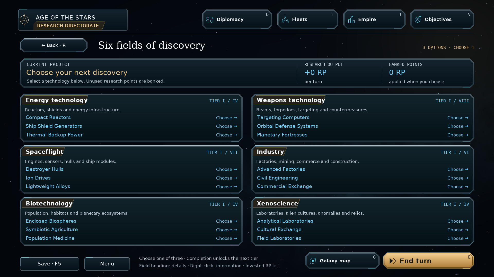
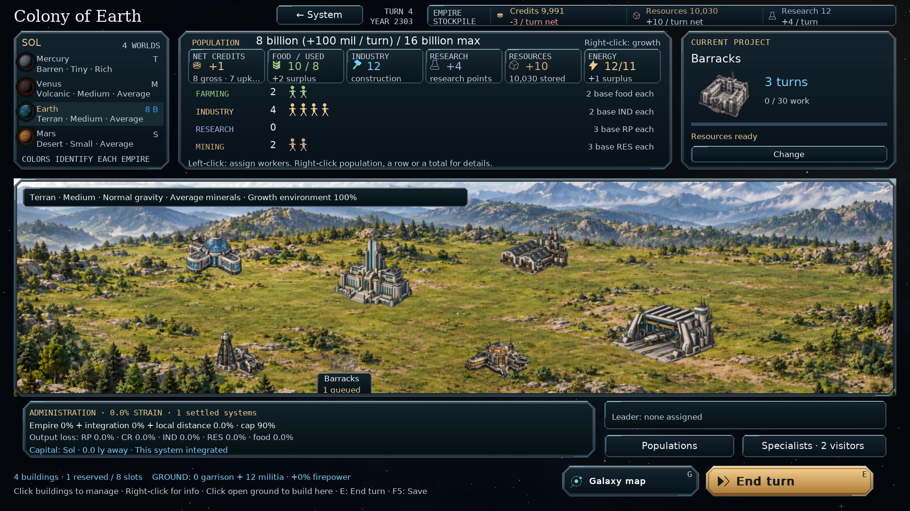
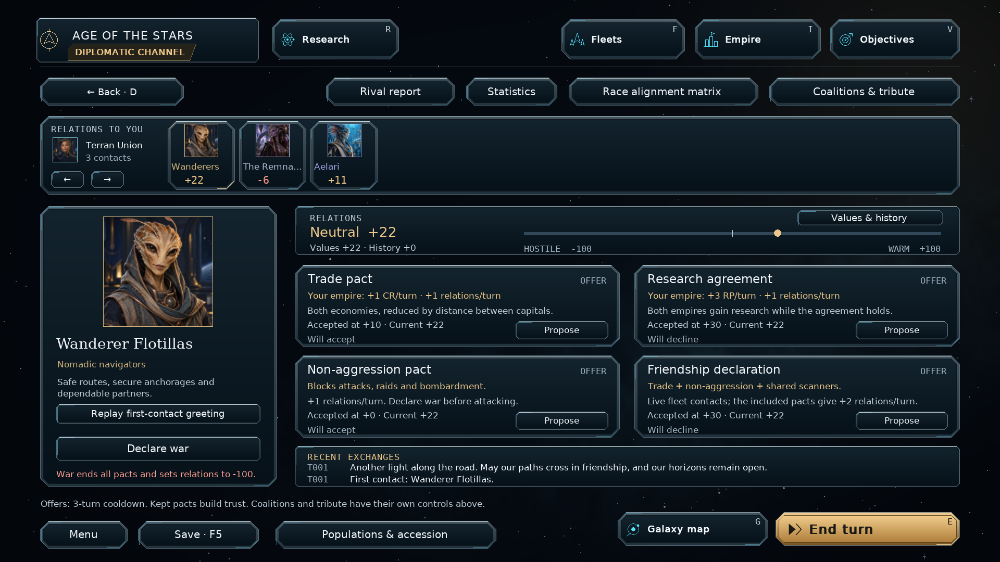
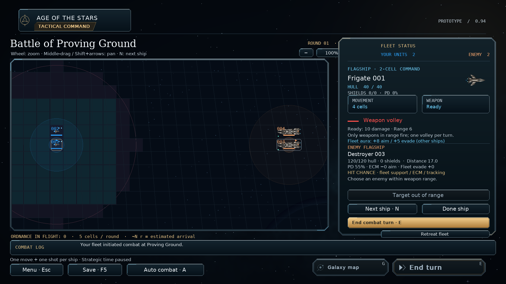

# Shared console theme — v0.94.0

The galaxy command console's metal frames, cyan edge accents and gold title
plates now form the game's shared interface. Research, diplomacy, empire and
colony management, fleets, ship design, exploration, objectives, combat,
Observer reports, menus, setup, settings, dialogs and tooltips use the same
panel and button rendering. The standalone combat simulator and balance
editor inherit the shared theme as well.

## Implementation

- `orion/console_theme.py` owns the cached frames, title plates, console rows
  and button rendering. `orion/galaxy_console.py` remains an import facade for
  existing galaxy views.
- `ui.panel` and `Button.draw` use the shared renderer. Existing semantic
  button styles, keys, actions and hit rectangles remain intact. Hover,
  keyboard focus, pressed states, disabled actions, shortcuts and badges are
  retained. Dialog confirmation buttons use the gold primary treatment on
  every underlying page.
- Short controls and dense data rows use thinner rims. Panels retain their
  existing fill tints and semantic accent colors. Frames stay inside their
  allocated rectangles, including when panels wrap onto several rows.
- Section headers and research fields use angled title plates. Research
  summaries fit names, output labels and captions within their columns;
  hovering abbreviated text reveals the full wording.
- Planet landscapes, outposts, battlefields and encyclopedia illustrations
  use transparent-center console frames. Text, navigation icons and frames
  render at the current interface resolution.

This is a presentation update. Campaign rules, star animation, ship behavior,
map and combat coordinates, keyboard bindings and save format **62** are
unchanged. It requires no new dependencies or generated art assets.

## Install and commit

Extract `orion_reach_v0940_console_theme_update.zip` into the **v0.93.0**
project root, alongside the existing `orion`, `tests`, `docs` and `screenshots`
directories. Replace the included files, then restart the game. This is an
incremental update based on commit `62e0c68`, not a complete game download.

From that project directory:

```bat
git add README.md orion/__init__.py orion/ui.py orion/console_theme.py orion/galaxy_console.py
git add orion/app.py orion/empire_view.py orion/research_view.py orion/system_views.py orion/observer_view.py
git add orion/colony_scene.py orion/outpost_view.py orion/combat_view.py orion/combat_simulator.py orion/encyclopedia_view.py
git add tests/test_combat_zoom.py docs/console-theme.md screenshots/menu.png screenshots/console_theme_*.png
git diff --cached --stat
git commit -m "Apply command-console theme across all screens (v0.94.0)"
git push
```

## Validation

- **122 tests and 291 subtests passed**, covering native text, window layout,
  navigation, six-field and classic research, colony controls, building
  information, combat zoom, the combat simulator, balance editor, Observer
  reports and the galaxy HUD, workspace, systems, styles, stars and fleets.
- The combat zoom test previously expected a fixed 15 remaining hull. That
  failure also occurred before this update: current frigates have 40 hull
  and deal 10 damage. Its assertion now checks the target's starting hull
  minus the firing ship's damage, preserving the input and animation check
  without depending on obsolete balance values. No combat rules changed.
- All **68 preview states** rendered at 1440×900, 1920×1080 and 1280×800
  with 175% interface scale. Representative screens, menus and dialogs were
  visually inspected, including separate simulator and editor captures.
- A before/after comparison of all 68 states found identical hit rectangles,
  keys and enabled states for **1,338 button instances**. Rendering left each
  serialized campaign unchanged.
- Repeated renders of the galaxy, production, empire, diplomacy, research,
  setup and combat views reused cached frames without further frame-cache
  misses after warm-up.
- Python compilation and `git diff --check` passed. The full simulation suite
  was not run for this presentation update.

The screenshots below are captures of the implemented game.








