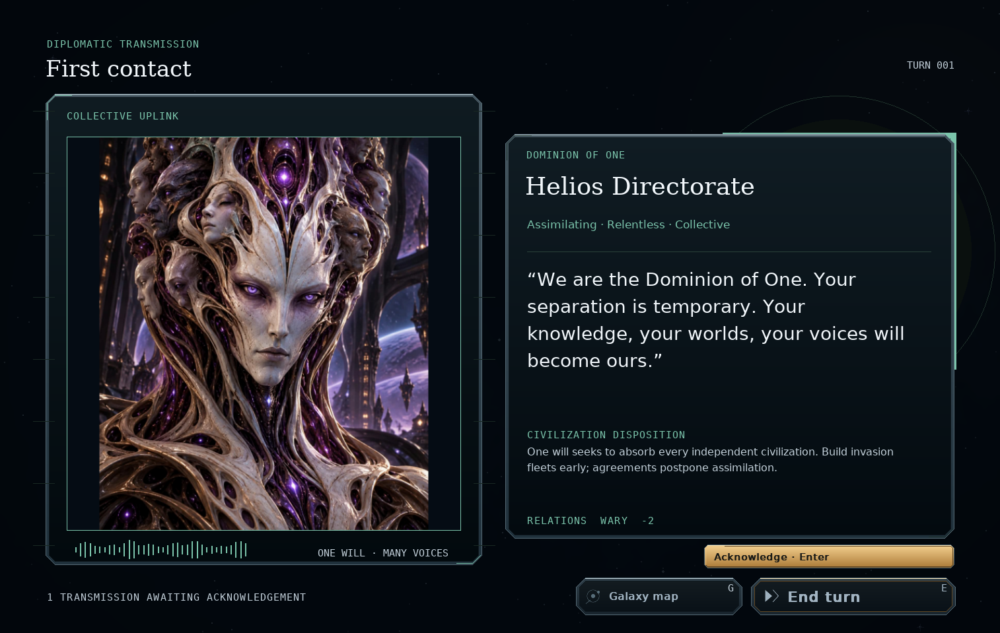
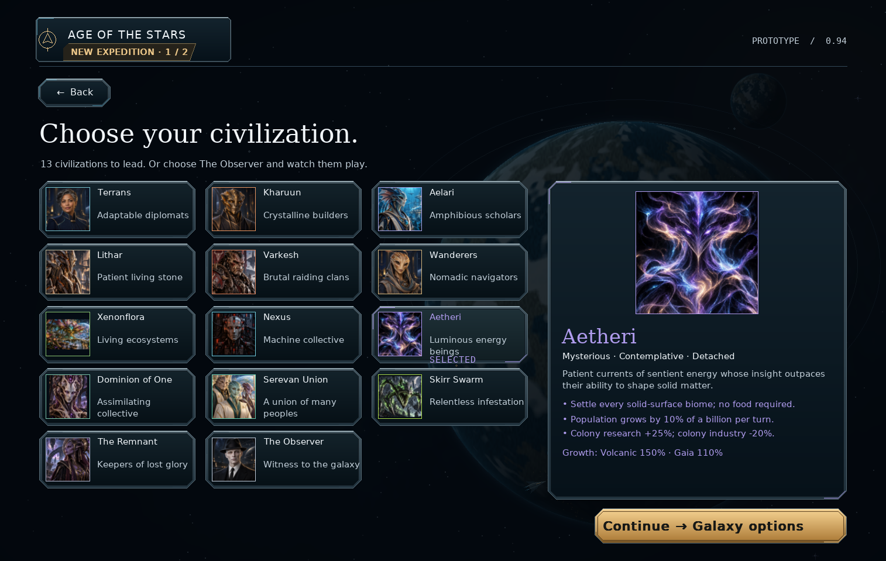

# Dominion of One and Aetheri portraits — v0.94.3

The two supplied portraits now appear wherever these civilizations are shown,
including race selection, galaxy setup, diplomacy, first contact, council
voting and victory views. Existing campaigns pick up the portraits after
restarting the game.

| Civilization | Supplied image | Active asset | Original size |
| --- | --- | --- | --- |
| Dominion of One | `dominion_of_one.jpeg` | `assets/portraits/concord-v2.jpeg` | 1280 × 1536 |
| Aetheri | `atheri.jpeg` | `assets/portraits/aetheri-v2.jpeg` | 1254 × 1254 |

The files are copied byte-for-byte. The shared portrait loader selects the
JPEGs while retaining the stable race IDs `concord` and `aetheri`. The renderer
fits each complete image into its frame with its original proportions. The
taller Dominion portrait therefore has narrow margins in square frames.

## Install and commit

Extract `orion_reach_v0943_dominion_aetheri_portraits_update.zip` over
**v0.94.2**, replacing the included files, then restart the game. This
incremental package is based on commit `c1d8725`. Campaign saves continue to
use format **62**.

```bat
git add README.md orion/__init__.py orion/race_art.py
git add assets/portraits/README.md assets/portraits/concord-v2.jpeg assets/portraits/aetheri-v2.jpeg
git add docs/dominion-aetheri-portraits.md screenshots/portrait_dominion.png screenshots/portrait_aetheri.png
git diff --cached --stat
git commit -m "Update Dominion of One and Aetheri portraits (v0.94.3)"
git push
```

## Validation

- Three existing race-setup tests passed, including portrait loading, race
  selection, navigation and campaign creation.
- Both installed JPEGs match the supplied files byte-for-byte; Pygame's
  decoded portraits match the supplied images pixel-for-pixel.
- Both races rendered in race selection, diplomacy and first contact at
  1514×959 / 100% and 1280×800 / 175%: 12 views, including loaded campaigns.
  Rendering left each serialized campaign unchanged.
- Seven portrait sizes per race rendered successfully, from small relation
  icons to the full contact image. Missing-image emblem fallbacks still work.
- Python compilation and `git diff --check` passed.




