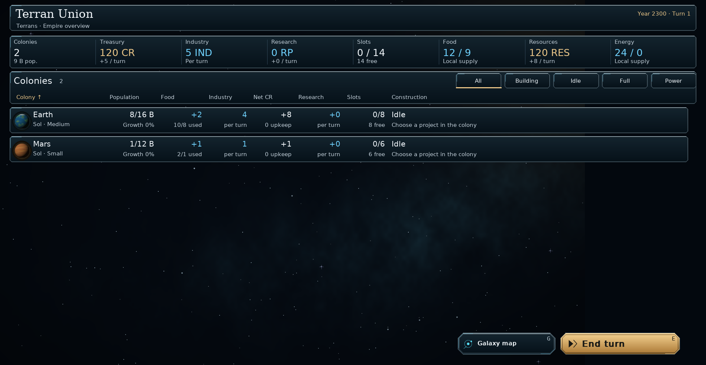
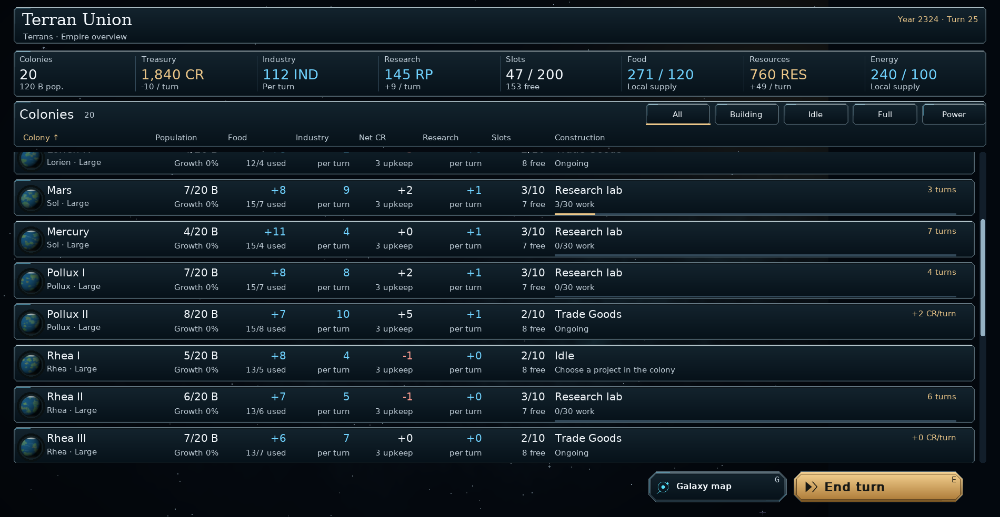

# Scrollable Empire overview — v0.95.0

The Empire overview now gives the colony list most of the screen. Colonies,
treasury, industry, research, building slots, food, resources and energy appear
in one summary row. Filters and column headings stay above the list; Galaxy map
and End turn stay below it. At standard interface size, several colonies fit at
once. Larger interface sizes use compact colony cards with the same information.

The top Research, Diplomacy, Fleets, Objectives, Rival report and Specialists
buttons, queued/idle header, permanent debt explanation, bottom budget/upkeep
breakdown, Menu and Save buttons, page counter and Prev/Next controls are gone.
The game still applies debt interest and includes it in net income.

## Controls

- Wheel: scroll through colonies. Drag the scrollbar or click its track to move
  further through the list.
- Page Up / Page Down or Left / Right: move through the list by a screenful.
- Home / End: go to the first / last colony.
- Up / Down, Tab and Shift+Tab: move keyboard focus; offscreen colonies scroll
  into view automatically. Enter opens the focused colony.
- Column headings sort the complete list; selecting the same heading reverses
  the order. Filters and sorting return to the start of their results.
- Returning from a colony preserves the list position. Resizing keeps the same
  part of the list visible, including when switching between rows and cards.
- P opens the pause menu, F5 saves, G opens the galaxy map, E ends the turn.

Only visible colonies are drawn. Row hit targets are clipped to the list, so
scrolling does not cover the summary or footer. Scroll position is UI state and
is not written into campaign saves.

## Install and commit

Extract `orion_reach_v0950_empire_overview_update.zip` over **v0.94.3**,
replacing the included files, then restart. This incremental package is based
on commit `6413159`. Existing campaigns continue to use save format **62**.

From the repository root:

```bat
git add README.md orion/__init__.py orion/app.py orion/empire_view.py orion/empire_scroll.py
git add tests/test_empire.py tests/test_ui_readability.py docs/empire-overview.md
git add screenshots/empire_overview.png screenshots/empire_overview_scrolled.png
git diff --cached --stat
git commit -m "Make Empire overview compact and scrollable (v0.95.0)"
git push
```

## Validation

37 tests and 246 subtests passed across Empire reports and input, UI scaling,
campaign navigation and window layouts. Checks cover sorted colony selection,
mouse wheel and scrollbar dragging, focus reaching every colony, Home/End,
empty filters, modal dialogs, fixed navigation, save/load and turn completion.

Real screens were inspected with two and twenty colonies, including partially
scrolled rows at 100%, 125% and 175% interface size. Rendering preserved the
serialized campaign state. Python compilation and `git diff --check` passed.

```sh
python -m pytest tests/test_empire.py tests/test_ui_readability.py tests/test_campaign_navigation.py tests/test_window_layout.py -q
```




