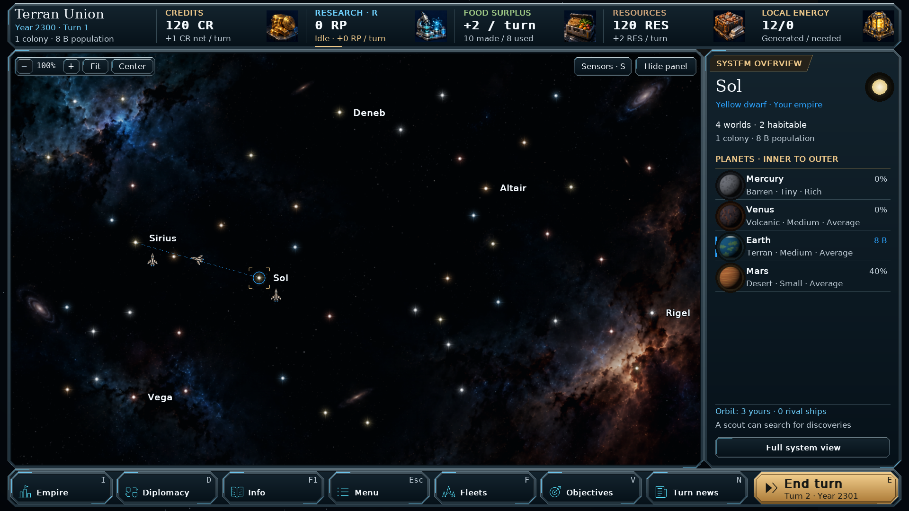
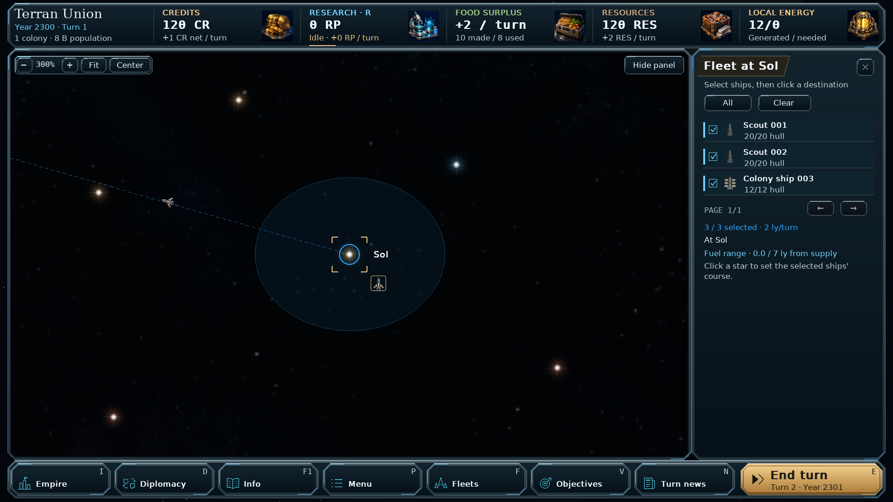

# Galaxy command console — v0.93.0

The galaxy workspace uses a continuous resource housing, a bevelled metal
chart frame and an integrated command dock. Cyan edge lights mark the frame;
gold title plates identify the active dossier. The system overview replaces
nested planet boxes with larger artwork, bold names, ownership bars and thin
dividers. Fleet manifests, destination previews, sensor contacts and black-hole
dossiers use the same console furniture.

Resource values use bold type and fit to narrow columns. Hovering a resource
adds an underline; idle research keeps its gold indicator. Dock icons are
brighter, buttons show hover/focus and pressed states, and End turn retains its
gold treatment. Keyboard shortcuts, unread-news badges and disabled states
remain visible.

## Layout and implementation

`orion/galaxy_console.py` draws cached frame surfaces at the final display
resolution. Text and icons also render at native resolution. The map frame
uses the existing gutter and a transparent centre, preserving the chart's
dimensions and its star, fleet and route rendering. Resource slots and the
footer share outer housings rather than individual panel backgrounds.

The existing layout still wraps the resource strip and places the dossier
below the chart in narrow windows. Large interface scales use the existing
scrolling controls. Planet rows, paging, fleet selection and all click targets
use the same layout coordinates as their rendered controls.

The theme applies to the galaxy workspace in both Star Atlas and Classic
styles, including Observer mode. Other game screens retain their existing
theme. No simulation, economy, research, star-animation or save-format changes
are included. Save format remains **62**.

## Install

Extract `orion_reach_v0930_command_console_update.zip` into the **v0.92.1**
project root, alongside the existing `orion`, `assets`, `docs` and
`screenshots` directories. Replace the included files, then restart the game.
This is an incremental update; it does not include the full game or its assets.

## Validation

- The focused galaxy, navigation, native-text, window-layout, mothership,
  guardian, Observer, sensor and black-hole interface run completed with
  **139 passing tests and 288 passing subtests**.
- Two existing black-hole tests fail in their fixture's research setup:
  `test_detail_panel_navigation_research_and_recovered_article` and
  `test_fatal_confirmation_cancel_accept_and_pending_cancel`. Their helper
  assumes six Computers tiers, while the current Xenoscience tree has four.
  Both failures were reproduced in an untouched checkout of v0.92.1
  (`f20595c`), before applying this update.
- Both affected workflows were separately checked through actual mouse
  events using the current research tree: navigation/relic links and unsafe
  expedition confirmation, cancellation and queued-departure cancellation.
- After the final text-fitting adjustments, all **33** HUD, workspace,
  system-panel and campaign-navigation tests passed again, with **176**
  passing subtests.
- Actual captures were inspected at 1920×1080, 1440×900, 1280×720,
  980×700 and 760×1024, using interface scales from 100% to 175%.
  Checks included narrow/stacked layouts, collapsed panels and fleet orders,
  dense maps, Classic style, Wanderer pagination, sensors and black holes.
  Rendering left the serialized campaign state unchanged.
- Python compilation and `git diff --check` passed. The full simulation
  suite was not run for this presentation update.

The included screenshots are captures of the implemented game:

