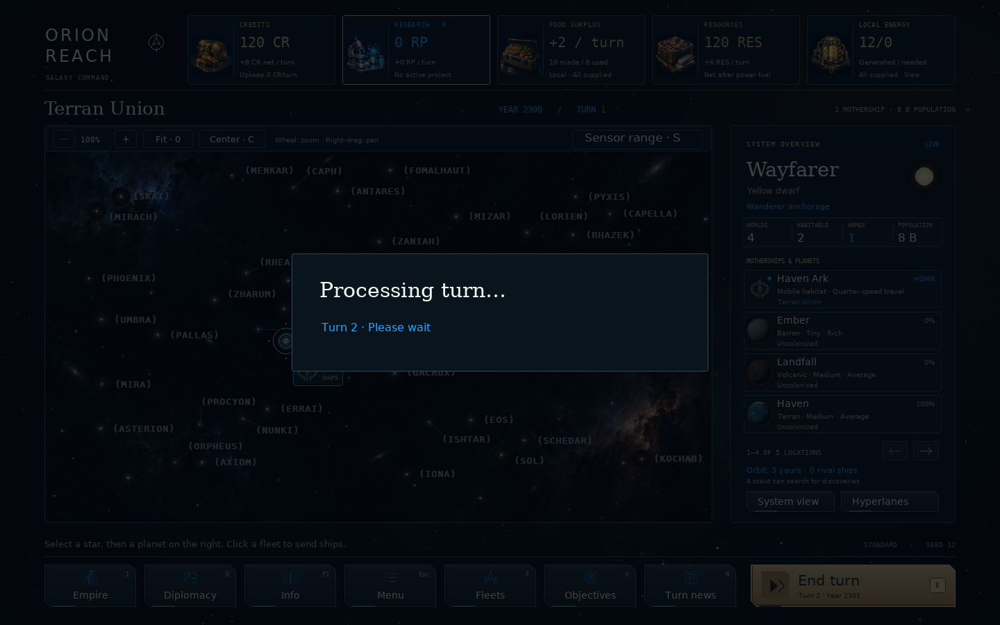

# Map and turn performance — v0.65.2

The optimizations are automatic and preserve the normal artwork, animations and
game rules. Autosaving remains a separate preference under **Menu → Settings**.

## What changed

System visibility now checks the requested system's worlds and orbiting ships
directly, instead of rebuilding the entire empire's observed-system set for each
question. The result is the same for colonies, outposts, anchored and travelling
motherships, fog of war, research-gated black holes and observer mode.

During drawing, repeated visible-fleet, system-intelligence and supply queries
share results through `frame_cache.frame_queries`. The cache is discarded even
if drawing fails. It never spans an input action, a simulation turn or a save.
Drawing treats returned collections as read-only; future code that changes game
state must do so outside this scope. AI calculations use fresh local checks.

Input is processed in order. Routine motion, wheel and typing events can share
one redraw; targets are rebuilt before a following mouse or keyboard action.
This preserves controls after screen changes, scrolling and camera movement.

End Turn presents **Processing turn…** before simulation and presents the new
state after processing and any enabled autosave. Commands captured in the same
input batch, or entered while this panel is visible, cannot trigger a further
turn or act on a newly opened report or battle. Window, quit, mouse-motion and
key-release events are retained. A fresh press after completion works immediately.
Repeated End Turn key events are ignored, and duplicate commands cannot bypass
an idle-colony prompt.

## Measured comparison

Local headless Pygame run on the same machine: seed 12, 48 systems, Wanderer
player, five AI rivals, fixed starting positions, no guardians, tomb worlds or
black holes. Sixteen warm galaxy redraws and eight consecutive simulation turns.

| Measurement | v0.65.1 | v0.65.2 |
| --- | ---: | ---: |
| Median galaxy redraw | 71.88 ms | 6.96 ms |
| Median simulation turn | 94.75 ms | 59.12 ms |
| Median redraw + display after a turn | 62.85 ms | 10.01 ms |
| Batch of 24 mouse-motion events + final display | 1,877.63 ms | 9.73 ms |
| Median autosave | 17.24 ms | 17.38 ms |

The motion batch is a deliberately queued input burst, not a frame-rate measure.
Simulation, drawing and saving are timed separately; these numbers are not total
End Turn latency. They describe one early-game scenario on the test machine,
not a guaranteed speedup for other hardware or larger, later campaigns.

Run `python tools/benchmark_performance.py` from the checkout to reproduce the
scenario. It uses a temporary data directory and never touches campaign saves.
Its output includes state fingerprints after each turn and pixel fingerprints
for the initial and final maps. The state fingerprint excludes the random
campaign identifier so equivalent runs can be compared.

## Verification

- All eight before/after campaign-state fingerprints matched exactly. Both
  before/after map images also matched pixel for pixel.
- Full regression suite: **1,113 tests passed**. After the final input-batching
  refinement, the focused performance, camera, fleet-UI and prototype suites
  passed again: **65 tests**.
- New tests compare whole simulation outcomes against the previous visibility
  calculation for Wanderers, Terrans and observer mode with multiple AI empires.
  They also cover live/stored intelligence, movement, ownership, outposts,
  research, fog, frame cleanup, rapid turn commands, held keys, error recovery,
  progress presentation, retained quit events and controls after camera pans.
- Save format **46** and balance profile **11** are unchanged.
