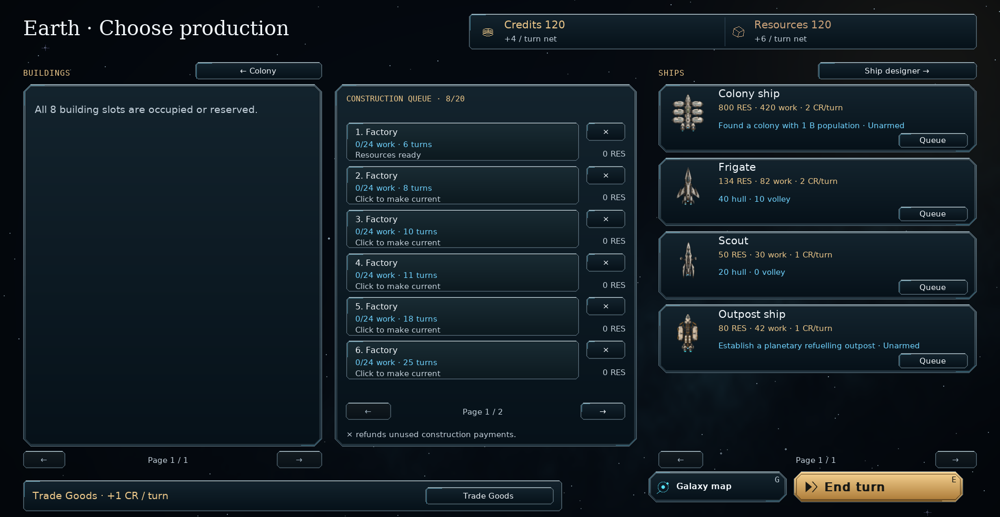

# Production availability — v0.96.1

The empty building catalogue now reports the actual capacity limit:
**All 8 building slots are occupied or reserved.** The number follows the
planet's capacity and includes both completed buildings and queued reservations.
Motherships use **module bays** instead of building slots.

A full 20-project queue instead says **Construction queue is full.** If building
slots and the queue are both full, the building column reports its slot limit;
the ship column reports the queue limit. Other empty catalogues simply say
**No available buildings**, **modules** or **ships**, without the misleading
research/queue instruction. Construction rules and save format 63 are unchanged.

Extract `orion_reach_v0961_production_availability_fix.zip` over **v0.96.0**,
replacing the included files, then restart.

```bat
git add README.md orion/__init__.py orion/planet_view.py docs/production-availability.md screenshots/production_slots_full.png
git diff --cached --stat
git commit -m "Show the correct reason when production slots are full (v0.96.1)"
git push
```

Validation covers occupied, reserved and mixed building slots, a full ship queue,
mothership bays, and reopening a slot by cancellation. The existing production
queue and repeatable-building checks pass: 34 tests and 34 subtests. The screen was rendered and inspected;
compilation and whitespace checks pass.


