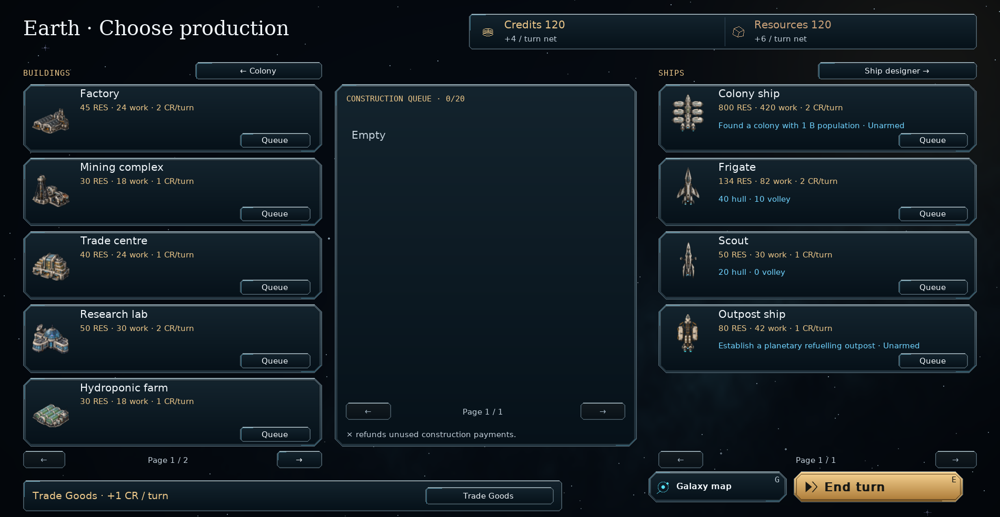
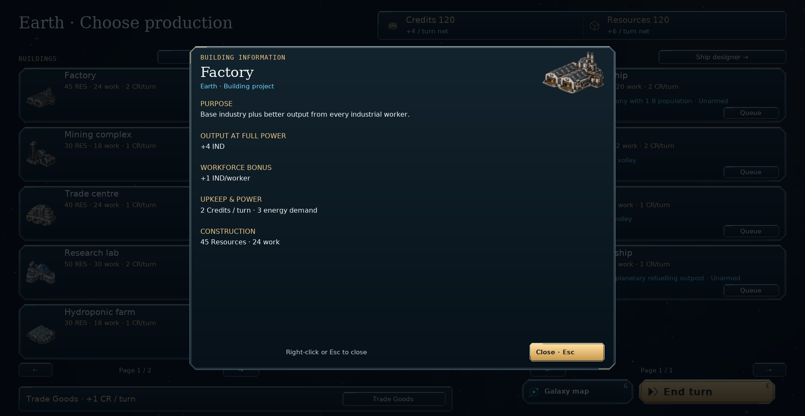

# Cleaner production screen — v0.95.1

The Choose production screen shows Credits and Resources in a taller top bar
with larger text. The Research total is removed from this screen. The available
projects instruction and every repeated “Resources reserved when work starts”
caption are removed. An empty construction queue displays **Empty**.

Building cards retain their artwork, name, costs and Queue/Place button. Their
blue output and workforce descriptions appear in a right-click information
window. Right-click any part of an available or queued building card to inspect
its purpose, full-power output, worker bonuses, upkeep, energy demand and
construction cost. Mothership modules use their module names and artwork.

The Trade Goods bar retains its current credit income and selection button.
Right-click either for the conversion percentage, credit strain, rounding and
paused-queue explanation. This works while Trade Goods is active, too. Close
information with Escape, right-click or Close. Inspection does not queue, cancel,
prioritize, spend resources or select Trade Goods.

Building information windows fit the available screen, including 175% interface
size. Longer descriptions use the existing page buttons. Construction rules
and save format **62** are unchanged.

## Install and commit

Extract `orion_reach_v0951_production_cleanup_update.zip` over **v0.95.0**,
replacing the included files, and restart. The package is based on commit
`f983425`.

From the repository root:

```bat
git add README.md orion/__init__.py orion/app.py orion/planet_view.py orion/building_info.py
git add tests/test_production_info.py tests/test_production_queue.py docs/production-ui-cleanup.md
git add screenshots/production_cleanup.png screenshots/production_building_details.png
git diff --cached --stat
git commit -m "Simplify production screen and add right-click details (v0.95.1)"
git push
```

## Validation

55 tests and 276 subtests passed across production and Trade Goods, building
inspection, surface placement, campaign navigation and window layouts. The new
checks cover right-clicking cards and Queue buttons at two interface sizes,
inspecting queued buildings without changing their order, active Trade Goods,
changing catalogue pages and inspecting mothership modules. Building popup
controls stay within the window without horizontal or vertical scrolling.

The production save test now checks the current `SAVE_VERSION` constant instead
of its obsolete hard-coded value of 52; the actual save version remains 62.

Real production, building-details and Trade Goods screens were inspected at
1900×984 / 100% and 1280×800 / 175%, including a paused construction queue.
Rendering preserved serialized campaign data. Compilation and
`git diff --check` passed.

```sh
python -m pytest tests/test_production_info.py tests/test_production_queue.py tests/test_building_info.py tests/test_surface_construction.py tests/test_campaign_navigation.py tests/test_window_layout.py -q
```




