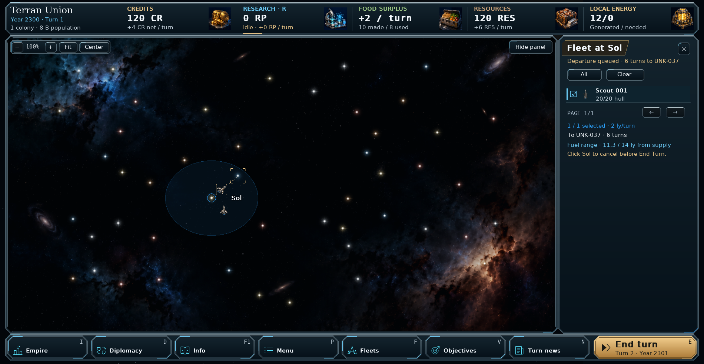
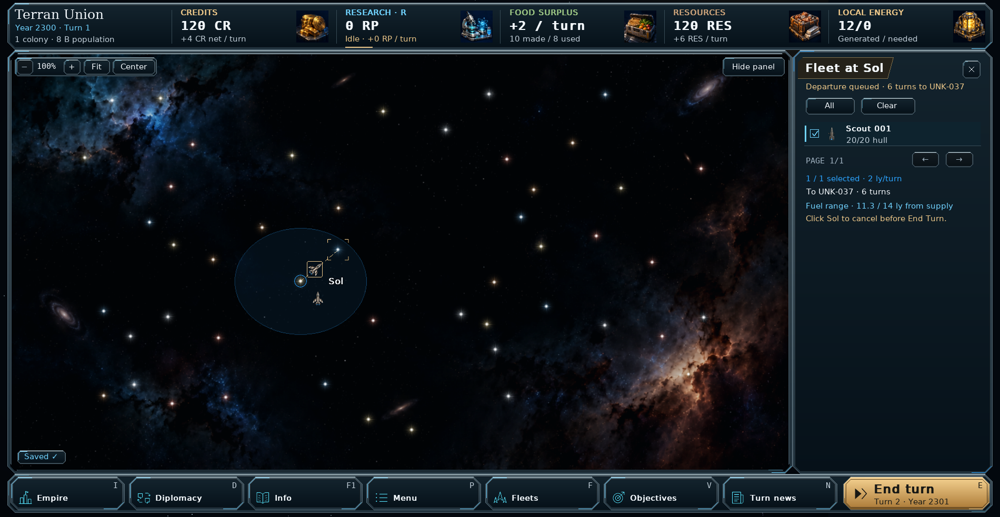
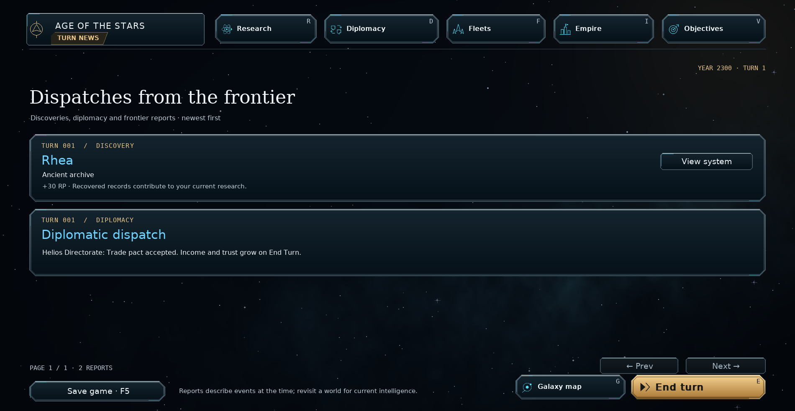

# Quieter notifications — v0.96.2

Routine confirmation banners no longer cover the interface. This applies to
course orders, queue changes, power allocation, assignments, design changes,
successful loading and other ordinary actions across campaign screens and the
combat simulator. Their results remain visible in the relevant panels.

Failed actions still explain why they failed, including invalid orders and
save/load errors. Successful routine actions cannot overwrite a save error.
Manual campaign and combat-scenario saves show a small **Saved ✓** indicator for
three seconds; autosaves remain silent. A failed save never shows that indicator.

Right-click information, consequential confirmations (including demolition and
unsafe expeditions), required decisions and existing urgent reports remain.

## Turn news

Scout discoveries now appear with their location and reward, and have a
**View system** button. Treaty acceptance, refusal, cancellation and declarations
of war issued by the player are recorded with the other empire's name. Existing
coalition, tribute and other diplomatic reports continue to use their original
journal, without an extra copy from the interface.

The new informational reports update the unread badge without automatically
opening Turn news. Unread state survives saving and loading, including multiple
discoveries during the same turn. Foreign discoveries remain private in a normal
campaign. Reports are saved as part of the campaign, rather than temporary banners.

## Install and commit

Extract `orion_reach_v0962_quiet_notifications_update.zip` over **v0.96.1**,
replacing the included files, then restart. Existing saves load normally. New
saves use format **64** to retain discovery read state and distinguish quiet
diplomatic reports from urgent dispatches. Original save files are not rewritten
when loaded.

From the repository folder:

```bat
git add README.md orion/__init__.py orion/app.py orion/coalitions.py orion/combat_simulator.py orion/diplomacy.py orion/diplomatic_affairs_view.py orion/exploration.py orion/model.py orion/news.py orion/news_view.py orion/notifications.py orion/storage.py
git add tests/test_quiet_notifications.py docs/quiet-notifications.md screenshots/quiet_fleet_orders.png screenshots/quiet_manual_save.png screenshots/quiet_turn_news.png
git diff --cached --stat
git commit -m "Remove routine notification banners and preserve useful feedback (v0.96.2)"
git push
```

## Validation

The focused notification, autosave, route preview, fleet, coalition/tribute,
campaign navigation and combat-simulator suite passes: **99 tests and 211
subtests**. This includes failure feedback, manual-save expiry, quiet autosaves,
demolition confirmation, discovery links, same-turn unread tracking, private
reports, observer deduplication, current save round trips and format-63 migration.
Compilation and whitespace checks pass. Actual screens were rendered and
inspected at 1900×984, 1280×800 and a compact 980×900 window with increased UI size.

The broader legacy exploration, diplomacy and hyperlane suites still contain
older failures, reproduced against the unchanged v0.96.1 source. These concern
legacy ship costs/hulls and migrations, a removed Empire navigation button, an
old shipyard return-screen expectation, a hard-coded save version of 52, and an
old hyperlane caption. They are outside this notification change.

To run the focused checks:

```bat
python -m pytest tests/test_quiet_notifications.py tests/test_optional_autosave.py tests/test_galaxy_route_preview.py tests/test_galaxy_fleets.py tests/test_coalitions_tribute.py tests/test_campaign_navigation.py tests/test_combat_simulator.py -q
```

## Preview






