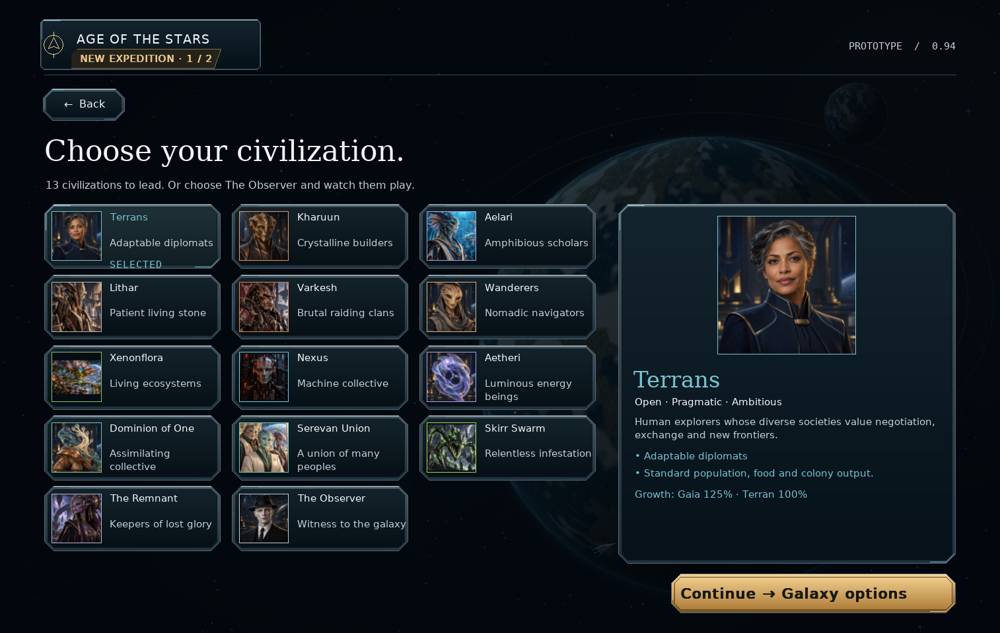

# Civilization selection cleanup — v0.94.2

Growth preferences now appear below the selected civilization's traits in the
information panel. The caption updates when another civilization is selected
and wraps within the panel. The Observer has no growth caption.

Removed the bottom “Next: galaxy options, rivals and victory conditions” text.
The Continue button still opens galaxy options.

## Install and commit

Extract `orion_reach_v0942_race_selection_cleanup_update.zip` into the
**v0.94.1** project root, alongside `orion`, `docs` and `screenshots`, replacing
the included files. Restart the game. This incremental update is based on
commit `8621da8`; existing saves remain compatible with format **62**.

```bat
git add README.md orion/__init__.py orion/setup_view.py docs/race-selection-cleanup.md screenshots/race_selection_cleanup.png
git diff --cached --stat
git commit -m "Move race growth details into civilization panel (v0.94.2)"
git push
```

## Validation

- Four existing race-setup and Observer setup tests passed, covering race
  selection, continuation, return navigation and campaign creation.
- All 14 setup identities rendered at 1514×959 / 100%, 1920×1080 / 100%
  and 1280×800 / 175%: 42 combinations. Each growth caption remained within
  its information panel; Observer omitted it; Continue remained enabled.
- Python compilation and `git diff --check` passed.


