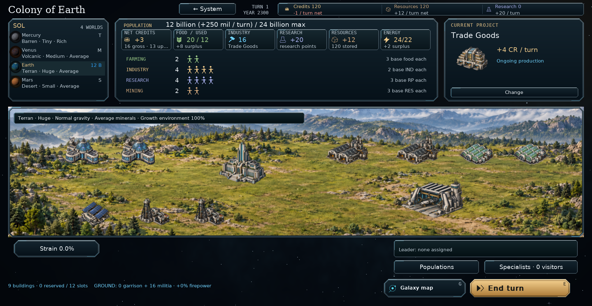
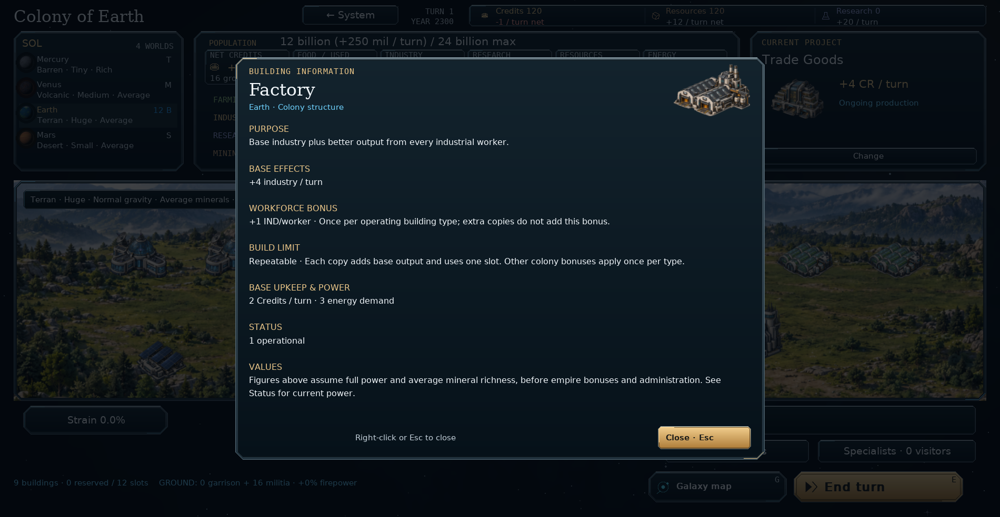

# Repeatable production buildings — v0.96.0

Factories, mines, research labs and hydroponic farms can be queued and built more
than once on a planet. This includes researched production variants, trade
facilities and power plants. Facilities that provide only special colony effects,
defensive installations and explicitly unique buildings retain their build limits.

Each additional copy adds its base output. Workforce bonuses apply once per
**distinct operating building type**, including bonuses to farmers, miners,
scientists, industrial workers and credit income per population. Different
researched building types continue to contribute their own bonuses. Other
colony-wide bonuses, such as extra capacity from an Ecology centre, also apply
once per type; extra copies add only the facility's base production.

At full power, before research, empire and administration modifiers:

| Building | Two copies provide | Shared workforce bonus |
| --- | --- | --- |
| Factory | +8 industry / turn | +1 industry per worker |
| Mining complex | +4 Resources × mineral richness / turn | +1 Resource × richness per miner |
| Research lab | +8 research / turn | +1 research per scientist |
| Hydroponic farm | +8 food / turn | +1 food per farmer |

Each copy still requires its normal Resources and work, reserves one building
slot, pays upkeep and draws power while enabled. Queued copies have no output or
workforce effect. An enabled copy keeps the shared bonus available if another is
disabled or demolished. If none operates, the bonus disappears. Power shortages
scale all active copies' output and the single shared bonus by the local power
ratio. Upkeep continues for disabled buildings, following the existing rule.

## Controls and saved positions

Repeatable projects remain in Choose production while there is a free slot and
queue capacity. Each completed or queued copy appears separately on the surface.
Left-click to manage that copy; right-click to inspect its operating status and
the repeat-building rules. Placement, queue priority, cancellation and demolition
preserve the positions of the remaining copies. Labels number repeated copies
when shown. Mothership modules follow the same output and slot rules.

The AI obtains distinct workforce bonuses before repeating development choices.
It can repeat income and power facilities, and adds extra farms when needed to
resolve a food shortage. Its output forecasts use the same non-stacking bonuses.

## Install and commit

Extract `orion_reach_v0960_repeatable_buildings_update.zip` over **v0.95.2**,
replacing the included files, then restart the game. Existing saves load without
starting a new campaign. New saves use format **63** to store separate sites for
copies of the same building; use v0.96.0 or later to open them. Existing duplicate
buildings remain installed and now follow the non-stacking workforce rule.

From the repository root:

```bat
git add README.md orion/__init__.py orion/ai.py orion/buildings.py orion/economy.py orion/model.py orion/storage.py
git add orion/colony_layout.py orion/colony_scene.py orion/building_info.py orion/production_breakdown.py orion/encyclopedia.py
git add tests/test_repeatable_buildings.py tests/test_production_queue.py tests/test_colony_scene.py tests/test_surface_construction.py tests/test_six_field_research.py tests/test_building_economy.py tests/test_ai.py
git add docs/repeatable-buildings.md screenshots/repeatable_buildings.png screenshots/repeatable_building_details.png
git diff --cached --stat
git commit -m "Allow repeatable production buildings with one workforce bonus per type (v0.96.0)"
git push
```

## Validation

157 tests and 431 subtests passed across repeated production, queue controls,
surface placement, economy and power, building information, research unlocks,
save/resume, population, window layouts and campaign navigation. These include
new checks for base output, non-stacking bonuses, fractional power, disabled
copies, capacity, queue funding and completion forecasts, distinct surface
controls, placement rejection, reordering, cancellation, demolition, old saves,
foreign surveys and mothership modules.

The broader historical suites have 12 existing failing cases, reproduced with
unchanged v0.95.2 source. They concern old debt/ship/research expectations, an old
save-version assertion, removed Empire controls, initial surface metadata and
an Expansive AI expansion threshold. Eight were deselected from the focused run;
the four remaining cases belong to the broader AI suite. They are not reported
as passing. Updated assertions for duplicate limits and stacking reflect the
new rules. Separate 450-turn Compact and Standard AI checks pass, as does
save/resume determinism; the pre-existing Expansive threshold still fails.

The colony and information window were rendered and inspected at 1900×984 /
100%, and information pagination at 1280×800 / 175%. Rendering preserved campaign
data. Compilation, archive verification and `git diff --check` passed.

The new feature checks can be run independently:

```sh
python -m pytest tests/test_repeatable_buildings.py -q
```




