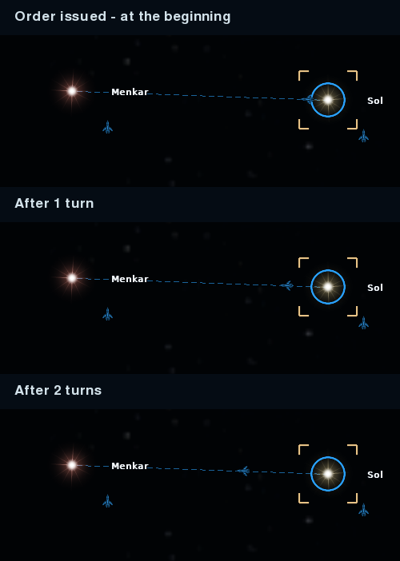

# Route departure position — v0.96.4

Ships now appear at the beginning of the dashed route as soon as a course is
issued. The previous fixed offset, including its attempt to avoid parked fleets,
could push the icon halfway along a short route. The first actual travel step
could then place the ship behind that preview.

The initial offset is now bounded by both 10% of the displayed route length and
half the first actual travel step. Within those bounds, it retains the existing
star clearance where space permits. The first-step estimate uses the same
navigation calculation as a real voyage, including saved speed/interdiction
settings. Orders committed before movement keep the same starting position.
Travelling ships continue to use their exact navigation positions.

The map resolves overlapping star/ship click areas by the nearest marker center.
This keeps the departure star, queued ship and remaining parked fleet separately
selectable without pushing the queued ship farther down its route. Dialogs,
other controls and the Classic map retain their existing click priority.

Travel times, order cancellation, resource costs and campaign data are unchanged.
Save format remains 64; existing queued orders receive the corrected display
when loaded. No new campaign is required.

## Install

Extract `orion_reach_v0964_route_start_fix.zip` into the existing **v0.96.3** game
folder (the folder containing `main.py`), allowing the included files to replace
their older copies. Restart the game. This is an incremental update.

## Validation

Based on repository commit `e16a8d51d6072d3c8215b59d1559e2586917946c`.
The targeted run completed with **74 passed, 68 passing subtests and two
pre-existing failures**. Both failures were reproduced on an untouched checkout
of that commit: the hyperlane save test still expects format 52 instead of 64,
and the hyperlane screen test expects an older caption. No new failures remain.
Compilation and whitespace checks pass. The comparison image was rendered and
visually inspected. The unrelated full gameplay suite was not run.

The route regression checks exercise short and long voyages, four directions,
three zoom levels, camera panning, unchanged campaign state during rendering,
an order committed before its first movement, and actual turn advancement through
arrival. Real mouse input checks selection of overlapping queued/parked fleets
and cancellation by clicking the departure star. Existing route tests cover
saving/reloading, redirecting orders, fog and destination previews.

Run the relevant checks from the project root:

```text
python -m pytest -q tests/test_galaxy_fleet_icons.py tests/test_galaxy_route_preview.py tests/test_galaxy_fleet_routes.py tests/test_galaxy_fleets.py tests/test_galaxy_style.py tests/test_galaxy_camera.py tests/test_hyperlanes.py
```

Recreate the comparison image with `python tools/preview_route_departure.py`.
The three panels use one real voyage, immediately after the order and after
each of its next two turns; the camera stays fixed.



## Commit commands

```text
git add README.md orion/__init__.py orion/app.py orion/galaxy_fleet_view.py tests/test_galaxy_fleet_icons.py tests/test_galaxy_route_preview.py tools/preview_route_departure.py docs/compact-faction-fleets.md docs/route-departure-position.md screenshots/route_departure_progress.png
git commit -m "Fix fleet route starting positions and prevent backward jumps (v0.96.4)"
```
