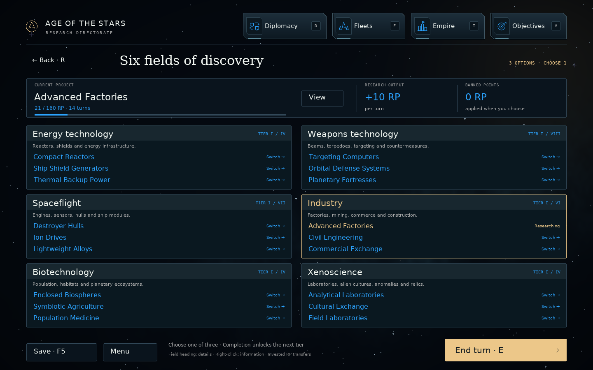
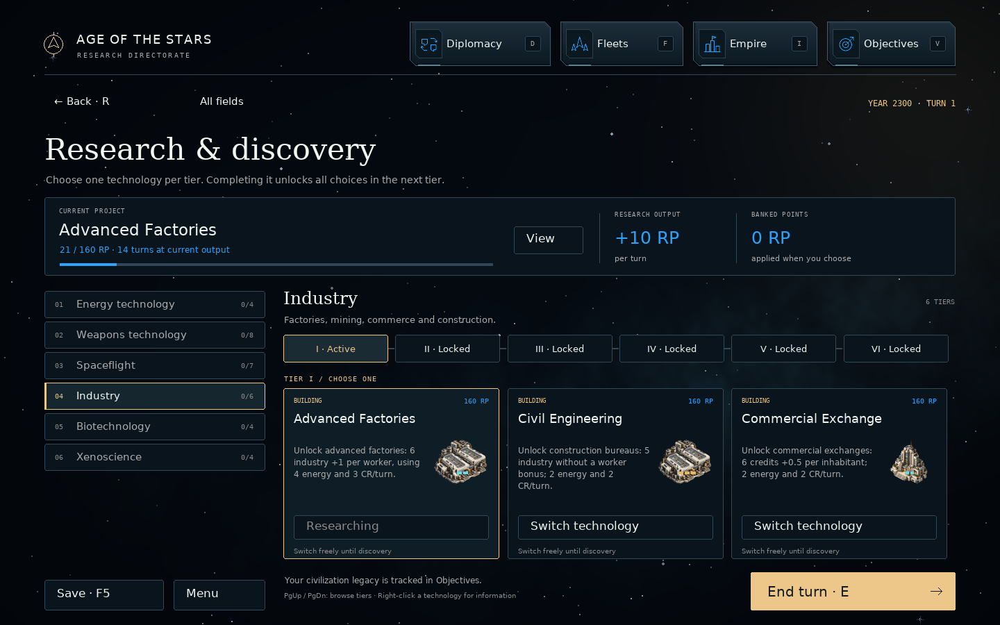

# Six-field research — v0.83

New campaigns have six fields in a two-column, three-row overview. Each tier
contains exactly **three alternatives**. Complete one to exclude the other two
and open every option in the next tier. No technology-specific prerequisite
chains connect tiers. A later factory, shield or weapon can be researched after
any earlier choice in its field. Equipment still needs a compatible ship hull.

There are **33 tiers and 99 ordinary technologies**, with one empire-wide active
project. Switching an unfinished project transfers all invested RP. Banked RP
and overflow are preserved. Completed choices are permanent for normal research;
the existing Research Array can exceptionally recover omitted discoveries.
Civilization legacies remain in Objectives; Ascension Theory remains retired.

## Complete default catalogue

Choose **one entry from each row**. Prices shown are the actual default RP costs;
a campaign's custom balance profile may change them.

### Energy technology

| Tier | Choice A | Choice B | Choice C |
|---|---|---|---|
| 1 | Compact Reactors · 160 RP | Ship Shield Generators · 160 RP | Thermal Backup Power · 160 RP |
| 2 | Fusion Power · 400 RP | Planetary Shielding · 400 RP | Gravity-Well Generators · 400 RP |
| 3 | Antimatter Power · 480 RP | Regenerative Shields · 480 RP | Hardened Shields · 480 RP |
| 4 | Field Stabilization · 880 RP | Advanced Planetary Shielding · 880 RP | Subspace Interdiction · 880 RP |

### Weapons technology

| Tier | Choice A | Choice B | Choice C |
|---|---|---|---|
| 1 | Targeting Computers · 160 RP | Orbital Defense Systems · 160 RP | Planetary Fortresses · 160 RP |
| 2 | Pulse Beams · 400 RP | Fusion Torpedoes · 400 RP | Electronic Countermeasures · 400 RP |
| 3 | Ion Beams · 480 RP | Precision Beam Optics · 480 RP | Advanced Flak Systems · 480 RP |
| 4 | Quantum Beam Batteries · 880 RP | MIRV Torpedoes · 880 RP | Predictive Fire Control · 880 RP |
| 5 | Plasma Beams · 1,440 RP | Siege Weapons · 1,440 RP | Interceptor Drones · 1,440 RP |
| 6 | Graviton Beams · 2,160 RP | Advanced Torpedo Guidance · 2,160 RP | Bomber Drones · 2,160 RP |
| 7 | Particle Beams · 3,040 RP | Phased Beams · 3,040 RP | Quantum Targeting · 3,040 RP |
| 8 | Heavy Beam Mounts · 4,160 RP | Disruptor Beams · 4,160 RP | Antimatter Torpedoes · 4,160 RP |

### Spaceflight

| Tier | Choice A | Choice B | Choice C |
|---|---|---|---|
| 1 | Destroyer Hulls · 160 RP | Ion Drives · 160 RP | Lightweight Alloys · 160 RP |
| 2 | Cruiser Hulls · 400 RP | Fusion Drives · 400 RP | Deep-Space Radar · 400 RP |
| 3 | Drone Carriers · 480 RP | Composite Structures · 480 RP | Reinforced Armor · 480 RP |
| 4 | Battleship Hulls · 880 RP | Cryogenic Fuel Tanks · 880 RP | Long-Range Sensors · 880 RP |
| 5 | Automated Damage Control · 1,440 RP | Colonial Navigation Network · 1,440 RP | Deep-Space Logistics · 1,440 RP |
| 6 | Titan Hulls · 2,160 RP | Antimatter Fuel Tanks · 2,160 RP | Subspace Scanners · 2,160 RP |
| 7 | Jump Gates · 3,040 RP | Spatial-Compression Tanks · 3,040 RP | Advanced Jump Drives · 3,040 RP |

### Industry

| Tier | Choice A | Choice B | Choice C |
|---|---|---|---|
| 1 | Advanced Factories · 160 RP | Civil Engineering · 160 RP | Commercial Exchange · 160 RP |
| 2 | Prefabricated Structures · 400 RP | Orbital Assembly · 400 RP | Colonial Administration · 400 RP |
| 3 | Robotic Manufacturing · 480 RP | Deep-Core Extraction · 480 RP | Commercial Complexes · 480 RP |
| 4 | Automated Refineries · 880 RP | Containment Processing · 880 RP | Modular Spaceframes · 880 RP |
| 5 | Molecular Shipbuilding · 1,440 RP | Mass Ship Production · 1,440 RP | Superconducting Foundries · 1,440 RP |
| 6 | Molecular Assembly · 2,160 RP | Stellar Forge Engineering · 2,160 RP | Asteroid Engineering · 2,160 RP |

### Biotechnology

| Tier | Choice A | Choice B | Choice C |
|---|---|---|---|
| 1 | Enclosed Biospheres · 160 RP | Symbiotic Agriculture · 160 RP | Population Medicine · 160 RP |
| 2 | Protected Habitats · 400 RP | Thermal Barriers · 400 RP | Radiation-Proof Habitats · 400 RP |
| 3 | Population Cultivation · 480 RP | Ecological Networks · 480 RP | Adaptive Ecology · 480 RP |
| 4 | Planetary Terraforming · 880 RP | Biosphere Restoration · 880 RP | Population Engineering · 880 RP |

### Xenoscience

| Tier | Choice A | Choice B | Choice C |
|---|---|---|---|
| 1 | Analytical Laboratories · 160 RP | Cultural Exchange · 160 RP | Field Laboratories · 160 RP |
| 2 | Advanced Laboratories · 400 RP | Scientific Institutes · 400 RP | Research Networks · 400 RP |
| 3 | Distributed Computing · 480 RP | Gravitic Mapping · 480 RP | Planetary Data Vaults · 480 RP |
| 4 | Quantum Research · 880 RP | Event Horizon Navigation · 880 RP | Relic Analysis · 880 RP |

## Research unlocks construction

Economic research unlocks separate buildings. Researching Advanced Factories does
not change any existing factory's output. Construct an advanced factory for its
6 industry and +1 industry per worker. It takes 70 Resources, 42 construction
work, one slot, 4 energy and 3 Credits upkeep per turn. Buildings are distinct:
a basic factory and an advanced factory may coexist, each paid and operated
separately. No earlier factory is needed to construct a later unlocked one.

The six existing advanced facilities remain available in the new catalogue.
The following 29 facilities are new. Each has the normal one-per-colony limit,
including reserved construction slots. Powered output is local to its colony.

| Facility | Required discovery | Resources / work | Energy used / upkeep | Operating effect |
|---|---|---|---|---|
| Advanced factory | Advanced Factories | 70 / 42 | 4 / 3 CR | +6 industry / turn; +1 IND/worker |
| Construction bureau | Civil Engineering | 55 / 33 | 2 / 2 CR | +5 industry / turn |
| Commercial exchange | Commercial Exchange | 65 / 39 | 2 / 2 CR | +6 credits / turn; +0.5 CR/pop |
| Administration centre | Colonial Administration | 90 / 54 | 3 / 2 CR | -15 percentage points of local strain |
| Commercial complex | Commercial Complexes | 135 / 81 | 4 / 4 CR | +8 credits / turn; +1 CR/pop |
| Mineral processor | Containment Processing | 120 / 72 | 4 / 3 CR | +6 resources / turn |
| Superconducting foundry | Superconducting Foundries | 180 / 108 | 4 / 5 CR | +10 industry / turn; +2 IND/worker |
| Compact reactor | Compact Reactors | 45 / 27 | 0 / 2 CR | +18 energy / turn |
| Antimatter plant | Antimatter Power | 110 / 66 | 0 / 4 CR | +40 energy / turn |
| Advanced planetary shield | Advanced Planetary Shielding | 200 / 120 | 12 / 6 CR | 200 planetary shield points |
| Advanced interdiction generator | Subspace Interdiction | 190 / 114 | 12 / 5 CR | 40% hostile slowdown within 8 ly |
| Planetary fortress | Planetary Fortresses | 100 / 60 | 2 / 3 CR | +75% defending firepower |
| Enclosed biosphere | Enclosed Biospheres | 65 / 39 | 3 / 2 CR | +20% local population capacity |
| Symbiotic farm | Symbiotic Agriculture | 65 / 39 | 4 / 2 CR | +8 food / turn; +2 food/farmer |
| Population care centre | Population Medicine | 60 / 36 | 3 / 2 CR | +25% local growth (all population types) |
| Habitat dome | Protected Habitats | 85 / 51 | 4 / 2 CR | remove 20% of environmental growth penalty |
| Population cultivation centre | Population Cultivation | 120 / 72 | 5 / 3 CR | +50% local growth (all population types) |
| Ecology centre | Ecological Networks | 100 / 60 | 3 / 2 CR | +4 food / turn · +10% local population capacity |
| Adaptation centre | Adaptive Ecology | 130 / 78 | 6 / 3 CR | remove 35% of environmental growth penalty |
| Terraforming facility | Planetary Terraforming | 220 / 132 | 10 / 5 CR | +10% local population capacity · remove 60% of environmental growth penalty |
| Biosphere restorer | Biosphere Restoration | 200 / 120 | 8 / 5 CR | +8 food / turn · +20% local population capacity; +2 food/farmer |
| Population engineering centre | Population Engineering | 220 / 132 | 9 / 5 CR | +75% local growth (all population types) · +10% local population capacity |
| Analytical laboratory | Analytical Laboratories | 60 / 36 | 3 / 2 CR | +6 research / turn |
| Field laboratory | Field Laboratories | 40 / 24 | 2 / 1 CR | +3 research / turn; +1 RP/scientist |
| Scientific institute | Scientific Institutes | 90 / 54 | 4 / 2 CR | +3 credits · +6 research / turn |
| Research network hub | Research Networks | 95 / 57 | 5 / 3 CR | +3 research / turn; +2 RP/scientist |
| Data centre | Distributed Computing | 130 / 78 | 5 / 3 CR | +10 research / turn |
| Planetary data archive | Planetary Data Vaults | 135 / 81 | 6 / 3 CR | +6 research / turn; +2 RP/scientist |
| Relic research centre | Relic Analysis | 230 / 138 | 10 / 6 CR | +18 research / turn; +1 RP/scientist |

### Population and environment

Growth facilities improve biological growth, synthetic assembly and passive
growth using each race's existing rules. They do not create food or industry
needed by those rules. Adaptation removes a percentage of an unfavorable
planet's environmental penalty; combined adaptation is capped at 80% of the
penalty. Favorable environments are unaffected. Terraforming facilities improve
local living conditions without changing the planet's type or racial preferences.

Capacity additions require operating buildings and add to the race's capacity
modifier. Total planetary capacity is capped at 100 billion. Mothership capacity
stays fixed. Gas giants remain uncolonizable.
Administration centres reduce local strain by 15 percentage points after the
normal cap, down to zero. The displayed breakdown uses that effective strain.

### Defense and system projects

Advanced planetary shields and advanced interdiction generators are separately
constructed facilities. Researching them does not refit basic generators.
Multiple shield or interdiction facilities use the strongest operational value;
capacities and slowdown do not sum. Sensors retain their established upgrade
access rules.

Stellar Forge Engineering and Asteroid Engineering are exclusive Industry tier
VI choices and unlock their named megastructures. Any Energy technology tier IV
choice unlocks Dyson Sphere construction; any Xenoscience tier IV choice unlocks
the Research Array. Existing construction, resource and ownership rules apply.

## Interface and AI

Click a field header to browse its tiers. Left-click one of three choices to
start or switch research. Right-click for its costs, effects, both alternatives,
and any constructible facility's output, workforce bonus, power and upkeep.
Descriptions paginate when necessary. Locked and completed choices remain
inspectable. The colony construction catalogue also paginates, so every unlocked
facility stays reachable. Research-tree editing supports three slots, swapping,
undo and validation of complete triples.

AI empires obey the same exclusion and construction rules. Race preferences
consider all three alternatives. When all potential destinations are outside
fuel range, the AI invests in the appropriate field's earlier tiers before
choosing a later tank upgrade, including in fully surveyed galaxies.

Six new 1280 × 1280 transparent building illustrations are shared by related
facilities. Existing sprites and saved surface positions remain intact.

## Existing campaigns and profiles

The default tree applies to **new campaigns**. Saved campaigns keep their original
branches, choices, effects, custom values and unfinished project's progress and
cost. The actual v0.82 save in `tests/fixtures/v082_research_save.json` exercises
this migration; old files are not rewritten during loading.

An existing custom `balance.json` also keeps its original tree. To use the new
catalogue, reset to defaults in the balance editor, save a separate profile and
start a new campaign with it. Automatic conversion of existing campaigns is
intentionally avoided because old selections can conflict within the new tiers.

Save format: **59**. Balance profile version: **21**. The repository/package names
remain unchanged. Install the incremental update over v0.82.

## Reproduce checks and previews

```bash
python -m pytest -q tests/test_six_field_research.py
python tools/preview_six_field_research.py
```

The dedicated tests cover all 99 choices, exclusions and tier access; RP transfer;
all new facility gates and save roundtrips; construction without automatic
upgrades; biological, assembly and passive growth; adaptation, power and capacity;
advanced shields; megastructure choices; third-slot editing; AI progression for
five civilizations; genuine old saves; all catalogue pages; and scaled controls
at 980 × 900, 1280 × 800 and 1920 × 1080.

The release's 18 new tests and 137 subtests pass. The full regression comparison
retains the same 31 pre-existing failures as v0.82; see
[validation details](research-v083-validation.md).




