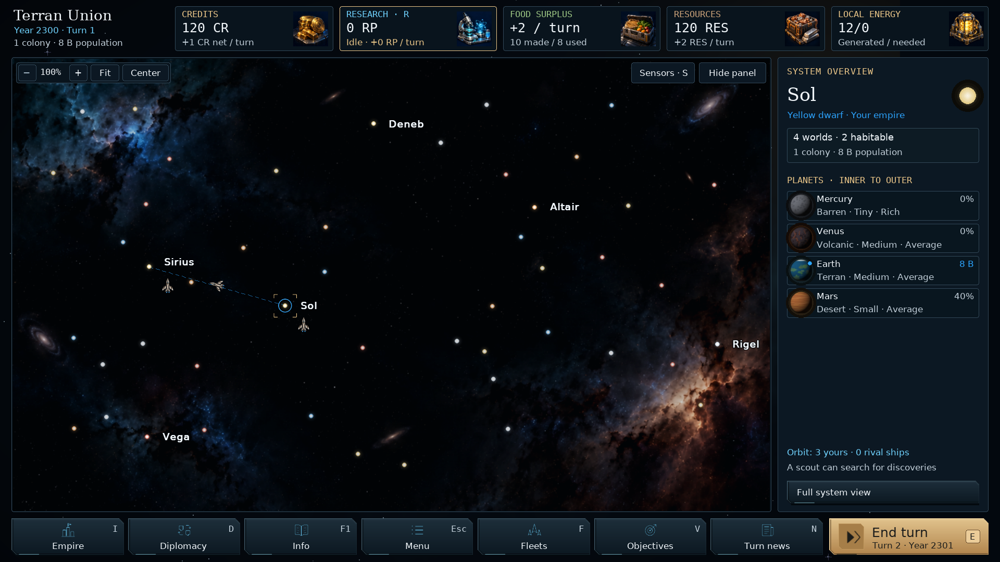

# Star Atlas — v0.92.0

Star Atlas is the default galaxy presentation, based on the smaller-ship version
of concept A. It replaces the label “Clean” in Settings → Interface. The saved
preference key remains `clean`, so existing settings adopt the new appearance.
Classic keeps its earlier rendering. Campaign saves still use format 62.

## Appearance and interaction

- Stars have small bright cores and transparent, restrained halos. Selection
  uses four corner brackets, which turn red for an unreachable route target.
- Names use 16-pixel logical bold sans-serif type with a quiet dark outline.
  Actual display-pixel glyph bounds determine their placement, including at
  fractional interface sizes. Names avoid stars, fleet targets and map controls.
- Known ownership appears in one thin ring. Multiple owners share its arc;
  colonies, refuelling outposts, stations and anchored motherships all contribute.
  Unvisited systems have no names or ownership rings. Stored surveys and current
  visibility continue to govern the information shown.
- Illustrated ships occupy at most 24 logical pixels inside a 28-pixel target.
  Neutral hulls retain faction-coloured navigation and engine accents. Selecting
  a fleet adds a gold outline without hiding those faction colours.
- Dock slots start 30 pixels right and 30 pixels below the star, spaced 32 pixels
  apart. Existing fleet membership retains its slot during arrivals and splits.
  Ship direction, queued departures and dashed route previews use the existing
  navigation geometry.

Map zoom changes the distance between systems. It does not enlarge symbols or
text. Interface size scales both the visuals and their click targets.

## Rendering

The renderer caches star sprites at their final display size; threefold sampling
smooths curves before the native-size blit. Ship sprites are made from a
256-pixel cropped master, rotated and reduced to their final display size.
The final blit bypasses canvas image rescaling. Missing artwork retains the
silhouette fallback. `galaxy_labels.py` measures and draws the same native font
size, including its outline, so scaled labels do not clip or overlap controls.

## Validation

Focused checks cover galaxy navigation, fleet docking and splitting, arrival,
all eight travel headings, fog, shared ownership, motherships, palette changes,
zoom, route previews, panel folding and native resource cards. Visual checks
cover five window/interface-size combinations, a crowded galaxy, fleet orders,
Wanderers and settings. Classic is compared against v0.91.2 at the same size.

